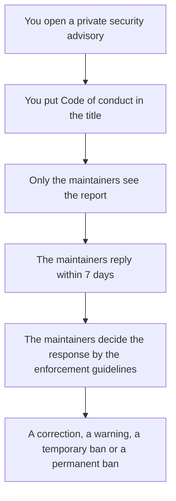

# Code of conduct

Shipinetics follows the [Contributor Covenant, version 2.1](https://www.contributor-covenant.org/version/2/1/code_of_conduct/). The code of conduct applies in the repository, its issues, its pull requests and its discussions. It also applies in each place where you represent the project.

In short:

- Be respectful and patient.
- Expect that other people mean well.
- Give feedback on the work, not on the person.
- Accept the decision of a maintainer.

Harassment, insults, and personal or political attacks are not acceptable.

## Report a problem

This diagram shows what happens to a report. The steps are below it.

To report a problem privately to the maintainers:

1. Open a [private security advisory](https://github.com/DreKwasi/shipinetics/security/advisories/new). Only the maintainers see it.
2. Put "Code of conduct" in the title.
3. Say what happened, where it happened (links), and who was involved.

The maintainers keep the report confidential, and they reply within 7 days.

The maintainers decide the response by the enforcement guidelines of the Contributor Covenant. The response is a correction, a warning, a temporary ban or a permanent ban.
