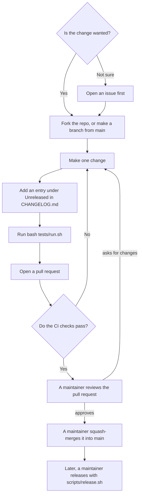
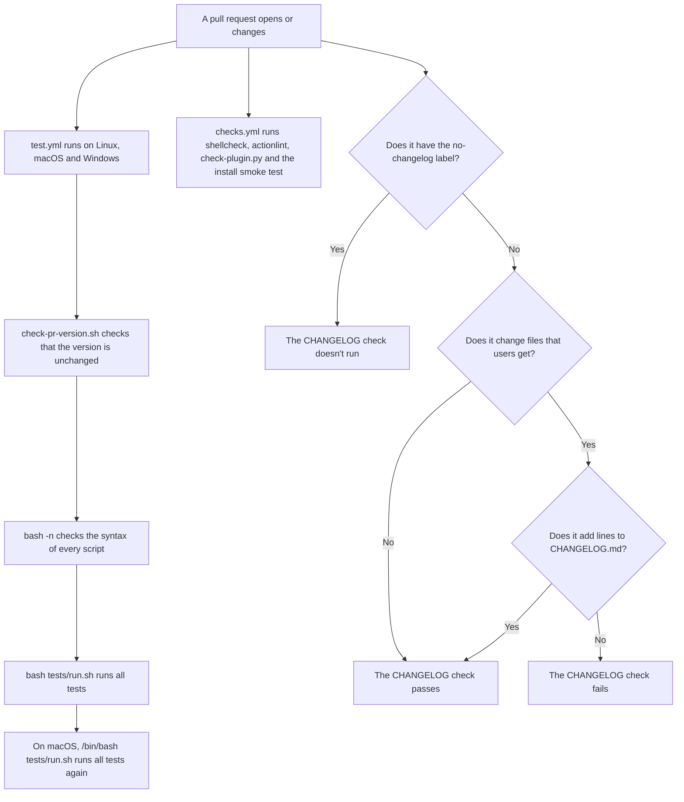
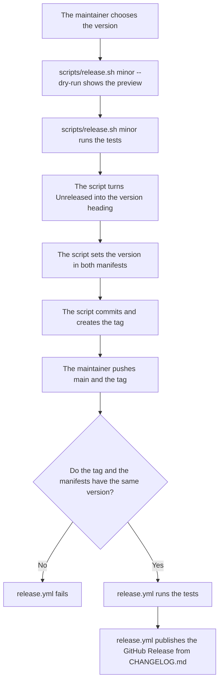

# Contributing to Shipinetics

Thank you for your help. This guide tells you how to set up a clone, how to change each part of Shipinetics, and how to test the change. It also tells you what a pull request needs before a maintainer merges it.

If you are not sure that a change is wanted, open an issue first: a bug report or a feature request. A short discussion before the work can prevent a rejected pull request.

This diagram shows the path of a contribution, from the first change to the release. The CI checks are in `.github/workflows/test.yml` and `.github/workflows/pr-checks.yml`, and the release is `scripts/release.sh`.



## What you need

- **bash** and **git.** The scripts must run in macOS `/bin/bash` (bash 3.2) and in Linux bash 4 or 5.
- **python3** (3.7 or later, standard library only). The hooks use it, or `jq`, to read their JSON input.
- **Claude Code** or **Antigravity**, to try a change in a real session. The tests don't need either.
- Optional: `ffmpeg` (evidence frames), `uv` (some companions), `shellcheck` (lint for scripts).

Shipinetics runs on macOS, Linux, WSL 2 and native Windows with Git for Windows (Git Bash). CI tests on Linux, macOS and Windows. On Windows, run the tests in Git Bash: `bash tests/run.sh`.

## Local setup

1. Fork the repository.
2. Clone your fork.
3. Try your changes in a harness:
   - **Claude Code:** run `claude --plugin-dir <path to your clone>`. Or add the clone as a local marketplace (`claude plugin marketplace add <path to your clone>`). Then run `/reload-plugins` after each edit.
   - **Antigravity:** run `./bin/shipinetics install antigravity`. It writes generated copies of the skills and subagents into `~/.gemini/config/plugins/shipinetics`, linked to this clone. Run `./bin/shipinetics refresh` after you edit `skills/` or `agents/`. Check the install with `./bin/shipinetics status antigravity`.

## How Shipinetics is built

Read [README.md](README.md) first, especially the sections "Instructions and enforcement", "A task, step by step" and "Known limits". [docs/how-it-works.md](docs/how-it-works.md) shows how the parts fit together. This table gives each part and where it is:

| Part | Where | What it is |
|---|---|---|
| Skills | `skills/<name>/SKILL.md` | Instructions that the agent follows: the task loop, specs, tests, reviews, evidence and setup |
| Agents | `agents/*.md` | Subagents with their own context: test-writer, the reviewers and the live tester |
| Hooks | `hooks/hooks.json` (Claude Code), `hooks.json` (Antigravity), `scripts/*.sh` | Code that enforces some rules: the edit guard, the secrets guard, the PR gate, the install gate, and notices |
| Shared code | `scripts/lib.sh` | Config, paths, the code fingerprint, and the hook input and reply formats of each harness |
| Tools | `bin/*` | Commands for agents and people: `shipinetics` (the installer for each harness), `shipinetics-verify`, `shipinetics-config`, `evidence`, `worksheet` and others |
| Harnesses | `harnesses.tsv`, `docs/research/` | What each harness enforces today, and the research behind it. `shipinetics status` reads `harnesses.tsv` |
| Terms and decisions | `GLOSSARY.md`, `docs/adr/` | The words that Shipinetics uses, and the decisions that are hard to reverse |
| Setup templates | `skills/setup/templates/` | The files that `/shipinetics:setup` writes into a project |
| Tests | `tests/test-*.sh`, `tests/helpers.sh` | One file for each part. `tests/run.sh` runs all of them |

## Running checks

Run the same checks that CI runs (`.github/workflows/test.yml` and `.github/workflows/checks.yml`):

```bash
# 1. Syntax check every shell script
for f in scripts/*.sh bin/* skills/setup/templates/bin/* skills/setup/templates/pre-* skills/setup/templates/commit-msg tests/*.sh; do
  bash -n "$f" || exit 1
done

# 2. Run all test suites
bash tests/run.sh

# 3. On macOS, also test with system bash 3.2
/bin/bash tests/run.sh

# 4. Lint the shell scripts (needs shellcheck)
bash scripts/lint-shell.sh

# 5. Check that the plugin is complete: manifests, hooks, executable tools, skill frontmatter
python3 scripts/check-plugin.py

# 6. Install into an empty HOME, then remove it with uninstall --all (your own HOME isn't used)
bash scripts/smoke-install.sh
```

CI also runs [actionlint](https://github.com/rhysd/actionlint) on the workflows. None of the checks calls a model.

To run one test file while you work:

```bash
bash tests/run.sh test-config.sh
```

## Rules for each kind of change

- **A script or a tool** (`scripts/`, `bin/`, `skills/setup/templates/`):
  - It must run in bash 3.2 and in Linux bash. Don't use associative arrays (`declare -A`), `${var,,}` or `mapfile`. Under `set -u`, don't expand an empty array without a guard.
  - Python helpers use the standard library only. Call `python3`. On Windows, `scripts/compat.sh` (loaded by `scripts/lib.sh`) makes `python3` work when only `python` or `py` exists. A tool that doesn't load `lib.sh` sources `scripts/compat.sh` itself, and never runs `exec python3`.
  - Paths from hook input can be Windows paths (`C:\\Users\\...`). Read them through `sy_hook_file_path` and `sy_hook_cwd`. These functions convert the paths with `sy_unix_path`.
  - Use only the commands that Git Bash also has, or give a fallback. GNU and BSD `date`, `stat` and `sed -i` are different. Never depend on `ln -s` to make a real link.
  - A hook must never fail in a way that blocks the person's work. When a hook can't decide, it lets the action through. The tests prove which case is which.
- **A hook:**
  - Keep Claude Code (`hooks/hooks.json`) and Antigravity (`hooks.json`) in step.
  - Give each hook a name that `hooks_off` can turn off, and add the name to the list in the README.
  - When a change makes a guard work, or stop working, in a harness, update `harnesses.tsv`. Then `shipinetics status` stays true.
- **A skill:**
  - The `name` is the same as the folder name. The `description` says what the skill does and when to use it ("Use when ..."), in 1,024 characters or fewer. Claude reads every description in every session, so keep detail out of it.
  - Keep `SKILL.md` short: 350 lines at most, and about 200 lines is better. Move detail into a reference file beside it, one level deep, and link to that file from `SKILL.md`.
  - Each `${CLAUDE_PLUGIN_ROOT}/...` or `${CLAUDE_SKILL_DIR}/...` path, and each relative `.md` link, points to a file that exists. `tests/test-skills.sh` checks these paths and links, the name and the description.
  - Add a rule only when real use shows that agents need it. Replace the text that failed. Don't add a paragraph next to it.
  - No automatic test checks how the agent behaves with the skill text. In the pull request, say how you tried the change: the session, the prompt, and what the agent did.
- **An agent** (`agents/*.md`): its `name` is the same as the file name. If it has a `model`, say why in the pull request. An agent that runs often must use the cheapest model that does the job well.
- **A setup template:** `/shipinetics:setup` copies it into other people's projects. Never put a value there that fits only your own project.
- **A companion** (`companions.tsv`): give its license, and say why Shipinetics needs it. Mark it `recommended` when a skill works clearly worse without it. Else, mark it `optional`.
- **Tests:**
  - Add or update tests in `tests/` for each change of behaviour and for each bug fix.
  - A test runs in a scratch folder under `$TMPDIR` (use `tests/helpers.sh`). It never touches your home folder or this repo.
  - Write one test for each behaviour, not one test for each function.
- **Writing:** docs, skill text, commit messages and pull request descriptions follow the plain-language guide (`skills/explain/plain-language.md`). The guide is based on ASD-STE100. Do your best. A maintainer can help with the wording, and the wording never blocks a first contribution.
- **No personal data:** don't commit the names of your employer, its projects or its tickets. Also don't commit private paths, hostnames, emails or tokens. Use examples such as `web`, `api` and `PROJ-123`.
- **Terms and decisions:** use the terms in `GLOSSARY.md`. Some decisions are hard to reverse, surprising without context, and the result of a real trade-off. Record each such decision as a new file in `docs/adr/`, and add it to `docs/adr/README.md`.

## Pull requests

1. **Make one change in each pull request.** Make a branch from `main`. Give it a short name that says what changes, for example `fix/pr-gate-docs-only` or `feat/codex-hooks`.
2. **Make small commits.** Each commit builds and passes the tests. The first line of the message says what changed, in 72 characters or fewer. The body says why.
3. **Add a CHANGELOG entry.** Add your entries under `## Unreleased` in [CHANGELOG.md](CHANGELOG.md), in the section that fits (`### Added`, `### Changed`, `### Fixed`, `### Removed`). For a breaking change, say so in the entry and give the steps for each project. The CI check is below the list.
4. **Don't change the version.** Don't edit the version in `.claude-plugin/plugin.json` or `plugin.json`, and don't add a `## X.Y.Z` heading. The maintainer sets the version at release time. CI checks this with `scripts/check-pr-version.sh`.
5. **Run the checks** above. Then fill in the pull request template: what changed, why, how you tested it, and what you didn't test.
6. **Answer the review.** A maintainer reviews each pull request. CI must pass on Linux, macOS and Windows. Answer each review comment with a fix or a reason. A maintainer can close a pull request that has no activity for 30 days. You can open it again.
7. **Merge.** A maintainer squash-merges the pull request. Then `main` gets one commit for it, with the title of the pull request.

The CHANGELOG check (`.github/workflows/pr-checks.yml`) fails a pull request when both of these are true:

- The pull request changes a file that users get: a file in `scripts/`, `bin/`, `skills/`, `agents/`, `hooks/` or `.claude-plugin/`, or `hooks.json`, `plugin.json`, `companions.tsv` or `harnesses.tsv`.
- The pull request adds no line to `CHANGELOG.md`.

A change only to docs, tests or CI needs no entry. When a change to a file that users get has nothing to tell users, a maintainer adds the `no-changelog` label, and the check doesn't run.

This diagram shows the CI checks on each pull request. They come from `.github/workflows/test.yml`, `.github/workflows/checks.yml`, `.github/workflows/pr-checks.yml` and `scripts/check-pr-version.sh`. A branch named `release/*` skips the version check and the CHANGELOG check.



## Releases

Maintainers release the changes that were merged. One release can hold many pull requests, so the version changes one time for the batch:

1. Choose the version by the rules at the top of [CHANGELOG.md](CHANGELOG.md). Before 1.0.0, a breaking change increases the minor number (0.9.0 to 0.10.0). Other changes increase the patch number (0.9.3 to 0.9.4).
2. Preview the release: `scripts/release.sh minor --dry-run` (or `patch`, `major`, `X.Y.Z`).
3. Run `scripts/release.sh minor`. The script runs the tests and turns `## Unreleased` into `## X.Y.Z`. It sets the version in both manifests, commits `Release X.Y.Z` and creates the tag `vX.Y.Z`.
4. Push the commit and the tag: `git push origin main vX.Y.Z`.

The tag starts `.github/workflows/release.yml`. The workflow checks that the tag and the manifests have the same version, runs the tests, and publishes the GitHub Release from the CHANGELOG. A branch named `release/*` can change the version through a pull request instead.

This diagram shows the release steps. They come from `scripts/release.sh` and `.github/workflows/release.yml`.



## Reporting a security problem

Don't open a public issue. Follow [SECURITY.md](SECURITY.md).

## Code of conduct

Everyone who takes part follows the [code of conduct](CODE_OF_CONDUCT.md).

## License

By submitting a pull request or other contribution to this repository, you agree that your contribution is licensed under the [MIT License](LICENSE).
