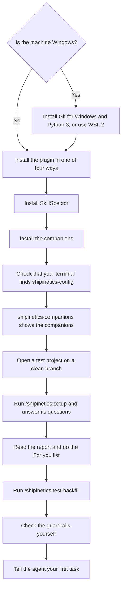
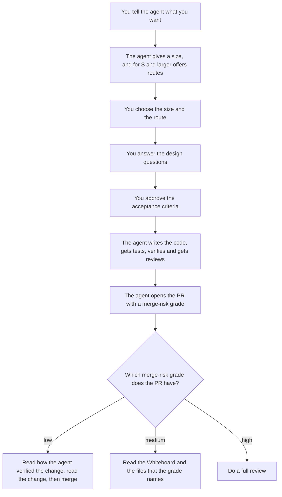
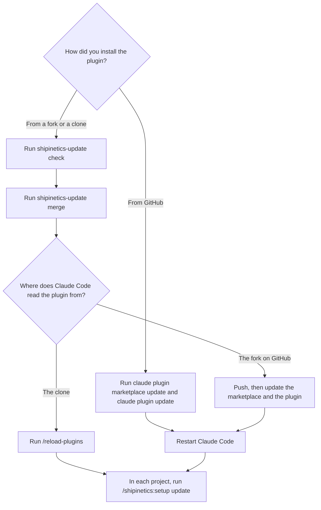

# Getting started with Shipinetics

This guide gives the steps to start with Shipinetics, in this order:

1. Install it on each machine, one time.
2. Set up each project, one time.
3. Then work with it each day, and keep it in good condition each week.

The [README](README.md) says what each part does, and which rules code enforces.

This diagram shows the path from the first install to the first task. Sections 1 to 3 give each step.



## 1. Install on each machine (one time)

**On Windows,** first install Git for Windows and Python 3, or use WSL 2. The "Windows" section of the README has the steps. Run the commands below in Git Bash or in WSL. Do not run them in PowerShell or cmd.

1. Install the plugin. Choose one of these four ways:

   | Way | Commands | How you update | Use it for |
   |---|---|---|---|
   | **From GitHub** (recommended) | `claude plugin marketplace add DreKwasi/shipinetics`, then `claude plugin install shipinetics@shipinetics` | `claude plugin marketplace update shipinetics` and `claude plugin update shipinetics@shipinetics`, or auto-update in `/plugin` | Most people |
   | **From your fork on GitHub** | Fork the repo, then `claude plugin marketplace add <you>/shipinetics` and `claude plugin install shipinetics@shipinetics` | Merge each release into the fork (`shipinetics-update merge`), push, then `claude plugin update`. A change of your own needs a new `version` | A team that shares changes to the plugin itself |
   | **From a clone on this machine** | `git clone https://github.com/DreKwasi/shipinetics.git`, then `claude plugin marketplace add <path to the clone>` and `claude plugin install shipinetics@shipinetics` | `shipinetics-update -C <clone> merge`, then `/reload-plugins`. Your edits load at the next session | One person who changes the plugin |
   | **For one session** | `claude --plugin-dir <path to a clone>` | You update nothing. Claude Code loads the clone each time | A first try, or work on Shipinetics |

   Use only one way at a time, because all four ways name the marketplace `shipinetics`. Section 6 has the update steps for each way. Before you fork, read "Do you need a fork?" in section 6. Most changes belong in the project, not in the plugin.

   **Do you also use Antigravity?** Do these steps in a clone of this repo:

   1. Run these commands:

      ```bash
      ./bin/shipinetics install antigravity
      ./bin/shipinetics link-skills antigravity
      ```

   2. Add `<path to the clone>/bin` to your shell `PATH`, for example in `~/.zshrc`.
   3. Check the install with `shipinetics status antigravity`.
   4. After you change the clone, run `shipinetics refresh`.

   `install` writes generated copies of the skills and subagents into `~/.gemini/config/plugins/shipinetics`, with their paths set to your clone. `link-skills` adds `~/.agents/skills` and `~/.claude/skills` to `~/.gemini/config/skills.json`. Then Antigravity shares the companion skills below.

   `shipinetics status` shows each harness, and the guards and gates that each harness enforces. Shipinetics does not support Codex, OpenCode and Copilot yet.

2. Install SkillSpector. Then you can scan each companion before you install it:

   ```bash
   uv tool install git+https://github.com/NVIDIA/skillspector.git
   ```

   For a quick scan of a source, run `skillspector scan <git URL> --no-llm`. This static mode needs no key, and it sends nothing to other computers. It gives false positives. The full scan also uses a model to check those findings. It uses your Claude Code login: `SKILLSPECTOR_PROVIDER=claude_cli skillspector scan <git URL>`. The full scan uses tokens from your plan. Also, the install gate asks you before an agent installs or updates a skill, plugin or MCP server.

3. Install the companions. Shipinetics uses them together with its own skills. The "Companions" section of the README gives the reason for each companion and its SkillSpector result. Install skills with `-g`. Then `skills-outdated` can find their updates later.

   ```bash
   npx skills add mattpocock/skills --skill grilling --skill domain-modeling --skill wait-what --skill research --skill prototype --skill codebase-design --skill diagnosing-bugs -g -a claude-code
   npx skills add cloudflare/security-audit-skill -g -a claude-code
   npx skills add warpdotdev/common-skills --skill merge-risk -g -a claude-code
   claude plugin marketplace add pbakaus/impeccable
   claude plugin install impeccable@impeccable
   claude plugin marketplace add devdotfast/whiteboard
   claude plugin install whiteboard@devfast
   ```

   Also install the dev.fast Whiteboard app. The Whiteboard plugin starts it.

4. Get the short commands in your terminal. The tools of the plugin are only on the PATH of the Bash tool of Claude Code. So when a session starts, Shipinetics puts short commands for these tools in `~/.local/bin`, and it tells you one time. Then `shipinetics-config`, `shipinetics-update` and the other `shipinetics-*` tools work in your terminal, also after each update.

   This happens only when `~/.local/bin` exists and is on your PATH. If your terminal doesn't find `shipinetics-config` after your first session, do one of these:

   - In a Claude Code session, ask the agent to run `shipinetics-shims install`. The tool is on the PATH of the agent.
   - Run the tool yourself, one time. First find the installed version. Then run the tool from that folder. The tool tells you how to add the folder to your PATH:

     ```bash
     ls ~/.claude/plugins/cache/shipinetics/shipinetics/     # for example 0.12.0
     ~/.claude/plugins/cache/shipinetics/shipinetics/0.12.0/bin/shipinetics-shims install
     ```

5. Check the result. `shipinetics-companions` shows each companion as installed, missing or declined. While a recommended companion is missing, each new session starts with a notice that lists the missing companions. If you don't want a companion, add its name to `companions_skip` in `~/.config/shipinetics/config`.

6. Install the optional tools that you want:
   - **Secrets in Google Secret Manager:** run `gcloud auth login` and `gcloud auth application-default login`. Then `bin/with-secrets` can read Secret Manager.
   - **Security tests of your app:** Strix: `curl -sSL https://strix.ai/install | bash`. Strix needs Docker, and Docker must run. Keep the key of its LLM provider in your vault.
   - **Agent review of all your code:** deepsec (Vercel). You install nothing. It needs Node.js, and it runs with `npx` in each project. Each run costs money: with Claude Opus, about 25 to 60 US dollars for each 100 files. So the agent asks you first, and it always sets a cap.
   - **Page design:** tasteskill: `claude plugin marketplace add Leonxlnx/taste-skill`, then `claude plugin install taste-skill@taste-skill`. When a task builds or redesigns a page, the agent offers tasteskill as a route. It needs Node 22 or newer, and Chrome, Edge or Chromium.

## 2. Set up a project (one time)

Start with one test project. Choose a project that has tests and some small tasks to do.

1. Open the project in Claude Code, on a clean branch.
2. Run `/shipinetics:setup`. It audits the project and writes the result to `docs/shipinetics-setup.md`.
3. Answer its questions.
   - With the Whiteboard app, setup shows its findings and the numbered questions on a Whiteboard, and sends you the link.
   - If the Whiteboard plugin is installed but the app is missing, setup first asks if you want to install the app.
   - Without Whiteboard, the questions come in one message.
   - Each question has a recommended answer. You answer in chat, by number, or with "use the recommended answers".

   First, choose how setup runs:
   - **All phases in one run** (recommended): the fastest way to a working setup.
   - **One phase at a time:** setup shows what each phase added, and asks before the next phase.
   - **Phase 1 only:** the core loop, then a stop. Run `/shipinetics:setup` later for the other phases.
   - **Audit only:** the audit and the questions, and no change.

   Setup also asks other questions, for example:
   - about the facts that it couldn't confirm;
   - for the secret names, and which files hold secrets;
   - where recordings go: the store of your team, or attached to the PR by hand;
   - how often to run the full security audit;
   - which optional phases you want.
4. Setup installs each phase in the same run. It proves that each phase works, and it commits the phase before it starts the next one.

   This diagram shows how setup runs its phases. The source is `skills/setup/SKILL.md`. With "One phase at a time", setup also asks you before each next phase.

   ```mermaid
   flowchart TD
     audit["Setup audits the project"] --> log["Setup writes docs/shipinetics-setup.md"]
     log --> ask["Setup asks all its questions"]
     ask --> how{"Is the answer Audit only?"}
     how -->|"Yes"| nochange["Setup stops and changes nothing"]
     how -->|"No"| phase["Setup installs the next phase"]
     phase --> proof{"Does the proof of the phase pass?"}
     proof -->|"No"| blocked["Setup fixes the phase, or stops and says what blocks it"]
     proof -->|"Yes"| commit["Setup commits the phase"]
     commit --> more{"Is a phase left in your choice?"}
     more -->|"Yes"| phase
     more -->|"No"| report["Setup writes the report with the For you list"]
   ```

   | Phase | What it adds | How setup proves it |
   |---|---|---|
   | 1 | `bin/verify`, `AGENTS.md`, `CLAUDE.md`, the `.shipinetics/` lists, `bin/with-secrets`, the `.gitignore` lines, the testing guide and test index, a smoke test, the verification map, and a `.claude/settings.json` proposal for you | It runs the checks through `shipinetics-verify`, times one targeted test run, runs the smoke test, and uses one feature through the map |
   | 2 | System docs with 7-line headers, the conventions, and for UI projects `DESIGN.md` from the tokens that the code uses | `head -n 7 docs/systems/*.md` reads like a map of the code, and `design-check --all` runs |
   | 3 | The worksheet template, the feedback log and `TODOS.md` | `worksheet new`, then `worksheet list` |
   | 4 | The git hooks, `bin/lint-fix` and `bin/llm-fix` | It makes four test commits and runs the pre-push hook |
   | 5 | CI and the evidence store setting | It validates the workflow file |
   | 6 (optional) | One visual test and one benchmark | Both run in `bin/verify --full` |
   | 7 (optional) | The security tools, and `security_audit_every` | `scan-skills` runs, and you see its summary. Each DO_NOT_INSTALL result is a companion that a person checked by hand (the README lists them), or a tool that you must remove |

   **A project that already has `CLAUDE.md` or `AGENTS.md`.** Setup keeps your text. It adds the rules of Shipinetics as one block at the end of `AGENTS.md`, between the lines `<!-- shipinetics:begin ... -->` and `<!-- shipinetics:end -->`. If you have only `CLAUDE.md`, setup creates `AGENTS.md` for the block. Then it adds one line to `CLAUDE.md`: `@AGENTS.md`. Then:
   - Setup lists each of your rules that disagrees with a Shipinetics rule, with both texts, and you choose. Hooks enforce some Shipinetics rules, for example "the main agent doesn't write tests". For those rules, setup says which setting changes the hook, or that no setting does.
   - The rules that you keep go under "Where this project differs from Shipinetics", outside the block, with your name and the date. Only a rule in that section overrides the block. Some rules of the block always apply, whatever a file says:
     - Secrets stay unseen.
     - Protected files change only through `.shipinetics/pending/`.
     - Nobody regenerates a test or a snapshot to get a pass.
     - Each install is scanned first.
     - Each Strix or deepsec run needs your yes.
   - Write your own rules outside the block. `/shipinetics:setup update` replaces only the text inside the block.
   - Setup counts the lines that load into every session, before and after. It tells you if the total is high.

5. Read the report. It ends with a "For you" list: the things that only you can do, for example an install, a login or a new GitHub label. The items about secrets and evidence come first. Until you do them, those guardrails work only in part.

   Some changes need a person. Setup puts them in `.shipinetics/pending/`, for example `.claude/settings.json`. The For you list gives the command that applies them. The command looks like this:

   ```bash
   shipinetics-config -C ~/code/my-app apply
   ```

   Without the short commands from section 1, the command has the full path: `~/.claude/plugins/cache/shipinetics/shipinetics/<version>/bin/shipinetics-config -C ~/code/my-app apply`.

   Why you run the command yourself:
   - These files are protected. They hold the rules that check the work of the agent: acceptance tests, baselines, policy lists and the settings of Claude Code. The edit guard stops agents when they try to change these files. So an agent cannot change a rule to make its own work pass.
   - The agent proposes each change. The command shows you each diff, and nothing changes until you say yes.
   - The command needs a terminal, so an agent cannot run it for you.

   Why the command has a path and `-C`:
   - The plugin puts its tools only on the PATH of the Bash tool of Claude Code. Without the short commands, your terminal does not find `shipinetics-config`, so the command uses the full path. The path contains the plugin version, so the path changes after each update. To fix this, run `shipinetics-shims install` one time (section 1).
   - `-C` names the project folder. Then you can run the command from any folder.

   To get the command again, ask the agent to run `shipinetics-config pending`.

   If setup stopped early, run `/shipinetics:setup` again. It starts at the first phase that isn't done. To do one phase again later, run `/shipinetics:setup <phase>`, for example `/shipinetics:setup 4`.

6. **Add tests to the existing app.** Setup writes only one smoke test. Run `/shipinetics:test-backfill`. It ranks the features of the app by risk, and then it works in batches of 3:
   1. It writes acceptance criteria for each feature, from what users see.
   2. You approve, change or remove the criteria, for the whole batch in one message. It also shows what looks like a bug, and you decide.
   3. One test-writer for each feature writes the tests. The test-writers work in parallel when the tests can run at the same time.
   4. It commits the tests of each feature and proposes the next batch.

   Run it again for each batch. `docs/testing/backfill.md` records where it stopped. Stop when the remaining features have low risk. Their tests come when a task changes them.

   The speed depends on one number: the time of one targeted test run. Setup measured it. If it is more than 10 seconds, fix that first, because each test that the agent writes runs many times. The setup report gives the likely cause.

7. **Check the guardrails yourself:**
   1. Run `shipinetics-verify quick`, then `shipinetics-verify`. The quick tier must take seconds, and the complete tier a few minutes at most. Then `shipinetics-verify status` must show that both tiers passed.
   2. Ask the agent to make a small change that breaks a test, and then to open a PR. The PR gate must refuse until `shipinetics-verify` passes.
   3. Ask the agent to write a test itself. The edit guard must refuse, and tell the agent to use `shipinetics:test-writer`.
   4. Ask the agent to run `env`. The secrets guard must refuse.

## 3. Day by day: a normal task

Tell the agent what you want, as you do now. The section "A task, step by step" in the README lists what the agent does.

This diagram shows your part of a task. The source is `skills/workflow/SKILL.md`. An XS task has no spec, so you approve no criteria for it.



Your part:

1. Choose the size and the route. The agent gives the task a size (XS, S or M), and says which steps that size skips. You can choose another size: XS for a small fix, or M for the full loop with a spec and a plan review. Verify, the run of the app, test-writer and the gates stay for every size. For tasks of size S and larger, the agent also offers two or three routes, and recommends one.
2. Answer the design questions. Each question has a recommended answer. When the code can answer a question, the agent reads the code and doesn't ask you.
3. Approve the acceptance criteria. Test-writer writes tests only for what a criterion states. So when test-writer proposes a new criterion, decide if the spec needs it.
4. Decide the design-system change requests in the worksheet, if there are any.
5. Review the PR as its merge-risk grade tells you:
   - **low:** look at how the agent verified it (the evidence, if any), read the change quickly, and merge;
   - **medium:** read the Whiteboard and the files that the grade names;
   - **high:** do a full review.
6. If you asked for evidence and the project doesn't set `evidence_upload_cmd`, drag the recording into the PR.
7. Fill in the three fields for you in the Metrics of the worksheet: the corrections, your review time, and if you accepted the work.

If a message from the agent isn't clear, type `/wait-what`. The agent explains it again, in simpler words.

For tasks of size M and larger, paste the `/goal` line from the spec into Claude Code. Claude continues to work until a separate evaluator sees each result: the tests pass, the checks pass, the review is done and the work is committed.

**Commands that you can run:**

| Command | When |
|---|---|
| `/shipinetics:spec <issue or idea>` | To get testable acceptance criteria before the code |
| `/shipinetics:review impl` | To get a review now |
| `/shipinetics:pr-review <PR links>` | To understand and review the PR of another person. It posts to GitHub only after your yes |
| `/shipinetics:explain <topic> html` | To get an interactive page that explains something |
| `/shipinetics:explain <topic> video` | To get a video with narration. It asks you first |
| `/shipinetics:evidence` | To record or check the evidence for the current task |
| `/shipinetics:security-scans repo` | To review all your code with deepsec. It asks you to approve the cost cap first |
| `/shipinetics:security-scans app` | To test your own app with Strix. It asks you to approve the targets first |
| `/wait-what` | When the last message wasn't clear |

## 4. Each week: keep the setup in good condition

These commands do not run automatically. Run them yourself, or schedule them.

| Command | What it does |
|---|---|
| `/shipinetics:sweep` | Looks at the commits since the last sweep (or the last 7 days) for duplicate code, drift and unfinished work. It also checks the verification map, the design system, the secrets and evidence guardrails, the time that checks take, flaky tests, and companions that have updates. When the full security audit is due, the sweep runs the audit |
| `/shipinetics:feedback ingest` | Puts the feedback of the agents into groups, and proposes fixes to docs, tools and lint rules. You approve each fix |
| `/shipinetics:test-audit` | Finds tests that don't test what they say. It removes tests that add nothing, and changes tests of functions into tests of behaviours |
| `/shipinetics:state-audit` | Writes down the states, invariants and transitions of one to three systems in their docs. It finds the invalid states that the code can reach, also through retries and two requests at the same time. It adds a task for each group of confirmed bugs. It fixes nothing unless you ask |
| `scan-skills` | Scans with SkillSpector the skills and agent files that can reach your sessions. Act on each result marked DO_NOT_INSTALL. The README lists the known false positives |
| `shipinetics-usage html` | A page with charts of the tokens that each session and each agent used. It reads the transcripts of Claude Code, so it costs nothing |

When the sweep finds the same problem areas each week, it suggests the `improve-codebase-architecture` skill by Matt Pocock. That skill isn't a companion, so install it only if you want it.

**The full security audit.** Setup asks how often to run it, and writes `security_audit_every` in `.shipinetics/config`: `off`, `weekly`, `monthly`, `quarterly` or a number of days such as `14d`. `shipinetics-config due security-audit` says if an audit is due. The sweep runs the audit when it is due. You can also ask for an audit at any time, for example before a release.

## 5. Use it in more projects

When the test project has run for two weeks without problems, run `/shipinetics:setup` in the next project. Each project keeps its own `AGENTS.md`, docs and lists. All projects share the plugin. So an improvement from the feedback of one project gets to every project at the next plugin update.

## 6. Update to a new version

An update has two parts: first the plugin on your machine, then each project. `shipinetics-update` tells you how your machine gets Shipinetics, and what to do next. Run it in the Bash tool of the agent, or by its full path in your terminal.

This diagram shows the two parts of an update. The steps are in the subsections below.



### The plugin, if you installed it from GitHub (`DreKwasi/shipinetics`)

```bash
claude plugin marketplace update shipinetics
claude plugin update shipinetics@shipinetics
```

Then restart Claude Code. To get each release without these commands, turn on auto-update for the marketplace in `/plugin`, under Marketplaces. Auto-update is off by default for this marketplace. With auto-update, read `CHANGELOG.md` when a new version arrives, and update each project.

### The plugin, if you use your own fork or clone

**Do you need a fork?** Most changes belong in the project, not in the plugin:

| You want to change | Put it in |
|---|---|
| A path, a command or a setting | `.shipinetics/config` (README, "Settings") |
| A rule for the agents | `AGENTS.md`, outside the Shipinetics block |
| A skill of your own | `.claude/skills/` in the project, or `~/.claude/skills/` for all projects |
| A companion that you don't want | `companions_skip` |

Fork only to change the plugin itself. When your change helps other people too, send it back as a pull request. Each change that you keep only in your fork can conflict with the next release.

To keep the merges small:

- Keep your changes as commits on top of a release, in few files. Don't reformat files that you don't change.
- Name the release remote `upstream`: `git remote add upstream https://github.com/DreKwasi/shipinetics.git`. `shipinetics-update` uses that remote. When there is no such remote, it fetches from that URL.

To update the clone:

1. Run `shipinetics-update -C <your clone> check`. It shows the latest release, how far behind the latest release your clone is, the files where a merge would conflict, and the release notes since your version. It changes no file.
2. Run `shipinetics-update -C <your clone> merge`. It merges the latest release into the current branch of your clone, then runs the tests.
   - It refuses to start when the clone has uncommitted changes.
   - On a conflict, it stops and lists the files. Keep your change and the change of the release, then run `git add` and `git commit`. `git merge --abort` undoes the merge.
   - When an agent runs `merge`, the install gate asks you first, because a release brings new hooks and tools.
3. Load the new version:
   - **Claude Code reads the plugin from your clone** (you ran `claude plugin marketplace add <path to the clone>`): run `/reload-plugins`, or start a new session.
   - **Claude Code installs from your fork on GitHub** (`claude plugin marketplace add <you>/shipinetics`): push, then run `claude plugin marketplace update <marketplace>` and `claude plugin update shipinetics@<marketplace>`, and restart. Claude Code keeps a copy of each version. It takes a new copy only when `version` in `.claude-plugin/plugin.json` changes. When you push a change of your own between releases, give it a new version first, for example `0.9.3-acme.1`. Without a new version, `claude plugin update` says that the plugin is already at the latest version. Then the `version` line conflicts at each release merge. Take the version of the release.

Use one Shipinetics marketplace at a time. The fork and the main repo both name their marketplace `shipinetics`. To change from one to the other, run `claude plugin marketplace remove shipinetics`. Then add the other marketplace, and install the plugin from it again.

To work on Shipinetics itself, `claude --plugin-dir <path to the clone>` loads the clone for one session, and `/reload-plugins` loads each edit.

### Each project

A plugin update changes the skills, agents, hooks and tools at the same time. The files that setup wrote into each project do not change. In each project, on a clean branch, run:

```
/shipinetics:setup update
```

The update does these steps:

1. It reads the Shipinetics version of the project from `docs/shipinetics-setup.md`.
2. It lists the steps for each project from each release since that version. The steps of breaking changes come first.
3. You choose: all steps (recommended), the breaking steps only, the steps that you pick, or a preview with no change.
4. It replaces the Shipinetics block in `AGENTS.md`, and leaves your text outside the block as it is.
5. It does the steps that you chose, runs the audit and the checks again, and commits.

`shipinetics-update steps <version>` prints the same list of steps.

A project that was set up before the block existed has no `shipinetics:begin` line. The first `update` shows you which sections of `AGENTS.md` came from the template. It puts them in the block only after your yes.

## Prompts for larger clean-ups

These prompts come from the work of other teams, changed for Shipinetics. Paste one into Claude Code in a set-up project. Each prompt shows you its plan before it changes anything.

**Clean up the test suite** (from the test clean-up in [OpenClaw's CI cost work](https://vincent.build/openclaw-ci-cost-reduction/)). Use it when the suite is slow or large, and many tests catch nothing:

```
/goal Clean up this repo's test suite, one system at a time, with /shipinetics:test-audit.
For each system in docs/systems/: read its production code and its system doc first, then its tests.
Name the behaviours that the tests must protect. Follow test-audit's rules: delete tests that copy
the implementation, repeat another test, or test code that is gone; fix flaky tests that protect a
real behaviour; never delete the only test of a behaviour. List tests that no criterion traces to,
and ask me before you delete one. A deletion is part of the result: record each one in the audit report,
with its reason. Keep each change to one system and under 400 lines, and run shipinetics-verify
before each commit. Don't release. Stop when every system is audited. Report the tests and the
mutants caught, before and after.
```

**Make CI faster and cheaper** (from the same article). Use it when CI takes a long time or costs much:

```
Audit this repo's CI for time and cost. First measure a baseline from the last 2 weeks of runs
(gh run list, or the CI provider's API): runner minutes for each workflow, the slowest jobs, cache
hit rates, and the runs that a newer push made useless. Then propose the changes with the most value,
in this order: delete tests that protect nothing; run each check at the stage that needs it (PR, main
branch, schedule); skip a job before its setup starts (job conditions, path filters); cancel runs that
a newer push replaces; select tests from the diff, and run the full suite when the selection is not
sure; cache by lockfile, toolchain and platform, and check that the cache hits; balance the shards.
Keep every required check. Show me the proposal first. Then make each change a small PR, and measure
the time and cost again after it.
```

**Write the tests of many approved features** without a person between batches: see "Prompt for a long backfill" in the test-backfill skill. You approve the criteria first, and the prompt only writes their tests.

## Problems and solutions

| Problem | Cause and solution |
|---|---|
| `shipinetics-verify quick` is slow | Set `verify_quick_cmd = bin/verify --quick` in `.shipinetics/config`, and make `--quick` check only the changed files. `shipinetics-verify times` shows how long each tier takes. Put slow suites behind `--full` |
| `gh pr create` is refused | The PR gate works as designed. The complete checks didn't pass on this exact code (run `shipinetics-verify`). |
| After a commit, the agent gets a report that the quick verify failed | The post-commit hook works as designed. It only gives information, and the commit stays. A test of a behaviour that the task changed is expected to fail until test-writer updates the tests. To turn off the hook, add `verify` to `hooks_off` |
| `shipinetics-config apply` lists a file "(delete)" | An agent proposed to delete a protected file, in `.shipinetics/pending/.delete`. Answer `y` to delete it |
| `evidence check` says that the code changed after the evidence | A code fix came after the recording. Record the affected criteria again, and update the Commit line in `EVIDENCE.md`. Changes to docs and tests don't cause this |
| `design-check` says that there is no design system | `DESIGN.md` is missing, or it has no token frontmatter. Run `/shipinetics:setup 2` (or `/impeccable document`) to write it from the code |
| The agent says that it can't write a test | The edit guard works as designed. The agent must use `shipinetics:test-writer`. For a large change that you make one time, start Claude Code with `SHIPINETICS_ALLOW_AUTHOR_TESTS=1` |
| A session starts with a list of missing companions | Install them (step 3 of section 1), or add the companions that you don't want to `companions_skip` in `~/.config/shipinetics/config` |
| A guard blocks a safe command | Report the command, so that the rule can be fixed. Until then, run the command yourself. To keep agents away from more files, or fewer, write a `secret-paths` list. To turn off one guard for a session, start Claude Code with its variable: `SHIPINETICS_ALLOW_ENV_READ=1` (the whole secrets guard), `SHIPINETICS_ALLOW_INSTALLS=1`, `SHIPINETICS_ALLOW_NO_EVIDENCE=1`, `SHIPINETICS_UNLOCK=1` or `SHIPINETICS_ALLOW_AUTHOR_TESTS=1`. The README lists them |
| `bin/with-secrets` fails | gcloud isn't installed or isn't logged in, a name in `.shipinetics/secrets.list` isn't in Secret Manager, or the project sets `vault = infisical` and the Infisical CLI isn't installed |
| The agents still use the old model or rules after a change to the plugin | A session loads the plugin when it starts. Run `/reload-plugins`, or start a new session. Update the plugin first (section 6) |
| The number of tests grows with each task | Tell the agent to use the `change` mode of test-writer after it commits a change. Read the net change in the report of test-writer. Run `/shipinetics:test-audit` to delete tests whose code is gone |
