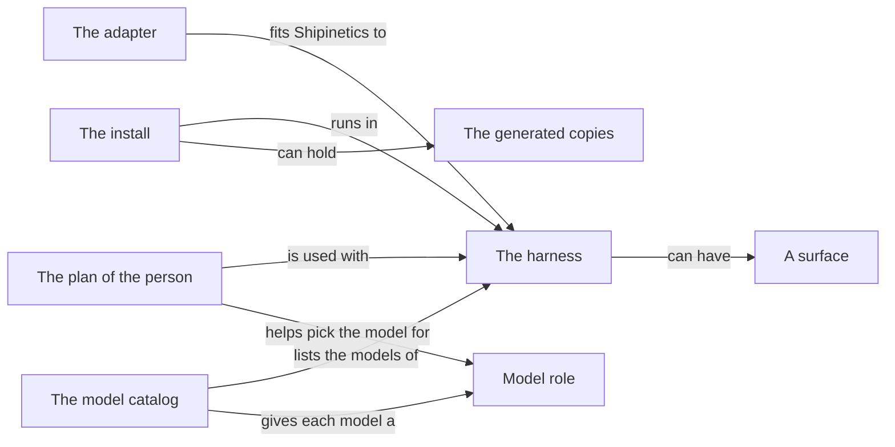
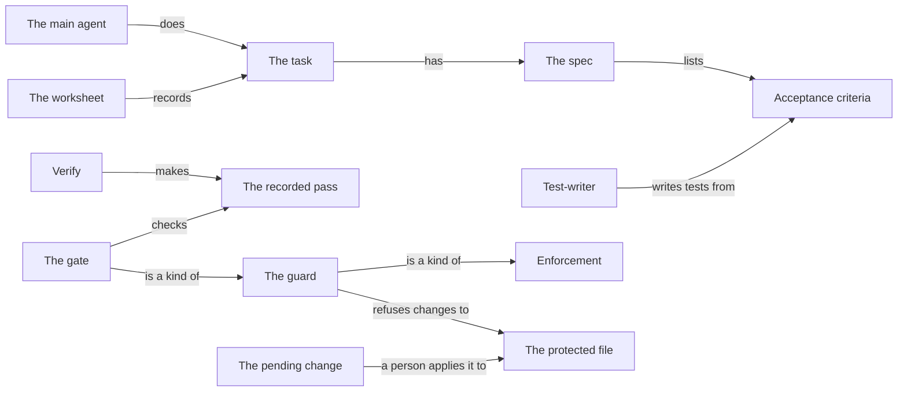

# Shipinetics

Shipinetics gives a coding agent one way to work in every project. It uses code to check the most important rules. This file lists the words that Shipinetics uses in its skills, docs, tools and replies.

## How the terms relate

This diagram shows how the terms for an install relate to a harness and to the models. The install terms are built in `bin/shipinetics` and `scripts/lib.sh`. The plan, the model catalog and the model role come from [ADR 0007](docs/adr/0007-models-by-role.md), which is not built yet.

This diagram shows how the terms for one task relate. The task loop is in `skills/workflow/SKILL.md`. The guards and gates are in `hooks.json` and `scripts/guard-*.sh`.

## Where it runs

**Harness**:
The agent program that runs Shipinetics and its skills. Examples are Claude Code, Antigravity, Codex, OpenCode and Copilot.
_Avoid_: Tool, client, IDE, agent CLI, host

**Surface**:
One way to use a harness that behaves differently from the other ways. Examples are the Copilot CLI, agent mode in VS Code and the Copilot cloud agent.
_Avoid_: Mode, flavor

**Adapter**:
The part of Shipinetics that fits Shipinetics to one harness. The adapter sets how Shipinetics installs in that harness, how its subagents are written, and how Shipinetics reads and answers the hooks of that harness.
_Avoid_: Integration, port, shim, driver

**Install**:
Shipinetics in one harness on one machine. A person makes an install from a clone. For Claude Code, a person can also make it from the marketplace of Claude Code.
_Avoid_: Deployment, setup (setup is for a project)

**Generated copy**:
The skills and subagents that Shipinetics writes from the clone for one harness. A generated copy has the format of that harness, and it has real paths.
_Avoid_: Rendered files, build output, dist

**Plan**:
The subscription or the billing that a person uses with a harness. Examples are Claude Pro, Claude Max, a ChatGPT plan, a Copilot plan and an API key. The plan sets how much usage Shipinetics can spend.
_Avoid_: Tier, subscription level, account type

**Model role**:
A kind of job that needs a level of model. Examples are deep review, build and quick checks. A person, or their plan, picks the model for each role.
_Avoid_: Model tier, model class

**Model catalog**:
The list of the models that each harness offers. For each model, the list gives the model role that the model can fill.
_Avoid_: Model list, model registry

## Projects

**Set-up project**:
A project that ran Shipinetics setup and holds the Shipinetics settings folder. The guards act only in a set-up project. Two exceptions act in all projects: the secrets guard and the install gate.
_Avoid_: Enrolled project, onboarded repo

**Shipinetics root**:
The folder that holds the Shipinetics settings of a project. It is the repo, or the top folder of a workspace.
_Avoid_: Project root, config root

**Workspace**:
A Shipinetics root that holds several package repos. A workspace is not one repo itself.
_Avoid_: Monorepo, multi-repo

**Package**:
One repo in a workspace. Each package has its own verify command.
_Avoid_: Subproject, module, service

**Harness repo**:
The git repo that keeps the versions of the Shipinetics files of a workspace. A workspace has a harness repo when the workspace root is not a repo.
_Avoid_: Meta repo, config repo

**Shipinetics block**:
The part of the agent instructions of a project that Shipinetics owns. Shipinetics replaces this part at each update. The text outside the block belongs to the project.
_Avoid_: Managed section, template section

**Companion**:
A skill, a plugin or a tool from a different author that Shipinetics uses together with its own skills.
_Avoid_: Dependency, extension, add-on

## Rules and how they hold

**Instruction**:
A rule that a skill tells the agent to obey. When the agent does not obey the rule, nothing stops the agent.
_Avoid_: Guideline, soft rule

**Enforcement**:
A rule that code checks each time. When the check fails, the code blocks the action and gives the reason.
_Avoid_: Hard rule, policy

**Guard**:
Enforcement that checks an action of an agent immediately before the action runs. A guard can refuse the action. The guards are the edit guard and the secrets guard.
_Avoid_: Check, filter, hook (a hook is how a harness runs a guard)

**Gate**:
A guard on a step that goes out of the session of the agent. The PR gate is on the step that opens a pull request. The install gate is on the step that installs a skill, a plugin or an MCP server.
_Avoid_: Blocker, barrier

**Protected file**:
A file that an agent can create but must never change by itself. The reason is that the file defines what "done" means. Examples are an acceptance test, a baseline and a policy list.
_Avoid_: Locked file, read-only file

**Pending change**:
A change to a protected file, or the deletion of a protected file. An agent proposes the change, and only a person applies it.
_Avoid_: Proposal, patch, suggestion

**For you list**:
The steps in a setup or an update that only the person can do. Examples are a login, a choice, a step in their own terminal, and a change outside the repo.
_Avoid_: TODO list, manual steps, action items

## The task loop

**Task**:
One unit of work that goes through the task loop. A task ends in one pull request, or in one push.
_Avoid_: Ticket, job, story

**Size**:
How big a task is: XS, S, M or L. The size sets which steps of the loop a task can skip. Before the work starts, the agent splits an L task into smaller tasks.
_Avoid_: Estimate, complexity, points

**Route**:
The set of companion skills that a task uses. The route is chosen at the start of the task, from the kind of task.
_Avoid_: Path, track, recipe

**Worksheet**:
The record of one task. It holds the plan of the task, its acceptance criteria, the checks that ran, and the result. Each commit names its worksheet.
_Avoid_: Trace, task log, journal

**Spec**:
The acceptance criteria for a task. A person approves the spec before the code is written.
_Avoid_: Requirements doc, PRD, design doc

**Acceptance criterion**:
One behaviour that a task must show. It has the form "given, when, then", and an ID such as AC1. Each test names the criterion that it proves.
_Avoid_: Requirement, test case, user story

**Task queue**:
The list of the tasks that wait to be done. For each task, the list gives the condition that the task waits for.
_Avoid_: Backlog, TODO list

**Feedback log**:
The place where agents record what went wrong or what made them slow. The rules and the tools improve from these records.
_Avoid_: Retro, lessons learned

**Docs checkpoint**:
The record that the docs hold what a session settled, at the current code. What a session settles is its terms, its decisions, the systems that it changed, and its worksheet. `/compact` waits for the docs checkpoint.
_Avoid_: Save point, snapshot

**Sweep**:
The weekly pass that checks that the docs, the tests and the guardrails are still true. The sweep adds each item that is not true to the task queue.
_Avoid_: Audit, maintenance run, health check

## Checks

**Verify**:
The run of the project's own checks (types, lint, tests and build) through Shipinetics. Shipinetics records the pass.
_Avoid_: Validate, CI check, test run

**Verify tier**:
How much of verify runs. There are three tiers:
- Quick: only the checks that the changed files touch.
- Complete: every fast check. A push and a pull request need it.
- Full: all the checks, in CI.
_Avoid_: Level, mode, stage

**Recorded pass**:
A verify tier that passed on exactly the current code. The recorded pass stays when you commit the same code. It also stays when you edit only worksheets and evidence.
_Avoid_: Cached result, green build

**Flaky test**:
A test that failed and then passed with no change to the code. A flaky test counts as a failure.
_Avoid_: Intermittent test, random failure

**Evidence**:
Proof from the real running app that a change works. For a visible change, the evidence is one recording of the flow. For a CLI or an API, it is the output of the commands. Evidence is optional: the user decides for each task ([ADR 0005](docs/adr/0005-evidence-is-the-users-choice.md)).
_Avoid_: Proof, artifacts, screenshots, demo

**Verification map**:
The recipe of a project for three things: to start the real app, to check that the app is usable, and to use each feature through each way that a user can get to it.
_Avoid_: Runbook, test plan, QA guide

**Merge-risk grade**:
An independent grade of the risk of merging a pull request: low, medium or high.
_Avoid_: Risk score, confidence

## Agents

**Main agent**:
The agent that the person talks to. The main agent writes the code and runs the task loop.
_Avoid_: Primary agent, orchestrator, implementer

**Subagent**:
A separate agent that the main agent starts. A subagent has a fresh context, its own tools and its own model.
_Avoid_: Child agent, helper, worker

**Test-writer**:
The only subagent that is permitted to write or change tests. It writes the tests from the acceptance criteria, not from the code.
_Avoid_: Test agent, QA agent

**Reviewer**:
A subagent that reads a change, a plan or a doc and reports findings. A reviewer never edits what it reads.
_Avoid_: Critic, checker, auditor

**Live tester**:
A subagent that uses the change in the real running app at wrap-up. For each feature, it reports one of three results: passed, has issues, or blocked.
_Avoid_: E2E agent, QA tester
