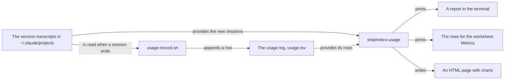

# Shipinetics

Shipinetics is a plugin for Claude Code. It gives the agent one way to work in every project, and it checks the most important rules with code.

In a project that Shipinetics has set up, a task goes like this:

1. The agent writes acceptance criteria, and you approve them.
2. The agent writes the code and commits it.
3. A second agent, `shipinetics:test-writer`, writes the tests from the criteria. It works in its own context, and it doesn't trust the code.
4. The agent starts the real app, uses the feature, and records evidence: a video of the flow, or the output of the commands.
5. Read-only reviewers check the change, each one in its own context.
6. The agent opens a PR. The PR body holds the evidence and a merge-risk grade: low, medium or high.

Hooks stop a PR when the checks didn't pass on that exact code, or when the evidence is missing. Other hooks stop the agent when it writes its own tests, reads a secret, or installs a skill, plugin or MCP server without your yes.

[GETTING-STARTED.md](GETTING-STARTED.md) gives the steps to start, one by one.

## Instructions and enforcement

Shipinetics has two kinds of rules:

- **Instructions.** The skills tell the agent what to do at each step. The agent follows them, but nothing stops it when it doesn't. The task loop, the routes, the specs, the reviews, the evidence recording and the writing rules are instructions.
- **Enforcement.** Hooks, git hooks and CI check a few rules every time. They block the action and say why.

These rules are enforced:

| Rule | What enforces it | Where it works | How to turn it off |
|---|---|---|---|
| Only test-writer creates or edits test files. The guard knows test-writer by its agent type: any agent type that ends in `test-writer` counts, `shipinetics:test-writer` included. Test-writer can edit only test files and the testing docs | The edit guard (`scripts/guard-edits.sh`) | Set-up projects | `SHIPINETICS_ALLOW_AUTHOR_TESTS=1` turns off both parts for a session |
| An agent can create a protected file, but it can't change one. You apply each change | The edit guard, and `shipinetics-config apply` | Set-up projects | `SHIPINETICS_UNLOCK=1` for a session |
| The agent can't show the environment, a variable with a secret-like name, a vault or a secret file | The secrets guard (`scripts/guard-secrets.sh`) | Every project | `SHIPINETICS_ALLOW_ENV_READ=1` turns off the whole guard for a session |
| `gh pr create` and `gh pr ready` work only with complete evidence, a complete verify pass on this exact code, and an `## Evidence` section in the PR body | The PR gate (`scripts/guard-pr.sh`) | Set-up projects | `SHIPINETICS_ALLOW_NO_EVIDENCE=1`, or `SHIPINETICS_SKIP_VERIFY=1` for the verify part only |
| You approve each `npx skills add`, `update` or `check`, `claude plugin install` or `update`, `claude plugin marketplace add` or `update`, and `claude mcp add` | The install gate (`scripts/guard-installs.sh`) | Every project | `SHIPINETICS_ALLOW_INSTALLS=1` for a session |
| A push needs a complete verify pass on the working tree. The hook reuses a recorded pass when `shipinetics-verify` is on the PATH, and runs `bin/verify` when it isn't | The git `pre-push` hook | Projects with `.githooks/` from setup | `git push --no-verify` |
| A commit changes 400 lines or fewer, and its lint problems are fixed. Lockfiles, worksheets, evidence and binary files don't count. Merges, cherry-picks and reverts skip the size limit | The git `pre-commit` hook | The same | `SHIPINETICS_ALLOW_BIG_COMMIT=1` for one commit |
| Each commit names its worksheet in a `Worksheet:` trailer | The git `commit-msg` hook | The same | `SHIPINETICS_ALLOW_NO_WORKSHEET=1` for one commit |
| The agent can't run `git push --force`, `git push -f`, `git reset --hard`, `gh pr merge`, `npm publish` or `gcloud secrets versions access`, or read `~/.config/gcloud`, `~/.aws` or `~/.ssh`. The rules match these command forms only: for example, `git push origin main --force` isn't covered | Deny rules in `.claude/settings.json` | Projects that use the settings template | Edit the settings |
| A PR passes `bin/verify --full`, and its Evidence section links a recording (`Video: <url>`), a screenshot (`Screenshot: <url>`), a GitHub attachment or `terminal.log`. CI blocks the merge only if branch protection requires these jobs | CI (`.github/workflows/verify.yml`) | Projects that use the CI template | The `no-evidence` label. A docs-only PR needs it in CI, though the PR gate lets it open |

Two more hooks only inform you:

- **The companions notice.** When a new session starts and a required companion is missing, it lists the missing companions, and tells Claude too. A missing optional companion (tasteskill, Strix) shows only beside a missing required one.
- **The usage log.** When a session ends, it records the tokens that the session used.

To turn off a hook, put its name in `hooks_off`: `edits`, `secrets`, `pr`, `installs`, `companions` or `usage`. Put it in a project's `.shipinetics/config`, or in `~/.config/shipinetics/config` for all projects. A project's `hooks_off` replaces yours. `SHIPINETICS_HOOKS_OFF="secrets installs"` does the same for one session.

The guards see the text of each command, and the paths in Claude's file tools. They don't see what a script does when it runs. So an agent can get around a guard with a script that it writes. The guards make that a deliberate act, and the reviewers look for it. "Known limits" lists the gaps.

## Install

1. Install the plugin:

   ```bash
   claude plugin marketplace add DreKwasi/shipinetics
   claude plugin install shipinetics@shipinetics
   ```

2. Install the companions: the third-party skills and tools that Shipinetics uses ("Companions" below). [GETTING-STARTED.md](GETTING-STARTED.md) gives all the install commands in one block. Until you install them, each new session starts with a list of the missing ones.

To try the plugin for one session without an install, run `claude --plugin-dir <path to a clone of this repo>`.

The plugin puts its tools (`bin/`) on the PATH of the agent's Bash tool. In your own terminal, run them by their full path, or add the plugin's `bin/` folder to your PATH.

## Update

Each release has a version, and [CHANGELOG.md](CHANGELOG.md) says what changed. An update has two parts: the plugin on your machine, then each project. `shipinetics-update` says how your machine gets Shipinetics and what to do next.

- **From GitHub:** `claude plugin marketplace update shipinetics`, then `claude plugin update shipinetics@shipinetics`, then restart Claude Code. Auto-update for the marketplace is in `/plugin`, under Marketplaces.
- **From your own fork or clone:** `shipinetics-update -C <clone> check` shows how far behind the clone is and where a merge would conflict. `shipinetics-update -C <clone> merge` merges the latest release and runs the tests. A clone that Claude Code reads from the folder needs only `/reload-plugins` then. A fork on GitHub needs a push. Claude Code takes a new copy only when `version` in `.claude-plugin/plugin.json` changes, so a change of your own between releases also needs a new version. [GETTING-STARTED.md](GETTING-STARTED.md), section 6, has the steps, and what to put in the project instead of a fork.
- **Each project:** a plugin update doesn't change the files that setup wrote. `/shipinetics:setup update` lists the steps for each project from each release since the project's version, replaces the Shipinetics block in `AGENTS.md`, and keeps your text outside the block.

## What setup writes into a project

Shipinetics has two layers:

- **The plugin** (this repo) holds the skills, agents, hooks and tools. When you update it, every project gets the change.
- **The project** holds its own files. `/shipinetics:setup` writes them, and you commit them. CI and other people can use these files without the plugin.

Only you can start setup: `/shipinetics:setup`. It first audits the project and writes the result to `docs/shipinetics-setup.md`. Then it asks all its questions in one message. Then it installs each phase, proves that the phase works, and commits it. [GETTING-STARTED.md](GETTING-STARTED.md) lists the phases.

| Files | What they do |
|---|---|
| `AGENTS.md`, `CLAUDE.md` | The project's instructions for any agent. `CLAUDE.md` imports `AGENTS.md`. Shipinetics's own rules are one block in `AGENTS.md`, between the `shipinetics:begin` and `shipinetics:end` lines, so that `/shipinetics:setup update` can replace them. In a project that already has these files, setup adds the block and the import line, keeps the rest, and asks you about each rule that disagrees. Only the rules that you approve under "Where this project differs from Shipinetics" win over the block, and some block rules (secrets, protected files, tests, scans, Strix and deepsec approvals) always hold |
| `bin/verify` | The project's checks, in three tiers: `--quick` (the changed files), complete, and `--full` (for CI) |
| `bin/with-secrets` | Runs a command with the secrets from the vault set as environment variables |
| `bin/lint-fix`, `bin/llm-fix` | Fix lint problems: first the linters' own fixes, then a cheaper model for what is left |
| `.githooks/pre-commit`, `commit-msg`, `pre-push` | The git hooks in the table above |
| `.shipinetics/config` | The project's settings ("Settings" below) |
| `.shipinetics/protected-paths`, `test-paths`, `ui-paths`, `secrets.list`, `secret-paths` | The lists that the guards and tools read: protected files, test files, UI files, secret names and secret files |
| `.claude/settings.json` | High effort, the credential scrub, and the deny rules. Setup proposes it in `.shipinetics/pending/`, so that you review each change to Claude Code's settings |
| `.github/workflows/verify.yml` | CI: `bin/verify --full` and the evidence check |
| `docs/systems/` | One doc for each system, each with a 7-line header that `head` can read |
| `docs/verification/` | The verification map: how to start the app, check it, and use each feature |
| `docs/worksheets/`, `docs/agent-feedback.md`, `TODOS.md` | The worksheet template, the agents' feedback log and the task queue |
| `docs/conventions.md` | The code conventions |
| `e2e/` | A Playwright config and one smoke test, for web projects |
| `DESIGN.md`, `PRODUCT.md` | For UI projects: the design system with its tokens, and who the product is for |
| `.gitignore` | Lines for the caches, the explainers, `.env*` files and test reports |

Setup's audit also looks for `docs/testing/how-to-write-tests.md`, `docs/testing/test-index.md` and `docs/tools.md`. No phase writes them. Their templates are in [skills/setup/templates/docs/](skills/setup/templates/docs/), and the agent fills them as tests and scripts appear.

A project can keep its files somewhere else. "Settings" below says how.

## A task, step by step

The agent follows `shipinetics:workflow`. If a project has its own `AGENT_WORKFLOW.md`, that file overrides the parts that conflict. The size of the task decides which steps the agent skips:

| Size | Looks like | What the agent skips |
|---|---|---|
| XS | A typo, a config value, a one-line fix | The spec and the plan reviews. It still runs the checks and the app |
| S | One area, under an hour | The research review. The criteria go in the worksheet |
| M | Several files or systems, a few hours | Nothing |
| L | Days, or unclear scope | The agent doesn't start. It splits the task into smaller tasks in the queue |

The steps:

1. **Orient.** The agent starts a worksheet, reads the system docs, and runs the checks once to see the starting state. For S and larger, it offers you two or three routes and recommends one. A route names the companion skills that it uses, for example `grilling` for decisions.
2. **Research** (M and larger). It reads the code that it will change. It writes each fact that the plan depends on in a claims table, with its evidence.
3. **Spec and plan.** For M and larger, it asks you about the design, one question at a time, each with a recommended answer. Then it writes a spec with acceptance criteria (`AC1`, `AC2` ...), and a reviewer checks the plan. You approve the criteria.
4. **Implement.** It writes the code in small steps and commits each step. After each step, it runs `shipinetics-verify quick`.
5. **Tests.** `shipinetics:test-writer` writes the tests ("Tests" below). The agent fixes the bugs that test-writer reports.
6. **Run the app.** It starts the real app, and uses the feature through each entry point in the verification map. Then it records the evidence.
7. **Verify.** It runs `shipinetics-verify`, the complete checks. A push and a PR need this pass.
8. **Review.** Independent reviewers check the change ("Reviews" below). The agent answers each finding in the worksheet.
9. **Docs.** It updates the system docs and the test index that the change made wrong.
10. **Wrap up.** It commits, writes the PR description, gets the merge-risk grade, opens the PR, tags the worksheet and writes its feedback.

What you do:

1. Choose a route, and answer the design questions.
2. Approve the acceptance criteria.
3. Decide the design-system change requests, if there are any.
4. Review the PR as its merge-risk grade tells you:
   - **low:** look at the evidence, read the change quickly, and merge;
   - **medium:** read the Whiteboard and the files that the grade names;
   - **high:** do a full review.

For M tasks and larger, the spec ends with a line for Claude Code's `/goal` command. Paste it, and Claude keeps working until a separate evaluator sees each result.

## Skills

Each skill is also a slash command: `/shipinetics:<name>`.

| Skill | What it does | Who starts it |
|---|---|---|
| `setup` | Audits a project and writes the project files, phase by phase | You |
| `workflow` | The task loop above | The agent, at the start of each task |
| `spec` | Turns an issue or an idea into a spec with testable acceptance criteria and a `/goal` line | The agent (M and larger), or you |
| `testing` | How tests get written: by test-writer, after the code, one test for each behaviour | The agent |
| `review` | Runs the reviewers at a checkpoint: research, plan, implementation, wrap-up, docs or merge risk | The agent, or you |
| `pr-review` | Explains someone else's PR on Whiteboard boards, and adds an independent review with ranked findings. It posts to GitHub only after your yes | You |
| `evidence` | Records and checks the proof that a change works, and builds the PR's Evidence section | The agent, or you |
| `verification-map` | Writes and keeps the recipe for starting the app and using each feature | The agent, and setup |
| `explain` | Picks the format to explain something to you: text, a diagram, a Whiteboard, an HTML page or a video. Holds the writing rules | The agent, or you |
| `worksheet` | Keeps the task's worksheet, so another agent can finish the task | The agent |
| `system-docs` | Keeps the docs in `docs/systems/` true, with their 7-line headers | The agent |
| `secrets` | How secrets reach the app, and what the agent may and may not do with them | The agent |
| `lint-rule` | Turns a repeated review finding into a lint rule that fixes the code | The agent |
| `task-queue` | Reads, claims and updates tasks in `TODOS.md`, or in Linear | The agent, or you |
| `feedback` | Writes the agent's feedback at the end of a task. `ingest` groups the feedback and proposes fixes | The agent; you run `ingest` |
| `sweep` | Looks across the commits since the last sweep for duplicate code, drift and unfinished work, and checks the setup. Nothing runs it on its own: run it weekly, or schedule it | You |
| `test-backfill` | Adds tests to an existing app in batches, riskiest features first: criteria from what users see, one approval round for each batch, then one test-writer for each feature | You, after setup |
| `test-audit` | Finds tests that don't test what they say, proves it by breaking the code, and fixes them | You |
| `state-audit` | Writes down a system's states and transitions, and finds the invalid states that the code can reach | You |
| `security-scans` | Runs SkillSpector on agent tools and, after your yes, deepsec on your code and Strix on your running app | You, in a weekly security pass |
| `visual-regression` | Screenshot tests with baselines, and the UI reviewer | Setup, or you |
| `perf` | Benchmarks that catch slowdowns, profiling, and a method to try optimizations | Setup, or you |

Most skills take an argument, for example a stage for `review` (`research`, `plan`, `impl`, `wrapup`, `docs`, `merge-risk`) or a format for `explain`. Claude Code shows each skill's argument hint when you type its name.

## Agents

Each agent works in its own context. The skills start them.

| Agent | Model and effort | Job | Can it edit files? |
|---|---|---|---|
| `reviewer` | Opus, high | The main review at each checkpoint, and the merge-risk grade. Without the `merge-risk` skill, it grades the PR by the same five areas itself | No |
| `security-reviewer` | Opus, medium | Reviews a change that touches security, with Cloudflare's `security-audit` skill | No |
| `ui-reviewer` | Opus, medium | Compares a UI change with `DESIGN.md`, then runs Impeccable's critique and audit on screenshots | No |
| `test-writer` | Opus, medium | Writes, changes and deletes tests. The only agent that can edit test files | Test files only |
| `test-plan-reviewer` | Sonnet, high | Checks test-writer's plan against the spec before any test is written | No |
| `live-tester` | Sonnet, medium | Uses the change in the real app itself, and reports PASS, ISSUES or BLOCKED | No |

The reviewers' tool lists have no Edit or Write, and Claude Code enforces that. They have Bash, so that they can run `git diff` and the tests. Bash can also write files, and only their instructions stop that.

## Tools

These tools are in the plugin's `bin/`. Run any of them with `--help` for the details.

| Tool | What it does |
|---|---|
| `shipinetics-verify` | Runs the project's checks for a tier (`quick` or `complete`), and records the pass for this exact code. `--force` runs them again. `status` shows which tiers passed. `times` shows where the time goes |
| `evidence` | `init`, `run`, `upload`, `frames`, `check` and `pr-body`: records, checks and publishes the evidence for a PR |
| `worksheet` | `new`, `current`, `use`, `list` and `tag`: creates, finds and tags worksheets |
| `shipinetics-config` | Shows the project's settings. `get <key>` prints one, and `root` prints the folder that holds `.shipinetics/`. `match` shows which line of a list covers a path. `pending` and `apply` let you review and apply the changes that agents propose to protected files. `due security-audit` says if the full security audit is due |
| `known-failing` | Gates a suite that already fails, so only new failures fail. Also finds flaky tests (`check --rerun`, `hunt`, `flaky`) |
| `design-check` | Finds the fonts, colours, radii and font sizes that a branch added and that aren't in `DESIGN.md` |
| `bench-compare` | Runs a benchmark several times and fails on a slowdown against this machine's baseline |
| `scan-skills` | Scans the skills and agent files that can reach your sessions with SkillSpector, and writes a report. It needs `jq` |
| `skills-outdated` | Shows which installed skills have a newer version upstream. It changes nothing |
| `shipinetics-companions` | Shows each companion as installed, missing or declined. `install` prints the install commands, and runs nothing |
| `shipinetics-update` | Says how this machine gets Shipinetics and what to do to update. For a fork or clone: `check` shows the latest release, the conflicts and the notes, and `merge` merges a release and runs the tests. `steps <version>` lists the steps for each project since that version |
| `shipinetics-usage` | Shows the tokens that each session used, from Claude Code's own transcripts. `html` makes a page with charts |

## When the checks run

Each check runs at the first moment that its result is useful. No check is dropped to save time.

| When | What runs | What it blocks |
|---|---|---|
| The start of a task | `shipinetics-verify`, once, to see the starting state | Nothing. A failure goes in the worksheet |
| A commit | The size limit and lint with fixes on the staged files (`pre-commit`), then the `Worksheet:` trailer check (`commit-msg`). A lint problem that the linters can't fix goes to `bin/llm-fix`, which calls a model | The commit |
| After each step | `shipinetics-verify quick`: the checks for the changed files | Nothing. It tells the agent early |
| Before the agent says that the work is done | `shipinetics-verify`: all fast checks, with the build and the e2e smoke test | Nothing in code. The workflow requires it |
| A push | The `pre-push` hook: a recorded complete pass, or a new run | The push |
| A PR | The PR gate: `evidence check --branch`, a recorded complete pass for exactly this code, and the Evidence section | The PR |
| CI | `bin/verify --full`, without local caches, and the evidence check | The merge, if branch protection requires these jobs |

`shipinetics-verify` records each pass against a hash of the code's contents, not against the commit. So a commit of checked code doesn't run the checks again. Changes to worksheets, evidence and the feedback log don't either. In a project without a quick tier (`verify_quick_cmd`), `quick` runs the complete tier. `shipinetics-verify` gives the verify command two variables: `SHIPINETICS_CHANGED_FILES`, the path of a file that lists the changed paths, one on each line, and `SHIPINETICS_VERIFY_TIER`, the tier.

No hook makes the agent run the checks before it stops. The workflow tells it to, and the push and PR gates refuse code without a pass.

## Tests

The agent that writes the code never writes its tests. `shipinetics:test-writer` writes them after the code is committed, in its own context, from the spec and the public interface. The edit guard enforces this in set-up projects.

One request can use several modes:

| Mode | When | What test-writer does |
|---|---|---|
| `acceptance` | M tasks and larger | Writes a test for each acceptance criterion, at the entry point |
| `unit` | Domain logic | Writes the other cases that the criteria state, through the public interface |
| `regression` | A bug fix | Writes a test that passes on the fix and fails on the code before the fix |
| `change` | Behaviour changed or was removed | Changes the tests of changed behaviour, and deletes the tests of removed behaviour |
| `backfill` | An existing feature with no tests (`/shipinetics:test-backfill`) | Writes tests for criteria that you approved. It reuses the tests that exist. The proof is the mutants, because there is no code before a change |

For M tasks and larger, test-writer writes a plan first. `shipinetics:test-plan-reviewer` cuts each planned test that doesn't prove its criterion, catches no plausible bug, repeats a test that exists, or sits at the wrong layer. A test cut at this step costs nothing.

The rules that keep the suite small:

- **Each test proves an acceptance criterion and names it,** for example `refund-rounding AC2`. A behaviour that no criterion states gets no test. Test-writer proposes the criterion instead, and you decide.
- **One test for each behaviour,** with every assertion that the behaviour needs. Never one test for each function.
- **The suite grows only with new behaviour.** Test-writer reports the net change in tests.
- **Each test is shown to catch a bug.** The new test fails on the code before the change. Test-writer also breaks the code on purpose (a mutant) and sees the test fail. It does this in git worktrees under `$TMPDIR`, never in your working tree.
- **Each new test runs 5 more times** before it is done. A test that fails once is flaky, and test-writer fixes the cause.
- **Property and differential tests where they fit.** A criterion that states a rule for every input (a round trip, an invariant, idempotency) gets a property test. A rewrite that must not change behaviour gets a differential test: the old and the new code on the same inputs.
- **`bin/verify --quick` runs only the tests related to the change,** with the runner's own selection. When the selection is not sure (test config, fixtures, a lockfile), it runs all unit tests.
- **Slow tests are reported.** When one targeted run costs over 10 seconds, the agent tells you the numbers and the usual fix. It doesn't change your test setup without your yes.

For a suite that already fails, `known-failing check <junit.xml>` in `bin/verify` fails only on new failures. The list of known failures is `.shipinetics/known-failing`, and only you change it. `known-failing check --rerun '<cmd>'` runs each new failure once more: a test that passes then is named flaky, but the check still fails. When you run the sweep, it runs `known-failing hunt` on the main branch to find flaky tests.

`/shipinetics:test-audit` finds tests that test nothing, and deletes tests whose code is gone.

For an app that has few tests, `/shipinetics:test-backfill` adds them in batches of 3 features, riskiest first. Setup's testing guide step measures the time of one targeted test run first, because each test that test-writer writes runs many times: 6 runs to check for flaky results, and one run for each mutant.

## Evidence

Each PR shows the change working in the real app:

- **A UI change** gets one recording of the whole flow, at a pace that a person can follow. Each acceptance criterion's row in `EVIDENCE.md` names the time where its result shows. Screenshots are only for a change that can't be recorded, and never beside a recording.
- **A CLI or an API** gets terminal transcripts, recorded with `evidence run`.

Recordings never go in git. If the project sets `evidence_upload_cmd`, `evidence upload` puts them in your team's store and links them. If not, you drag the recording into the PR. Agents can't watch a video, so `evidence frames` extracts the frame at each criterion's time (it needs `ffmpeg`).

`evidence check` fails when the code changed after the evidence was recorded. Changes to docs, tests and records don't count. `evidence pr-body` prints the PR's Evidence section, with the recording links and the terminal logs.

## Reviews

- **At each checkpoint** (research, plan, implementation, wrap-up), `shipinetics:reviewer` reviews the work. For a change that touches security, `shipinetics:security-reviewer` also reviews it. For a UI change, `shipinetics:ui-reviewer` does.
- **Personas** give the reviewer a lens: `ai-smells`, `code-quality`, `maintainability`, `performance`, `security`, `state-integrity` and `test-integrity`. A project can add its own domain persona from `domain-expert-template.md`.
- **The live re-check.** For M tasks and larger, and UI changes, `shipinetics:live-tester` uses the change in the app itself, through each entry point in the verification map. It doesn't trust the author's recording.
- **Claims tables.** Research and docs reviews check each fact against evidence that the reviewer opened: `file:line`, or a source URL with the date.
- **Merge risk.** Before a PR opens, an independent reviewer grades it low, medium or high with Warp's `merge-risk` skill, and names the files that cause the grade. Nothing merges by itself.
- **Your view.** For M tasks and larger, the agent makes a Whiteboard of the change, with the merge-risk grade and the review results at the top. Without Whiteboard, it makes an HTML page.

The agent answers each finding in the worksheet: fixed, disagree (with a reason), or deferred (with a task in the queue).

**Design system.** `design-check` and the UI reviewer compare UI changes with `DESIGN.md`. An agent never adds a token to make a finding go away. It writes a design-system change request in the worksheet, and you decide.

## Writing for people

All text for people follows the plain-language guide, [skills/explain/plain-language.md](skills/explain/plain-language.md). ASD-STE100 (Simplified Technical English) is its baseline, not a compliance target. The guide covers docs, worksheets, reports, PR descriptions, commit messages, review comments and replies.

- The agent names the actor, uses the specific verb, and states results, not intent.
- It cuts words that add nothing, such as "simply", "just" and "robust", unless they carry weight.
- Identifiers, commands and product names stay exactly as they are.
- Labels on boards, diagrams and tables follow the same rules: a node is a short sentence or a name, and an edge says what happens.

Before it opens a PR, the agent reads its summary against the guide. At the wrap-up review, the reviewer reads the branch's commit messages against it.

`shipinetics:explain` picks the format. Where there is structure or flow, the agent shows it on a dev.fast Whiteboard, and a committed file also gets a Mermaid diagram. For a big change, it makes an HTML page in `.shipinetics/explainers/`. It makes a video with narration only when you ask.

## Secrets

Secrets stay in a vault: Google Secret Manager by default, or Infisical (`vault = infisical`). They reach the app as environment variables. Setup keeps `.env` files out of git, and it stops to ask you when it finds one in git.

- `bin/with-secrets <command>` runs a command with the secrets in `.shipinetics/secrets.list` set. It leaves a variable that is already set alone. The agent never sees a value.
- `CLAUDE_CODE_SUBPROCESS_ENV_SCRUB=1` in the project settings is Claude Code's own setting. It removes credentials from each command, hook and stdio MCP server that Claude Code starts. Claude Code's docs list what it keeps. This is the strongest layer.
- The secrets guard is the second layer. It blocks these:
  - commands that show the environment, and inline scripts that read it;
  - commands that print a variable with a secret-like name;
  - direct reads from a vault;
  - any command or Read that names a secret file.

You choose the secret files: write a `secret-paths` list in `.shipinetics/`, or in `~/.config/shipinetics/` for all projects. The first list that the guard finds is the whole list. Without a list, a built-in list covers cloud and tool credentials, such as gcloud, AWS, Azure, SSH keys, `.netrc` and `.npmrc`.

The guard doesn't judge three kinds of text:

- the body of a heredoc that can't run: a plain `cat > file`, `cat >> file` or `tee [-a] file` alone on its line, with no quotes or other commands, a file that the command names nowhere else, and a body that can't expand;
- the pattern given to `grep`, `rg` and similar search commands;
- reads of variables that never hold secrets (`HOME`, `PATH`, `TMPDIR`, `NODE_ENV`, `CI` and others), plus the names in `env_safe_names`.

## Security scans

- **SkillSpector** (NVIDIA) scans a skill, an agent, a plugin or an MCP server. You, or the agent after your yes, scan each source before you install it: `skillspector scan <source> --no-llm`. The install gate asks you before each install, and reminds you to scan. It doesn't run the scan. `scan-skills` scans the `SKILL.md` folders and agent files in `~/.claude/skills`, `~/.agents/skills`, the plugin cache, the project's `.claude/` and Shipinetics. It doesn't scan hooks, commands or MCP servers.
  - **Static mode** (`--no-llm`) is what `scan-skills` uses by default. It needs no key, and nothing leaves your machine. `skillspector` itself runs the full scan unless you pass `--no-llm`. It matches risky words and patterns, so it gives false positives.
  - **The full scan** adds SkillSpector's LLM analysis, which also checks the static findings. With `SKILLSPECTOR_PROVIDER=claude_cli`, it uses your Claude Code login and needs no API key: `SKILLSPECTOR_PROVIDER=claude_cli skillspector scan <source>`, or `SKILLSPECTOR_PROVIDER=claude_cli scan-skills --llm`. It sends each skill's files to the model and uses your plan's tokens. For a provider with an API key, run it through `bin/with-secrets`.
- **deepsec** (optional, from Vercel) sends coding agents through the whole repository to find old vulnerabilities, then checks each finding again. It costs money for each file that it reads, so each run needs your yes and has a cost cap. `deepsec process --diff <base>` reads only the files of one change. With `--agent claude --model-auth local` it uses your Claude Code login, so it needs no key. Exported findings go to `.deepsec/findings/`, which setup adds to `.gitignore`.
- **Strix** (optional) runs security tests against your running app. It runs only after you approve the targets of each run. It needs Docker and an LLM provider key in your vault.
- **The full security audit** runs Cloudflare's `security-audit` skill on the whole codebase. Set how often in `security_audit_every`: `off`, `weekly`, `monthly`, `quarterly` or a number of days such as `14d`. Nothing runs it on a timer. When you run `/shipinetics:sweep` and `shipinetics-config due security-audit` says that it is due, the sweep runs it.

## Companions

Shipinetics uses these skills, plugins and tools together with its own skills. They are not part of the plugin, so you install each one yourself. Install them when you install Shipinetics. [GETTING-STARTED.md](GETTING-STARTED.md) gives the commands in one block.

Shipinetics tells you about each missing companion in three places:

- **At the start of each new session.** A notice lists each missing companion, why Shipinetics uses it, its SkillSpector result and its install command.
- **`shipinetics-companions`.** It shows the full list and the status of each companion. `shipinetics-companions install` prints the install commands. It runs nothing.
- **`/shipinetics:setup`.** It checks the companions in each project.

During a task, the agent offers you routes. Each route names the companion skills that it uses (shipinetics:workflow, "Choose a route").

| Companion | Why Shipinetics uses it | SkillSpector result | Install |
|---|---|---|---|
| `grilling` (Matt Pocock) | Asks you about each decision in a plan, one at a time, with a recommended answer. Used before a spec, and before each decision that is hard to reverse | SAFE. 1 MEDIUM finding, a keyword match | `npx skills add mattpocock/skills --skill grilling -g -a claude-code` |
| `domain-modeling` (Matt Pocock) | Keeps the glossary (`GLOSSARY.md`) and the decision records (`docs/adr/`). Used with `grilling` | CAUTION. No findings. The analysis is partial, because the skill names files that it writes later | `npx skills add mattpocock/skills --skill domain-modeling -g -a claude-code` |
| `wait-what` (Matt Pocock) | You type `/wait-what` when a message is not clear. The agent explains it again, more simply | CAUTION. No findings. The analysis is partial, because the skill names a project file that it reads | `npx skills add mattpocock/skills --skill wait-what -g -a claude-code` |
| `research` (Matt Pocock) | Finds facts in primary sources (official docs, API limits, versions). Used when a task depends on external facts | SAFE. No findings | `npx skills add mattpocock/skills --skill research -g -a claude-code` |
| `prototype` (Matt Pocock) | Builds a throwaway prototype to answer one design question. Used before a spec | SAFE. No findings | `npx skills add mattpocock/skills --skill prototype -g -a claude-code` |
| `codebase-design` (Matt Pocock) | The words and rules to design modules and interfaces. Used for a new module or seam | SAFE. No findings | `npx skills add mattpocock/skills --skill codebase-design -g -a claude-code` |
| `diagnosing-bugs` (Matt Pocock) | A loop that finds the cause of a hard bug or a slow path. Used for bug fixes | CAUTION. 1 HIGH finding, a keyword match in a script comment | `npx skills add mattpocock/skills --skill diagnosing-bugs -g -a claude-code` |
| `security-audit` (Cloudflare) | The security reviewer, and the full security audit on the schedule in `security_audit_every` | DO_NOT_INSTALL in static mode. All 10 HIGH findings are false positives (see below) | `npx skills add cloudflare/security-audit-skill -g -a claude-code` |
| `merge-risk` (Warp) | The merge-risk grade on each PR | SAFE. No findings | `npx skills add warpdotdev/common-skills --skill merge-risk -g -a claude-code` |
| Impeccable plugin | The UI reviewer, `design-check`, the design-system setup step, HTML pages | DO_NOT_INSTALL in static mode. All 6 HIGH findings are false positives (see below) | `claude plugin marketplace add pbakaus/impeccable`, then `claude plugin install impeccable@impeccable`. Use the plugin, not `npx skills add`: that copy is not written for Claude Code |
| tasteskill plugin (optional) | A route for UI work that builds or redesigns a page or app screen: an art direction, real photographs, and checks in a real browser. A page takes 30 to 45 minutes and a few hundred thousand tokens. It needs Node 22 or newer and Chrome, Edge or Chromium | DO_NOT_INSTALL in static mode. All 23 HIGH findings are false positives (see below) | `claude plugin marketplace add Leonxlnx/taste-skill`, then `claude plugin install taste-skill@taste-skill` |
| dev.fast Whiteboard plugin | Whiteboards of changes and systems, for your review. Without it, the agent uses Mermaid diagrams | SAFE for the plugin. The plugin only starts the Whiteboard app, which SkillSpector does not scan | `claude plugin marketplace add devdotfast/whiteboard`, then `claude plugin install whiteboard@devfast`, and the dev.fast Whiteboard app |
| NVIDIA SkillSpector | `scan-skills` and the install gate | Not scanned: it is the scanner | `uv tool install git+https://github.com/NVIDIA/skillspector.git` |
| Strix (optional) | Security tests of your app (shipinetics:security-scans). It needs Docker and a provider key in your vault | Not scanned: it is a CLI, not a skill | `curl -sSL https://strix.ai/install \| bash` |
| deepsec (optional, Vercel) | An agent review of the whole repository, for old bugs that a review of one change cannot see (shipinetics:security-scans). Each run needs your yes and has a cost cap: with Claude Opus, about 25 to 60 US dollars for each 100 files | Not scanned: it is a CLI, not a skill | Nothing to install. It needs Node.js. You run `npx deepsec init --agent claude --model-auth local --max-cost-usd <cap>` in a project |

The list is in [companions.tsv](companions.tsv). The notice, `shipinetics-companions` and setup read it.

If you do not want a companion, add its name to `companions_skip` in `~/.config/shipinetics/config` (or in a project's `.shipinetics/config`). Separate names with spaces, for example `companions_skip = strix merge-risk`. Then the notice does not list it. To switch off the notice, set `hooks_off = companions`.

### SkillSpector results

The results come from SkillSpector 2.12.0 in static mode (`--no-llm`), on 2026-10-28 (tasteskill on 2026-11-08). Static mode looks for risky words and patterns, so it gives false positives. Each HIGH finding was checked by hand:

- **Impeccable:** six phrases in design guidance, for example "Never judge fidelity from one full-page thumbnail" and "without warning" (about a turn limit). None of them is an instruction to do something harmful.
- **`security-audit`:**
  - a security checklist that names credential files (`credentials.json`, keychain);
  - `/etc/passwd` in tests that reject unsafe paths;
  - four files that the scan read only in part.
- **`diagnosing-bugs`:** "show instruction" in a comment of a script template.
- **tasteskill:**
  - 19 HTML comments that tell the agent how to fill in its templates (16 in `starter.html`, 3 in other templates and READMEs);
  - a symlink helper and a Windows error message in `install.sh`. The plugin install does not run `install.sh`;
  - a CSS comment that names developer tools, and its rules for addresses on a page ("a street and a district only").

  Its scripts start headless Chrome, `ffmpeg` and `node`. They get fonts, icons and photographs from Google Fonts, jsDelivr, Wikimedia Commons and Lorem Picsum. The scan read five files only in part.

These versions were scanned:

| Companion | Version |
|---|---|
| Matt Pocock's skills | `mattpocock/skills`, skill folder hashes: `grilling` 28aceb4, `domain-modeling` ea30ee4, `wait-what` c8b050e, `research` 0a6796c, `prototype` e41d92e, `codebase-design` 07ba1cd, `diagnosing-bugs` 5fdd6cc |
| `security-audit` | `cloudflare/security-audit-skill`, skill folder hash ccbc33e |
| `merge-risk` | `warpdotdev/common-skills` at commit 8792394 (2026-10-20) |
| Impeccable | 4.5.0, commit 508d7e8 |
| Whiteboard plugin | 0.1.0, commit 23cead9 |
| tasteskill | 2.5.1, commit f6b7657 (2026-11-07) |

A newer version can be different. Scan it again before you install it: `skillspector scan <source> --no-llm` (shipinetics:security-scans). For the full scan with SkillSpector's LLM analysis, see "Security scans".

### Keep the companions up to date

Companions change upstream, and Shipinetics depends on some of their details. The sweep checks for updates when you run it. Only you apply them.

1. **Check.** The sweep runs `skills-outdated`. This tool compares each installed skill with its repo. It changes nothing. For plugins, the sweep compares `claude plugin list` with each marketplace.
   Do not use `npx skills check` to look for updates. It can update and remove skills while it checks. The install gate asks you before an agent runs it.
2. **Scan.** Scan the new version with SkillSpector (shipinetics:security-scans).
3. **Update.** For skills: `npx skills update -g <names>`. For plugins: `claude plugin marketplace update <marketplace>`, then `claude plugin update <plugin>@<marketplace>`. For CLIs: use their own installers. The install gate asks you before an agent runs these commands.
4. **Check again.** The sweep reads each updated companion and compares it with the table below. If a detail that Shipinetics needs changed, the sweep adds a task to the queue.

`skills-outdated` reads the lock file of the `skills` CLI (`~/.agents/.skill-lock.json`). It only sees skills that the CLI installed. Install skills with the CLI and `-g`.

### What Shipinetics needs from each companion

| Companion | Shipinetics needs |
|---|---|
| `security-audit` | A guidance mode for one change. A full six-phase mode that writes its report outside the repo (default `~/security-audit-skill/<repo>/run-<N>`). Its severity names |
| Impeccable | The `shape`, `polish`, `critique`, `audit`, `document`, `detect`, `init`, `doctor` and `hooks` commands. A `DESIGN.md` with token frontmatter |
| `grilling` | A recommended answer for each question. The agent finds facts itself, and does not ask you for them |
| `domain-modeling` | The glossary in `GLOSSARY.md` (`GLOSSARY-MAP.md` when there are several). Decision records (ADRs) in `docs/adr/` |
| `wait-what` | A new explanation in ASD-STE100, with the terms from `GLOSSARY.md` |
| `diagnosing-bugs` | Its phases 1 to 6. The regression test is in phase 5 |
| `merge-risk` | A grade of low, medium or high, with the files that caused the grade |
| tasteskill | The `design-taste-frontend` skill. Its checkers (`consistency.mjs`, `assets/layout/check.mjs`, `perf.mjs`) report FAIL and WARN for a page in a real browser. It builds on its own kit (`assets/`) |

### Other skill packs

Shipinetics also takes two ideas from pstack (Lauren Tan's skills): the verification map and the independent check by the reviewer. They are part of Shipinetics, so you do not install pstack.

You can use other skills with Shipinetics. The edit guard applies to all of them: only `shipinetics:test-writer` writes tests. If a skill tells the main agent to write a test, the guard blocks that step. Give that step to test-writer.

## Records

- **Worksheets.** Each task has a worksheet in `docs/worksheets/`: the goal, the research, the plan, a log of what happened, the reviews and a Metrics block. Another agent can finish a task from its worksheet. Each commit names its worksheet in a `Worksheet:` trailer, and `worksheet tag` tags the last commit (`ws/<name>`).
- **System docs.** Each doc in `docs/systems/` starts with a 7-line header: title, summary, what it owns, entry points, dependencies, gotchas, and the owner with the last check. `head -n 7 docs/systems/*.md` reads like a map of the code. A system with states also gets a "States" section with its transition table.
- **Feedback.** At the end of each task, the agent writes what slowed it down in `docs/agent-feedback.md`. `/shipinetics:feedback ingest` groups the entries and proposes fixes to docs, tools and lint rules. You approve each fix.
- **The task queue.** `TODOS.md`, or Linear through its CLI. The agent claims a task before it starts.

### Token usage

`shipinetics-usage` shows the tokens that each session used. It reads Claude Code's own transcripts, so no model runs and it costs no tokens. Each API call counts once, and subagents are included.



| Command | What it shows |
|---|---|
| `shipinetics-usage` | This project's sessions in the last 30 days: new input, cache write, cache read and output tokens, with the totals |
| `shipinetics-usage session [id]` | One session (by default the newest), for each agent and model, with the rows for the worksheet Metrics |
| `shipinetics-usage html` | A page with charts of the tokens for each session and each agent, with a table view. In a set-up project, the page goes in `.shipinetics/explainers/`. `--out` sets another path |
| `shipinetics-usage backfill` | Records the transcripts that the log doesn't have yet. The report and the page do this themselves |

Use `--all` for every project, and `--days N` for another range. Claude Code deletes old transcripts after `cleanupPeriodDays` (30 days by default), but the log in `~/.local/share/shipinetics/usage.tsv` keeps the numbers. The log shows tokens, not money: use `/usage` in Claude Code for the cost.

Each worksheet's Metrics block records the model, the effort, the plugin version, the tokens, the API calls, the time, the merge-risk grade, the review rounds and the bugs that test-writer suspected. It has a cost row that no tool fills: fill it in from `/usage` if you want it. Three fields are for you: the corrections that you needed, your review time, and whether you accepted the work. `/shipinetics:feedback ingest` summarises them for the accepted tasks.

## Settings

Every setting is optional. A project sets its own in `.shipinetics/config`, one `key = value` on each line. `shipinetics-config` prints all settings and marks the ones that the project set. The template, with an example for each key, is [skills/setup/templates/config](skills/setup/templates/config).

| Setting | Default | What it sets |
|---|---|---|
| The path keys: `worksheets_dir`, `feedback_file`, `systems_dir`, `conventions_file`, `testing_guide_file`, `test_index_file`, `tools_index_file`, `queue_file`, `personas_dir`, `evidence_dir` | `shipinetics-config` prints each default | Where the project keeps each kind of file. Use them to map Shipinetics onto a project with its own layout |
| `verify_cmd` | `bin/verify` | The complete checks |
| `verify_quick_cmd` | None | The checks for the changed files. Without it, the quick tier runs the complete checks |
| `evidence_upload_cmd` | None | A command that uploads a recording to the team's store and prints a link. Setting it is the team's yes to upload evidence there |
| `launch` | `agent` | `user` when you start the dev servers yourself. Then agents don't start, restart or stop the servers. They run the doctor check before they use the app. They don't seed or reset data, they write only as the test account, and they remove what they create |
| `hooks_off` | None | The hooks that are off for this project |
| `companions_skip` | None | The companions that the team doesn't use. They show as declined, not missing |
| `security_audit_every` | `off` | How often the full security audit runs |
| `secrets_runner` | `bin/with-secrets` | The command that runs another command with the secrets |
| `vault`, `infisical_args` | Google Secret Manager | `vault = infisical` makes `bin/with-secrets` run `infisical run` |
| `env_safe_names` | None | The project's own variables that never hold secrets |
| `bench_cmd` | `bin/bench` | The benchmark command |
| `worksheet_new_cmd`, `worksheet_tag_cmd`, `tag_prefix` | None, None, `ws/` | Hand worksheets to the project's own scripts |
| `packages`, `package_verify_cmd`, `package_verify_quick_cmd`, `package_bench_cmd`, `package_worksheets_dir`, `harness_repo` | None | Workspace mode (below) |

`hooks_off` and `companions_skip` can also go in `~/.config/shipinetics/config`, for all your projects. A project's setting replaces yours.

**Workspace mode** is for a folder that holds several package repos and isn't a repo itself. Set `packages` to turn it on.

- `shipinetics-verify` in a package runs `package_verify_cmd` for it. `shipinetics-verify quick` runs `package_verify_quick_cmd`.
- The PR gate and `evidence` work in the package repo that the PR comes from.
- The root's own files (`.shipinetics/`, the queue, the worksheets, the docs) must be in a git repo too. Make the root a repo that ignores the package folders, or set `harness_repo` to a separate repo. `shipinetics-config` warns you when neither is true.

## Environment variables

| Variable | Effect |
|---|---|
| `SHIPINETICS_HOOKS_OFF="secrets installs"` | Turns off the named hooks for a session: `edits`, `secrets`, `pr`, `installs`, `companions` or `usage` |
| `SHIPINETICS_ALLOW_AUTHOR_TESTS=1` | Lets any agent edit test files, and test-writer edit source files, for a session. For example, for a rename of many files |
| `SHIPINETICS_UNLOCK=1` | Lets agents edit protected files for a session |
| `SHIPINETICS_ALLOW_ENV_READ=1` | Turns off the secrets guard for a session |
| `SHIPINETICS_ALLOW_NO_EVIDENCE=1` | Turns off the PR gate for a session |
| `SHIPINETICS_SKIP_VERIFY=1` | Turns off only the PR gate's check for a verify pass, for a session |
| `SHIPINETICS_ALLOW_INSTALLS=1` | Turns off the install gate for a session |
| `SHIPINETICS_ALLOW_NO_WORKSHEET=1` | Lets one commit through without a `Worksheet:` trailer |
| `SHIPINETICS_ALLOW_BIG_COMMIT=1` | Lets one commit through above the size limit. Say why in the commit message |
| `SHIPINETICS_LLM_FIX=0` | Skips the model step in `bin/lint-fix` |
| `SHIPINETICS_FIX_MODEL` | The Claude model for `bin/llm-fix` (default `sonnet`) |
| `SHIPINETICS_FIX_EFFORT` | The effort for `bin/llm-fix` (default `high`; empty means the model's default) |
| `SHIPINETICS_USAGE_LOG` | Another path for the usage log |
| `SHIPINETICS_BENCH_MACHINE` | The machine name for `bench-compare` baselines (default `<host>-<arch>`). Set it in CI, so all runners share one baseline |
| `GOOGLE_CLOUD_PROJECT` | The default project for `bin/with-secrets` (else gcloud's project) |
| `XDG_CONFIG_HOME`, `XDG_DATA_HOME` | Move `~/.config/shipinetics` and `~/.local/share/shipinetics` |
| `CLAUDE_CODE_EFFORT_LEVEL` | Claude Code's own setting: one effort level for the session and all agents |
| `CLAUDE_CODE_SUBPROCESS_ENV_SCRUB=1` | Claude Code's own credential scrub. The settings template turns it on |

## Effort

| Part | Model and effort | How to change it |
|---|---|---|
| The main session | Your model, at high effort (the settings template sets `effortLevel`) | `/effort`, or `effortLevel` in `.claude/settings.json` |
| Each agent | See "Agents" | Edit the `model:` or `effort:` line in `agents/<name>.md`. The skills don't override it |
| `bin/llm-fix` | Sonnet, high | `SHIPINETICS_FIX_MODEL`, `SHIPINETICS_FIX_EFFORT` |
| Everything at once | | Start Claude Code with `CLAUDE_CODE_EFFORT_LEVEL=medium` (or another level). It overrides all other settings |

## Known limits

- **The guards read command text.** They see the text of each command and the paths in Claude's file tools, not what a script does when it runs. So an agent can write a file or print a variable through a script that it writes and runs. The credential scrub and the reviewers are the layers behind the guards.
- **The guards match words, not intent.** The PR gate and the install gate react to their command words anywhere in a command: in a heredoc, a quoted string, a comment or a commit message. The secrets guard skips a heredoc only in the case that "Secrets" describes.
- **Each guard watches some tools only.** The edit guard watches Edit, Write and NotebookEdit. The secrets guard watches Bash and Read, not Grep or Glob.
- **The install gate knows some install commands only.** It doesn't see `uv tool install`, `npm install -g`, `curl ... | bash` or an edit of `.mcp.json`.
- **Bash can write.** The reviewers have no Edit or Write tool, but they have Bash. Claude Code ignores the `hooks` field in a plugin agent's frontmatter, and no hook checks what a reviewer writes through Bash.
- **Some changes need a person.** When a baseline or the list of known failures exists, `bench-compare --init` and `known-failing init` write a proposal to `.shipinetics/pending/`. Only `shipinetics-config apply` applies a proposal, and it needs a terminal, so an agent's Bash tool can't run it by accident. This slows an agent down. It isn't a lock.
- **The install gate asks you.** In a run with no person, nobody is there to answer it.
- **No hook runs the checks when the agent stops.** The workflow tells the agent to run them, and the push and PR gates refuse code without a pass.
- **The usage log reads Claude Code's transcript files.** Their format is internal to Claude Code, and it can change. If Claude Code is killed, the hook may not run, but `shipinetics-usage` records the session later from its transcript. The log needs `python3`.
- **The companion check is simple.** A plugin counts as installed when Claude Code's `installed_plugins.json` names it, even when it is disabled. A skill counts only in `~/.claude/skills`, `~/.agents/skills` or the project's `.claude/skills`. A skill that comes inside another plugin shows as missing: add it to `companions_skip`.
- **SkillSpector's static mode gives false positives** on skills that discuss security or that hold templates with comments. "SkillSpector results" lists each one that was checked by hand.
- **Without a store, a person attaches the recording.** `evidence pr-body` links the terminal logs on the pushed branch, so push before you open the PR.
- **CI has no plugin.** If `bin/verify --full` uses `known-failing` or `bench-compare`, copy them from the plugin's `bin/` into the project's `bin/`.
- **`bin/with-secrets` knows two vaults:** Google Secret Manager through gcloud, and Infisical through its CLI. A project with another vault sets `secrets_runner`.
- **The Strix and deepsec steps are untested.** No Strix or deepsec run was part of building them. The deepsec commands and flags come from its docs and its CLI source on 2026-11-18.
- **deepsec shows as installed when `npx` is on the PATH.** It runs with `npx` in each project, so there is nothing else to find.
- **`/shipinetics:test-backfill` has not run on a real project yet.** Nor has `/shipinetics:setup update`, or setup in a project that already has `CLAUDE.md` or `AGENTS.md` with the new block.
- **`shipinetics-update` reads `claude plugin list --json`** to find where the plugin comes from. A change to that output can break the first command. `check`, `merge` and `steps` don't use it.
- **`design-check` checks fonts, colours, radii and font sizes.** The UI reviewer checks the rest: spacing, unknown `var()` names, new tokens and copied components. Without token frontmatter in `DESIGN.md`, there is nothing to check against.

## Layout

```
.claude-plugin/   plugin.json and marketplace.json
.github/          the CI workflow of this repo (test.yml)
agents/           reviewer, security-reviewer, ui-reviewer, test-writer, test-plan-reviewer, live-tester
bin/              the tools, on the agent's PATH: bench-compare, design-check, evidence, known-failing,
                  scan-skills, shipinetics-companions, shipinetics-config, shipinetics-usage,
                  shipinetics-update, shipinetics-verify, skills-outdated, worksheet
hooks/            hooks.json: which script runs at which event
scripts/          the hooks (guard-edits.sh, guard-secrets.sh, guard-pr.sh, guard-installs.sh,
                  companions-notice.sh, usage-record.sh), lib.sh with the shared helpers, and
                  usage.py with usage-page.html for the token usage
skills/           the 22 skills. setup/templates/ holds the files that setup writes into a project.
                  review/personas/ holds the reviewer personas. explain/plain-language.md is the
                  writing guide. worksheet/template.md is the worksheet template, and
                  evidence/record-template.mjs the Playwright recording template
companions.tsv    the companions: why Shipinetics uses each one, how to install it, its SkillSpector result
CHANGELOG.md      what changed in each release, and the versioning rules
tests/            the tests of the hooks and tools
```

## Work on Shipinetics

- **Run the tests** with `bash tests/run.sh`. Also run `/bin/bash tests/run.sh` on macOS: the scripts must work in bash 3.2. CI runs both, on Linux and on macOS.
- **Try a change** in one session with `claude --plugin-dir <path to this repo>`, or add the marketplace from your clone. Then `/reload-plugins` loads each edit.
- **Release a change:**
  1. Choose the version by the rules at the top of [CHANGELOG.md](CHANGELOG.md). Before 1.0.0, a breaking change increases the minor number (0.7.0 to 0.8.0). Other changes increase the last number (0.7.0 to 0.7.1).
  2. Set the version in `.claude-plugin/plugin.json`.
  3. Write the entry in `CHANGELOG.md`. For a breaking change, give the steps for each project.
  4. Commit, and tag the commit `vX.Y.Z`.
  5. Push the commit and the tag.

  If the version doesn't change, `claude plugin update` does nothing for installs from GitHub.
