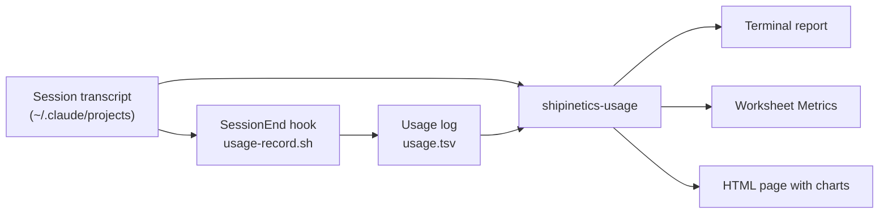

# Shipinetics

Shipinetics is a plugin for Claude Code. It gives every project the same workflow, reviews and guardrails. You install it one time. Then each project gets these parts:

- **Verify gates.** Checks run in tiers. The agent runs quick checks while it works, and all fast checks before the work is done. CI runs the full suite. The agent runs verify itself. A push or a PR is blocked until the complete checks pass on exactly that code. A pass stays valid until the code changes.
- **Independent tests.** A separate agent writes the tests, never the agent that wrote the code. Each test proves an acceptance criterion and names it. It writes one test for each behaviour that a user or caller can see, never one test for each function. When code changes or is deleted, test-writer changes or deletes its tests in the same task, after the change is committed. So the suite grows only with new behaviour.
- **A verification map.** It tells any agent how to start the real app, check it, and use each feature the way a user does. A reviewer uses the feature again by itself. It does not trust the author's recording.
- **Evidence on every PR.** Each PR shows the change in the running app. The evidence is one paced recording of the flow, with the time of each acceptance criterion (screenshots only when it can't be recorded, never both), or terminal output. Recordings never go in git: they go to your team's store (opt-in) or are attached to the PR. An independent reviewer gives each PR a merge-risk grade.
- **Design checks.** UI changes are compared with the project's design system (`DESIGN.md`). Setup writes `DESIGN.md` from the tokens that the code already uses.
- **Secrets stay hidden.** Secrets stay in the vault. The agent never sees their values.
- **Independent reviewers.** The reviewers are read-only and work in their own context. They include a security reviewer (Cloudflare's security-audit skill) and a UI reviewer (Impeccable).
- **Security scans.** SkillSpector scans agent tools before you install them. Strix tests your own app, but only after you approve each run. A full security audit runs on the schedule that you choose.
- **Routes.** For small tasks and larger, the agent offers you two or three routes and recommends one. Each route names the skills that it uses.
- **Companions.** Shipinetics uses some third-party skills with its own skills, for example Matt Pocock's `grilling` and Cloudflare's `security-audit`. Each new session tells you which ones are missing, why Shipinetics uses each one, and its SkillSpector result.
- **Explanations.** Whiteboards and HTML pages show you what the agents did. All text for people uses ASD-STE100 (Simplified Technical English) as a baseline, with the plain-language rules in [skills/explain/plain-language.md](skills/explain/plain-language.md). PR descriptions and commit messages follow them too.
- **Worksheets.** Each task has a worksheet. Another agent can continue a task from its worksheet.
- **Token usage.** A log records the tokens that each session used, for each agent and model. A page shows them in charts. No model runs to make them, so they cost nothing.

## Two layers

- **The plugin** (this repo) has the general parts: skills, agents, hooks and tools. When you update the plugin, every project gets the change.
- **The project** has its own parts. `/shipinetics:setup` writes them into the repo, and you commit them. Examples: `AGENTS.md`, `bin/verify`, `bin/with-secrets`, the lists in `.shipinetics/`, the system docs and the task queue. CI and other people can use these files without the plugin.

[GETTING-STARTED.md](GETTING-STARTED.md) gives the steps to start, one by one.

## Install

1. Install the plugin:

   ```bash
   claude plugin marketplace add DreKwasi/shipinetics
   claude plugin install shipinetics@shipinetics
   ```

   If you use more than one GitHub account, `github.com` in your `~/.ssh/config` can point to a key that cannot read this repo. Then the clone fails. Give the full SSH URL with the host alias for your account:

   ```bash
   claude plugin marketplace add git@<your-ssh-alias>:DreKwasi/shipinetics.git
   claude plugin install shipinetics@shipinetics
   ```

   Put the `Host` name from your `~/.ssh/config` in place of `<your-ssh-alias>`.

   If the install stops with `Unrecognized key: "displayName"`, your Claude Code is too old. Run `claude update`, then do the install again.

2. Install the companions. Shipinetics uses them together with its own skills. "Companions" below gives the reason for each one and its SkillSpector result. [GETTING-STARTED.md](GETTING-STARTED.md) gives all the install commands in one block. If you start a session before you install them, the session starts with a list of the missing ones.

To try the plugin for one session without an install, run `claude --plugin-dir <path to a clone of this repo>`.

## Update

Each release has a version. [CHANGELOG.md](CHANGELOG.md) shows what changed.

1. Update the plugin:

   ```bash
   claude plugin marketplace update shipinetics
   claude plugin update shipinetics@shipinetics
   ```

2. Restart Claude Code.
3. Read the changelog entry. If it has a **breaking** change, do the steps it gives in each project.

If you added the marketplace from a local clone of this repo (`claude plugin marketplace add <path to the clone>`), Claude Code reads the plugin from that folder. Then you do not update it. Edits in the folder take effect at the next session, or when you run `/reload-plugins`. The version number is only for installs from GitHub.

The plugin update changes the skills, agents, hooks and tools. It does not change the files that setup copied into your projects. To compare a project with the newest templates, run `/shipinetics:setup audit` in the project. Setup merges changes into your files. It never overwrites them.

## Companions

Shipinetics uses these skills, plugins and tools together with its own skills. They are not part of the plugin, so you install each one yourself. Install them when you install Shipinetics. [GETTING-STARTED.md](GETTING-STARTED.md) gives the commands in one block.

Shipinetics tells you about each missing companion in three places:

- **At the start of each new session.** A notice lists each missing companion, why Shipinetics uses it, its SkillSpector result and its install command.
- **`shipinetics-companions`.** It shows the full list and the status of each companion. `shipinetics-companions install` prints the install commands. It runs nothing.
- **`/shipinetics:setup`.** It checks the companions in each project.

During a task, the agent offers you routes. Each route names the companion skills that it uses (shipinetics:workflow, "Choose a route").

| Companion | Why Shipinetics uses it | SkillSpector result | Install |
|---|---|---|---|
| `grilling` (Matt Pocock) | Asks you about each decision in a plan, one at a time, with a recommended answer. Used before a spec, and before each decision that is hard to reverse | SAFE. 1 MEDIUM finding, a keyword match | `npx skills add mattpocock/skills --skill grilling -g -a claude-code` |
| `domain-modeling` (Matt Pocock) | Keeps the glossary (`GLOSSARY.md`) and the decision records (`docs/adr/`). Used with `grilling` | CAUTION. No findings. The analysis is partial, because the skill names files that it writes later | `npx skills add mattpocock/skills --skill domain-modeling -g -a claude-code` |
| `wait-what` (Matt Pocock) | You type `/wait-what` when a message is not clear. The agent explains it again, more simply | CAUTION. No findings. The analysis is partial, because the skill names a project file that it reads | `npx skills add mattpocock/skills --skill wait-what -g -a claude-code` |
| `research` (Matt Pocock) | Finds facts in primary sources (official docs, API limits, versions). Used when a task depends on external facts | SAFE. No findings | `npx skills add mattpocock/skills --skill research -g -a claude-code` |
| `prototype` (Matt Pocock) | Builds a throwaway prototype to answer one design question. Used before a spec | SAFE. No findings | `npx skills add mattpocock/skills --skill prototype -g -a claude-code` |
| `codebase-design` (Matt Pocock) | The words and rules to design modules and interfaces. Used for a new module or seam | SAFE. No findings | `npx skills add mattpocock/skills --skill codebase-design -g -a claude-code` |
| `diagnosing-bugs` (Matt Pocock) | A loop that finds the cause of a hard bug or a slow path. Used for bug fixes | CAUTION. 1 HIGH finding, a keyword match in a script comment | `npx skills add mattpocock/skills --skill diagnosing-bugs -g -a claude-code` |
| `security-audit` (Cloudflare) | The security reviewer, and the full security audit on the schedule in `security_audit_every` | DO_NOT_INSTALL in static mode. All 10 HIGH findings are false positives (see below) | `npx skills add cloudflare/security-audit-skill -g -a claude-code` |
| `merge-risk` (Warp) | The merge-risk grade on each PR | SAFE. No findings | `npx skills add warpdotdev/common-skills --skill merge-risk -g -a claude-code` |
| Impeccable plugin | The UI reviewer, `design-check`, the design-system setup step, HTML pages | DO_NOT_INSTALL in static mode. All 6 HIGH findings are false positives (see below) | `claude plugin marketplace add pbakaus/impeccable`, then `claude plugin install impeccable@impeccable`. Use the plugin, not `npx skills add`: that copy is not written for Claude Code |
| tasteskill plugin (optional) | A route for UI work that builds or redesigns a page or app screen: an art direction, real photographs, and checks in a real browser. A page takes 30 to 45 minutes and a few hundred thousand tokens. It needs Node 22 or newer and Chrome, Edge or Chromium | DO_NOT_INSTALL in static mode. All 23 HIGH findings are false positives (see below) | `claude plugin marketplace add Leonxlnx/taste-skill`, then `claude plugin install taste-skill@taste-skill` |
| dev.fast Whiteboard plugin | Whiteboards of changes and systems, for your review. Without it, the agent uses Mermaid diagrams | SAFE for the plugin. The plugin only starts the Whiteboard app, which SkillSpector does not scan | `claude plugin marketplace add devdotfast/whiteboard`, then `claude plugin install whiteboard@devfast`, and the dev.fast Whiteboard app |
| NVIDIA SkillSpector | `scan-skills` and the install gate | Not scanned: it is the scanner | `uv tool install git+https://github.com/NVIDIA/skillspector.git` |
| Strix (optional) | Security tests of your app (shipinetics:security-scans). It needs Docker and a provider key in your vault | Not scanned: it is a CLI, not a skill | `curl -sSL https://strix.ai/install \| bash` |

The list is in [companions.tsv](companions.tsv). The notice, `shipinetics-companions` and setup read it.

If you do not want a companion, add its name to `companions_skip` in `~/.config/shipinetics/config` (or in a project's `.shipinetics/config`). Separate names with spaces, for example `companions_skip = strix merge-risk`. Then the notice does not list it. To switch off the notice, set `hooks_off = companions`.

### SkillSpector results

The results come from SkillSpector 2.12.0 in static mode (`--no-llm`), on 2026-10-28 (tasteskill on 2026-11-08). Static mode looks for risky words and patterns, so it gives false positives. Each HIGH finding was checked by hand:

- **Impeccable:** six phrases in design guidance, for example "Never judge fidelity from one full-page thumbnail" and "without warning" (about a turn limit). None of them is an instruction to do something harmful.
- **`security-audit`:**
  - a security checklist that names credential files (`credentials.json`, keychain);
  - `/etc/passwd` in tests that reject unsafe paths;
  - four files that the scan read only in part.
- **`diagnosing-bugs`:** "show instruction" in a comment of a script template.
- **tasteskill:**
  - 19 HTML comments that tell the agent how to fill in its templates (16 in `starter.html`, 3 in other templates and READMEs);
  - a symlink helper and a Windows error message in `install.sh`. The plugin install does not run `install.sh`;
  - a CSS comment that names developer tools, and its rules for addresses on a page ("a street and a district only").

  Its scripts start headless Chrome, `ffmpeg` and `node`. They get fonts, icons and photographs from Google Fonts, jsDelivr, Wikimedia Commons and Lorem Picsum. The scan read five files only in part.

These versions were scanned:

| Companion | Version |
|---|---|
| Matt Pocock's skills | `mattpocock/skills`, skill folder hashes: `grilling` 28aceb4, `domain-modeling` ea30ee4, `wait-what` c8b050e, `research` 0a6796c, `prototype` e41d92e, `codebase-design` 07ba1cd, `diagnosing-bugs` 5fdd6cc |
| `security-audit` | `cloudflare/security-audit-skill`, skill folder hash ccbc33e |
| `merge-risk` | `warpdotdev/common-skills` at commit 8792394 (2026-10-20) |
| Impeccable | 4.5.0, commit 508d7e8 |
| Whiteboard plugin | 0.1.0, commit 23cead9 |
| tasteskill | 2.5.1, commit f6b7657 (2026-11-07) |

A newer version can be different. Scan it again before you install it: `skillspector scan <source> --no-llm` (shipinetics:security-scans).

### Keep the companions up to date

Companions change upstream, and Shipinetics depends on some of their details. The weekly sweep checks for updates. Only you apply them.

1. **Check.** The sweep runs `skills-outdated`. This tool compares each installed skill with its repo. It changes nothing. For plugins, the sweep compares `claude plugin list` with each marketplace.
   Do not use `npx skills check` to look for updates. It can update and remove skills while it checks. The install gate asks you before an agent runs it.
2. **Scan.** Scan the new version with SkillSpector (shipinetics:security-scans).
3. **Update.** For skills: `npx skills update -g <names>`. For plugins: `claude plugin marketplace update <marketplace>`, then `claude plugin update <plugin>@<marketplace>`. For CLIs: use their own installers. The install gate asks you before an agent runs these commands.
4. **Check again.** The sweep reads each updated companion and compares it with the table below. If a detail that Shipinetics needs changed, the sweep adds a task to the queue.

`skills-outdated` reads the lock file of the `skills` CLI (`~/.agents/.skill-lock.json`). It only sees skills that the CLI installed. Install skills with the CLI and `-g`.

### What Shipinetics needs from each companion

| Companion | Shipinetics needs |
|---|---|
| `security-audit` | A guidance mode for one change. A full six-phase mode that writes its report outside the repo (default `~/security-audit-skill/<repo>/run-<N>`). Its severity names |
| Impeccable | The `critique`, `audit`, `document` and `detect` commands. A `DESIGN.md` with token frontmatter |
| `grilling` | A recommended answer for each question. The agent finds facts itself, and does not ask you for them |
| `domain-modeling` | The glossary in `GLOSSARY.md` (`GLOSSARY-MAP.md` when there are several). Decision records (ADRs) in `docs/adr/` |
| `wait-what` | A new explanation in ASD-STE100, with the terms from `GLOSSARY.md` |
| `diagnosing-bugs` | Its phases 1 to 6. The regression test is in phase 5 |
| `merge-risk` | A grade of low, medium or high, with the files that caused the grade |
| tasteskill | The `design-taste-frontend` skill. Its checkers (`consistency.mjs`, `assets/layout/check.mjs`, `perf.mjs`) report FAIL and WARN for a page in a real browser. It builds on its own kit (`assets/`) |

### Other skill packs

Shipinetics also takes two ideas from pstack (Lauren Tan's skills): the verification map and the independent check by the reviewer. They are part of Shipinetics, so you do not install pstack.

You can use other skills with Shipinetics. The edit guard applies to all of them: only `shipinetics:test-writer` writes tests. If a skill tells the main agent to write a test, the guard blocks that step. Give that step to test-writer.

## Projects with their own setup, and multi-repo workspaces

Shipinetics has default paths and commands. A project can change them in `.shipinetics/config` (the template is `skills/setup/templates/config`). For example, you can set the worksheet folder, the feedback log, the system docs, the verify command and the secrets runner. Then the skills, hooks and tools use the project's own files.

Two commands help:

- `shipinetics-config` shows all settings, and which ones the project set.
- `shipinetics-config match <list> <path>` shows which line in a list covers a path. It uses the same rules as the guards.

Set `launch = user` when you start the dev servers yourself. Then agents only run the doctor check. They do not seed or reset data. They write only as the test account, and they remove what they create. If the sandbox blocks localhost, they use the harness's preview browser. See shipinetics:verification-map.

**Workspace mode** is for a folder that holds several package repos and is not a repo itself. Set `packages` in the config to turn it on.

- `shipinetics-verify` in a package runs `package_verify_cmd` for it, and `shipinetics-verify quick` runs `package_verify_quick_cmd`.
- The PR gate and `evidence` work in the package repo that the PR comes from.
- The root's own files (`.shipinetics/`, the queue, worksheets, docs) must also be in a git repo. Make the root a repo that ignores the package folders, or set `harness_repo` to a separate repo. `shipinetics-config` warns you when neither is true.

`/shipinetics:setup` audits the project first. Then it asks all its questions in one message. Then it installs every phase in one run, with a commit for each phase.

## Where each part lives

| # | Part | In the plugin | In the project |
|---|---|---|---|
| 0 | Router | setup writes it | `AGENTS.md`, `CLAUDE.md` (it imports `@AGENTS.md`) |
| 1 | Workflow | `shipinetics:workflow` | Your `AGENT_WORKFLOW.md`, if you have one, replaces it |
| 2 | System docs that stay true | `shipinetics:system-docs` | `docs/systems/*.md`, each with a 7-line header |
| 3 | Run the app | `shipinetics:verification-map`, workflow step 6 | `docs/verification/`, and "Run the app yourself" in `AGENTS.md` |
| 4 | Tests | `shipinetics:testing`, `shipinetics:test-writer` (modes: acceptance, unit, regression, change), `shipinetics:test-plan-reviewer`, `shipinetics:spec` | `docs/testing/`, `e2e/`, `.shipinetics/test-paths` |
| 5 | Linters that fix | `shipinetics:lint-rule` | `bin/lint-fix`, `bin/llm-fix`, `.githooks/pre-commit` (it also limits commits to 400 changed lines), `.githooks/commit-msg` (it requires the `Worksheet:` trailer) |
| 6 | Reviews by other agents | `shipinetics:review`, three reviewer agents, 8 personas | `docs/review/personas/` for the project's own personas |
| 6b | Review of someone else's PR | `shipinetics:pr-review` | Whiteboard boards, or an HTML explainer. Nothing in the repo |
| 7 | Worksheets and tags | `shipinetics:worksheet`, `worksheet` | `docs/worksheets/`, `ws/*` tags, `Worksheet:` trailers |
| 8 | Session feedback | `shipinetics:feedback`, workflow wrap-up | `docs/agent-feedback.md` |
| 9 | Tools that agents build | `shipinetics:workflow` (step 9) | `bin/`, `docs/tools.md` |
| 10 | Commit sweeps | `shipinetics:sweep` | `docs/sweeps/`, `sweep/*` tags |
| 11 | Conventions | `shipinetics:lint-rule` moves them into linters | `docs/conventions.md` |
| 13 | Task queue | `shipinetics:task-queue` | `TODOS.md`, or Linear through `bin/tasks` |
| 14 | Test audit | `shipinetics:test-audit` | `docs/test-audits/` |
| 14b | State audit | `shipinetics:state-audit`, the `state-integrity` persona | The "States" section of each doc in `docs/systems/`, `docs/state-audits/` |
| 15 | Visual regression | `shipinetics:visual-regression`, `shipinetics:ui-reviewer` | Screenshot tests, with baselines in LFS or PR artifacts |
| 16 | Benchmarks | `shipinetics:perf`, `bench-compare` | `perf/baselines/`, `bin/bench` |
| 17 | Profiling | `shipinetics:perf` (experiment steps) | `docs/perf/experiments.md` |
| S | Secrets | `shipinetics:secrets`, the secrets guard | `.shipinetics/secrets.list`, `bin/with-secrets` |
| V | Evidence on every PR | `shipinetics:evidence`, `evidence`, the PR gate, a CI job | `docs/evidence/<worksheet>/`, `.shipinetics/ui-paths` |
| D | Design system | `design-check`, `shipinetics:ui-reviewer`, setup's design-system step | `DESIGN.md` with token frontmatter, `PRODUCT.md`, design-system change requests in worksheets |
| M | Merge risk | `shipinetics:review` | `## Merge risk` in each PR body |
| X | Security tools | `shipinetics:security-scans`, `scan-skills`, the install gate | `docs/security/` |
| E | Explanations | `shipinetics:explain`, Whiteboard | `.shipinetics/explainers/` (not committed) |
| C | Companions | `companions.tsv`, `shipinetics-companions`, the companions notice | `companions_skip` in `.shipinetics/config` or `~/.config/shipinetics/config` |
| U | Token usage | `shipinetics-usage`, the usage log hook | The worksheet Metrics. The log is `~/.local/share/shipinetics/usage.tsv`, outside the project |

## What code enforces

Skills are instructions. The parts below are hooks and scripts. They work even when an agent does not follow its instructions.

You can switch off each hook. Put `hooks_off` in the project's `.shipinetics/config`, or in `~/.config/shipinetics/config` for all projects. The names are `edits`, `secrets`, `pr`, `installs`, `companions` and `usage`. Example: `hooks_off = secrets installs`. If a project sets `hooks_off`, the project setting is used, not yours. `SHIPINETICS_HOOKS_OFF` does the same for one session.

**Pre-push hook** (`.githooks/pre-push`, setup installs it). The complete checks must pass before code leaves the machine. It uses a recorded pass, so it costs no time after the agent ran the checks.

**Edit guard** (`scripts/guard-edits.sh`, only in set-up projects). It has two rules. Each rule uses a list in `.shipinetics/`:

- `protected-paths`: an agent can create these files (acceptance tests, baselines) but cannot change them. To change one, the agent writes the new version to `.shipinetics/pending/<path>`. You read the change and apply it with `shipinetics-config apply`. `shipinetics-config pending` lists the changes that wait for you. `apply` needs a terminal, so an agent's Bash tool cannot run it by accident. Like the guards, it slows an agent down. It is not a lock. The same method works for `.claude/settings.json`, which Claude Code does not let agents edit.
- `test-paths`: only `shipinetics:test-writer` can create or edit test files. Test-writer cannot edit source files.

**Known failures** (`bin/known-failing`). Some suites already fail. For them, `bin/verify` can run `known-failing check <junit.xml>`. Then only new failures fail the check. The list of known failures is `.shipinetics/known-failing`, and it is protected. See shipinetics:testing.

**Flaky tests** (`bin/known-failing`). A flaky test passes and fails on the same code. Three checks find them, and none of them turns a failure into a pass:
- Test-writer runs each new test 5 more times before it is done.
- `known-failing check --rerun '<cmd>'` in `bin/verify` runs the failures once more. A test that passes then is named flaky and logged, but the check still fails.
- The weekly sweep runs the suite 5 times with `known-failing hunt` and queues a task for each flaky test.

**Secrets guard** (`scripts/guard-secrets.sh`, in every project). It blocks commands that could show a secret to the agent:
- commands that show the environment;
- inline scripts that read the environment;
- commands that print a variable with a secret-like name;
- direct reads from a vault;
- reading or naming a secret file, with Bash or the Read tool.

You choose the secret files. Write a `secret-paths` list in `.shipinetics/`, or in `~/.config/shipinetics/` for all projects. Put one pattern on each line. The template is `skills/setup/templates/secret-paths`. The first list that the guard finds is the whole list. If there is no list, a built-in list covers cloud and tool credentials: gcloud, AWS, Azure, SSH keys, `.netrc`, `.npmrc` and others.

The guard ignores text that only mentions the environment:
- the body of a heredoc that goes into a file;
- the pattern given to grep, rg and similar commands;
- reads of variables that never hold secrets: `HOME`, `PATH`, `TMPDIR`, `NODE_ENV`, `CI` and others, plus the names in `env_safe_names`.

The block message names the project's secrets runner (`secrets_runner`).

**PR gate** (`scripts/guard-pr.sh`, only in set-up projects). It blocks `gh pr create` and `gh pr ready` until three things are true:
1. `evidence check --branch` passes;
2. the complete checks passed on exactly this code;
3. the PR body has a `## Evidence` section.

`evidence check` also fails when the code changed after the evidence was recorded. Changes to docs, tests and records do not count. A branch that changes only docs passes.

**Usage log** (`scripts/usage-record.sh`, in every project). When a session ends, it reads the session's transcript and records the tokens that the session used, subagents included, in `~/.local/share/shipinetics/usage.tsv`. It runs no model, so it costs nothing. See "Measure the setup".

**Companions notice** (`scripts/companions-notice.sh`, in every project). At the start of each new session, it lists each missing companion: why Shipinetics uses it, its SkillSpector result and its install command. It installs nothing. It is quiet when every required companion is installed or in `companions_skip`. It lists a missing optional companion (Strix) only together with a missing required one.

**Install gate** (`scripts/guard-installs.sh`, in every project). Before an agent installs or updates a skill, plugin, marketplace or MCP server, the gate asks you. It also tells you to scan the source with SkillSpector first.

**CI** (the project's `verify.yml`). It runs `bin/verify --full`. It fails a PR that has no Evidence section with a screenshot, recording or terminal output. A PR with the `no-evidence` label passes.

**`bin/with-secrets`**. It gets the secrets in `.shipinetics/secrets.list` from Google Secret Manager. Then it runs a command with the secrets set. The agent never sees a value.

**Environment scrub** (`CLAUDE_CODE_SUBPROCESS_ENV_SCRUB=1`, in the project settings). It removes credentials from every command, hook and MCP server that Claude Code starts. This is the strongest secrets layer. The guard is a second layer.

## When checks run

Each check runs at the first time its result is useful, and before anything depends on it. No check is dropped to save time.

| When | What runs | What it blocks |
|---|---|---|
| A commit | Lint, with fixes, on the staged files (the pre-commit hook) | The commit |
| After a step, run by the agent | `shipinetics-verify quick` (`verify_quick_cmd`): lint of the changed files, an incremental type check, the tests related to the changes | Nothing. It tells the agent early |
| Before the agent says the work is done | `shipinetics-verify`: all fast checks, with the build and the e2e smoke test | The report that the work is done |
| A push or a PR | A recorded complete pass for exactly this code | The push or the PR |
| CI | `bin/verify --full`, without local caches | The merge |
| Weekly | The sweep, a check of the verification map and the design system | The report |

A pass is recorded against a hash of the code's contents, not against the commit. So a commit of checked code does not run the checks again. Changes to worksheets, evidence and the feedback log do not run them again either.

- `shipinetics-verify` runs a tier and records the pass.
- `shipinetics-verify status` shows which tiers passed on the current code.
- `shipinetics-verify times` shows where the check time goes.

In a project without `verify_quick_cmd`, `shipinetics-verify quick` runs the complete tier.

## Reviews, evidence and explanations

- **Agent reviews** happen at each checkpoint:
  - `shipinetics:reviewer` on Opus at high effort, in its own context;
  - `shipinetics:security-reviewer` for changes that touch security;
  - `shipinetics:ui-reviewer` for changes that people see.

  The UI reviewer first compares the change with `DESIGN.md` (`design-check`, then a check by hand). Then it runs Impeccable's critique and audit on real screenshots. The findings of all reviewers are merged and filtered before the author acts on them.
- **Independent check.** For medium tasks and larger, and UI changes, `shipinetics:live-tester` uses the change in the app itself, on Sonnet at medium effort. It uses every entry point from the verification map, on the final code. Its result is PASS, ISSUES or BLOCKED.
- **Design system.** Agents never change tokens to remove a finding. They write the change in the worksheet, under "Design-system change requests". You decide. Setup can protect the design files.
- **Claims tables.** Reviews of research and docs check each fact against evidence that the reviewer opened: `file:line`, or a source URL with the date. Each fact gets a result: verified, incorrect or unresolved.
- **Evidence.** Each PR shows the change in the real app:
  - for UI changes, one paced recording of the flow with the time of each criterion; screenshots only when it can't be recorded, never both. Never committed: `evidence upload` puts it in the store that `evidence_upload_cmd` names (opt-in), or you drag it into the PR. Agents check it frame by frame (`evidence frames`, needs `ffmpeg`);
  - terminal output for CLIs and APIs.

  Agents record it with `evidence` and the Playwright template in `shipinetics:evidence`.
- **Merge risk.** An independent reviewer grades each PR as low, medium or high. It uses Warp's `merge-risk` skill. The grade tells you how carefully to review. Nothing merges by itself.
- **Your review.** For medium tasks and larger, the agent makes a Whiteboard. The merge-risk grade, the review results and the evidence screenshots are at the top. Without Whiteboard, the agent makes an HTML page.
- **Explanations.** `shipinetics:explain` sets the formats: ASD-STE100 text, diagrams, Whiteboards, HTML pages, and videos with narration when you ask for one.
- **Plain language.** [skills/explain/plain-language.md](skills/explain/plain-language.md) is the guide for all text for people, and for PR descriptions first. The agent names the actor, uses the specific verb, states results and not intent, and cuts words such as "simply" and "robust". Identifiers, commands and product names stay exactly as they are. The agent reads its PR summary against the guide before it opens the PR. At the wrap-up review, the reviewer reads the branch's commit messages against it.

## Tests

`shipinetics:test-writer` writes all the tests, after the agent implements and commits the change. It works in its own context, from the spec and the public interface, and it does not trust the code. One request can use several modes:

| Mode | When | What it does |
|---|---|---|
| `acceptance` | Medium tasks and larger | Writes the acceptance tests from the spec. They must pass on the code |
| `unit` | Domain logic | Writes tests of the module's behaviours |
| `regression` | A bug fix | Writes a test that passes on the fix and fails on the code before the fix |
| `change` | The task changed or removed behaviour | Changes the tests of changed behaviour. Deletes the tests of removed behaviour, and names each one |

For medium tasks and larger, test-writer writes its test plan first, and writes no tests. `shipinetics:test-plan-reviewer` reviews the plan against the spec, in its own context. It cuts a planned test that does not prove the acceptance criterion that it names, that catches no plausible bug, that an existing test already covers or that is at the wrong layer. It also finds acceptance criteria that have no planned test. Then test-writer writes the tests of the approved plan. A test that is cut at this step costs nothing to write or to prove.

These rules keep the suite small:

- **Each test proves an acceptance criterion.** The test's name starts with its criterion, for example `refund-rounding AC2` (the spec and the criterion's ID). Each case checks what that criterion states. When a behaviour seems to need a test but no criterion states it, test-writer writes no test. It proposes the criterion, and you decide. Criterion IDs never change, so `rg 'refund-rounding AC2'` always finds the tests of a criterion. A bug fix first gets a criterion for the correct behaviour.
- **One test for each behaviour, with every assertion that it needs.** A test has one reason to fail. Test-writer never splits one behaviour into a test for each assertion. One test never covers two behaviours.
- **The suite grows only with new behaviour.** Test-writer reports the net change in tests. Each new test names its new behaviour.
- **Each test must catch a bug.** Each new test fails on the code before the change. Test-writer also breaks the code on purpose and sees the test fail. It does this in git worktrees under `$TMPDIR`, never in your working tree. One script runs all the mutants, and each mutant runs only the new and changed tests.
- **Test-writer runs only targeted tests.** The complete `shipinetics-verify`, before the work is done, runs the suite.
- **Slow tests are reported to you.** Test-writer measures the fixed cost of one targeted run. If it is over 10 seconds, or the proof runs take over 5 minutes, the agent tells you the numbers, the likely cause and the usual fix. It doesn't change your test setup without your yes. Set the fastest targeted command in `docs/testing/how-to-write-tests.md`: a high fixed cost per run (for example, a test database built again from all migrations) makes each proof run slow.

The test-integrity reviewer checks each change for tests that stay after their code was deleted. `/shipinetics:test-audit` finds tests that test nothing, and it deletes orphan tests first.

## Effort

The model and the effort depend on the job:

- `reviewer` runs on Opus and sets `effort: high`. It is the main review at each checkpoint.
- `test-writer`, `security-reviewer` and `ui-reviewer` run on Opus and set `effort: medium`.
- `live-tester` runs on Sonnet and sets `effort: medium`. It only drives the app and reports what it saw. The reviewers judge the work.
- `test-plan-reviewer` runs on Sonnet and sets `effort: high`. It judges a short test plan against the spec, before the tests are written.
- The project settings template sets `"effortLevel": "high"` for the main session.

To change the effort:

| For | Do this |
|---|---|
| All parts, agents too | Start Claude Code with `CLAUDE_CODE_EFFORT_LEVEL=medium` (or another level). It overrides all other settings |
| The main session | Use `/effort` in the session, or set `effortLevel` in the project's `.claude/settings.json` |
| One agent | Edit its `model:` or `effort:` line in `agents/<name>.md`. The skills do not override these lines when they start an agent |
| The lint-fix model | `SHIPINETICS_FIX_EFFORT` (empty means the model's default) |

## Measure the setup

**Token usage.** `shipinetics-usage` shows the tokens that each session used. It reads Claude Code's own transcripts, so no model runs and it costs nothing. Each API call counts once, and the subagents are included.



| Command | What it shows |
|---|---|
| `shipinetics-usage` | This project's sessions in the last 30 days: new input, cache write, cache read and output tokens, and the totals |
| `shipinetics-usage session [id]` | One session (default: the newest one), for each agent and model, with the rows for the worksheet Metrics |
| `shipinetics-usage html` | A page with charts: tokens for each session, output tokens for each session, and tokens for each agent. Each chart has a table view. In a set-up project the page goes in `.shipinetics/explainers/`, else in `$TMPDIR`. `--out` sets another path |
| `shipinetics-usage backfill` | Records the transcripts that the log does not have yet. The report and the page do this themselves |

Use `--all` for every project and `--days N` for another range. Claude Code deletes old transcripts (after `cleanupPeriodDays`, 30 days by default), but the log keeps the numbers. The log shows tokens, not money. The cost depends on your plan: use `/usage` in Claude Code for it.

Each worksheet has a Metrics block. It records the model, the effort, the plugin version, the tokens and API calls (from `shipinetics-usage session`), the time and merge risk. It also records the review rounds, what happened to each finding, and the bugs that test-writer suspected. Three fields are for you: the corrections you needed, your review time, and whether you accepted the work. `/shipinetics:feedback ingest` summarises them for each accepted task. Change one thing at a time, then compare the next group of accepted tasks.

## Environment variables

| Variable | Effect |
|---|---|
| `SHIPINETICS_SKIP_VERIFY=1` | Turns off the PR gate's check of verify for a session |
| `SHIPINETICS_UNLOCK=1` | Lets agents edit protected paths for a session |
| `SHIPINETICS_ALLOW_AUTHOR_TESTS=1` | Lets any agent edit tests for a session (for example, a rename of many files) |
| `SHIPINETICS_ALLOW_ENV_READ=1` | Turns off the secrets guard's checks of commands and inline scripts that read the environment, for a session |
| `SHIPINETICS_ALLOW_NO_EVIDENCE=1` | Turns off the PR gate for a session |
| `SHIPINETICS_ALLOW_INSTALLS=1` | Turns off the install gate for a session |
| `SHIPINETICS_HOOKS_OFF="secrets installs"` | Switches off the named hooks for a session (edits, secrets, pr, installs, companions, usage) |
| `SHIPINETICS_ALLOW_NO_WORKSHEET=1` | Lets one commit through without a `Worksheet:` trailer (work that is not part of a task) |
| `SHIPINETICS_ALLOW_BIG_COMMIT=1` | Lets one commit through above the size limit (for example, a vendored library). Say why in the commit message |
| `CLAUDE_CODE_EFFORT_LEVEL` | One effort level for the session and all agents |
| `CLAUDE_CODE_SUBPROCESS_ENV_SCRUB=1` | Claude Code's own credential scrub. Setup puts it in the project settings |
| `SHIPINETICS_FIX_EFFORT` | The effort for `bin/llm-fix` (default `high`) |
| `SHIPINETICS_FIX_MODEL` | The Claude model for `bin/llm-fix` (default `sonnet`) |
| `SHIPINETICS_LLM_FIX=0` | Skips the LLM step in `bin/lint-fix` |
| `SHIPINETICS_USAGE_LOG` | Another path for the usage log (default `${XDG_DATA_HOME:-~/.local/share}/shipinetics/usage.tsv`) |
| `SHIPINETICS_BENCH_MACHINE` | The machine name for `bench-compare` baselines (default `<host>-<arch>`). Set it in CI, so all runners use one baseline |
| `GOOGLE_CLOUD_PROJECT` | The default project for `bin/with-secrets` (else gcloud's project) |

## Known limits

- The guards only see Claude's file tools and the text of commands. Changes to guarded files go through a person or a named command (`shipinetics-config apply`, `bench-compare --init`, `known-failing init`). The setup skill lists them. An agent can still write a file or print a variable through a script that it writes and runs. The environment scrub and the reviewers are the layers behind the guards.
- The reviewers have Bash, so they can run `git diff` and tests. They are read-only because their instructions say so, not because code enforces it. Claude Code ignores the `hooks` field in a plugin agent's frontmatter.
- The install gate asks you. In a run without a person, nobody can answer, so installs are refused.
- The usage log reads Claude Code's transcript files. Their format is internal to Claude Code and can change. If Claude Code is killed, the SessionEnd hook may not run, but `shipinetics-usage` records the session later from its transcript. The usage log needs `python3`.
- The companion check is simple. A plugin counts as installed when Claude Code's `installed_plugins.json` names it, whatever its scope and even when it is disabled. A skill counts as installed only in `~/.claude/skills`, `~/.agents/skills` or the project's `.claude/skills`, so a skill that comes inside another plugin shows as missing. Add it to `companions_skip` in that case.
- Strix was not installed when these parts were built. SkillSpector static mode gives false positives on skills that discuss security (see "SkillSpector results").
- `evidence pr-body` copies the recording links from EVIDENCE.md and links `terminal.log` on the pushed branch. Push before you open the PR. Without a store, a person must drag the recording into the PR.
- `bin/with-secrets` reads Google Secret Manager through gcloud. When `.shipinetics/config` has `vault = infisical`, it runs `infisical run`. A project with its own runner sets `secrets_runner`.
- No hook makes the agent run verify before it stops. The workflow tells it to, and the push and PR gates refuse code that has no complete pass. Keep `--quick` to seconds and the complete tier to a few minutes. Never let a check print environment values.
- `design-check` finds fonts, colours, radii and font sizes that are not in `DESIGN.md`. The UI reviewer checks the rest: spacing, unknown `var()` names, new tokens and copied components. Without token frontmatter in `DESIGN.md`, there is nothing to check against.

## Layout

```
.claude-plugin/   plugin.json, marketplace.json
agents/           reviewer (Opus, high), test-writer, security-reviewer, ui-reviewer (Opus, medium),
                  live-tester (Sonnet, medium), test-plan-reviewer (Sonnet, high)
bin/              bench-compare, design-check, evidence, known-failing, scan-skills,
                  shipinetics-companions, shipinetics-config, shipinetics-usage, shipinetics-verify,
                  skills-outdated, worksheet (on the agent's PATH)
hooks/            hooks.json
scripts/          lib.sh (shared helpers), guard-edits.sh, guard-secrets.sh, guard-pr.sh,
                  guard-installs.sh, companions-notice.sh, usage-record.sh, usage.py and
                  usage-page.html (the token usage log and page)
skills/           setup (with templates/), workflow, spec, system-docs, testing, lint-rule,
                  review (with personas/), evidence, security-scans, secrets, explain, worksheet,
                  feedback, task-queue, sweep, test-audit, state-audit, pr-review,
                  visual-regression, perf, verification-map
companions.tsv    the companions: why Shipinetics uses each one, how to install it, its SkillSpector result
CHANGELOG.md      what changed in each release, and the versioning rules
tests/            the tests for the hooks and tools. Run tests/run.sh. CI runs it on Linux and on
                  macOS's bash 3.2
```
