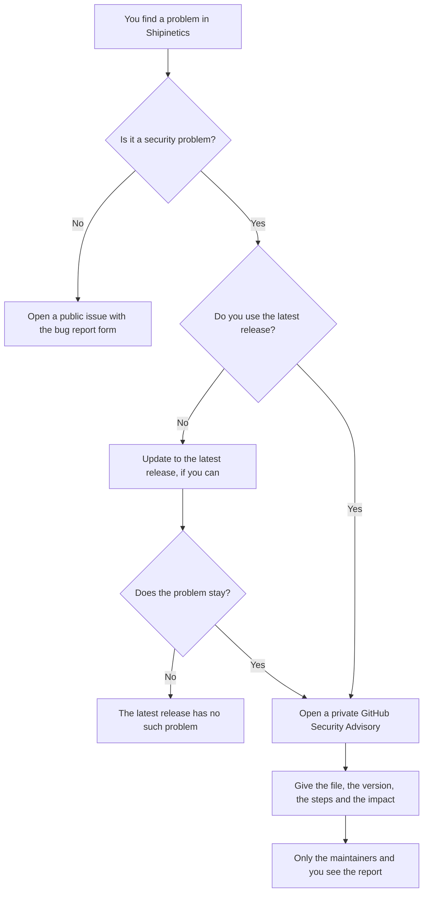

# Security Policy

## Supported versions

Shipinetics fixes security issues in the latest release only. If you can, update to the latest release before you report a problem.

## Reporting a vulnerability

Do not open a public GitHub issue for a security vulnerability. A public issue shows the problem to everyone before a fix exists.

This diagram shows how to report a problem. The steps are below it.

To report a vulnerability:

1. Open a private report with GitHub Security Advisories: https://github.com/DreKwasi/shipinetics/security/advisories/new
2. Give the affected file, hook or CLI tool, and the Shipinetics version.
3. Give the steps or a minimal payload that reproduces the issue.
4. Give the impact. For example: a bypass of a guard, a leaked secret, arbitrary command execution, or XSS in the usage HTML page.

## Scope and known limits

In scope:

- Bypasses in `scripts/guard-secrets.sh`, `scripts/guard-edits.sh`, `scripts/guard-pr.sh` and `scripts/guard-installs.sh` that contradict their documented guarantees.
- Injection or unsafe path handling in `bin/*`, `scripts/*` or `skills/setup/templates/*`.
- Localhost binding or XSS issues in `scripts/usage.py` and `scripts/usage-page.html`.

Known limits of the design (the [README](README.md#known-limits) documents them):

- The guards read the tool arguments and the command text. They are not an OS sandbox. An agent can write a script and run it, and so go around a guard that matches text. Use an OS sandbox (the Seatbelt sandbox of Antigravity) or `CLAUDE_CODE_SUBPROCESS_ENV_SCRUB=1` (Claude Code) as the real boundary.
- `bin/shipinetics-usage serve` binds only to `127.0.0.1`. It is for a local machine with one user.
