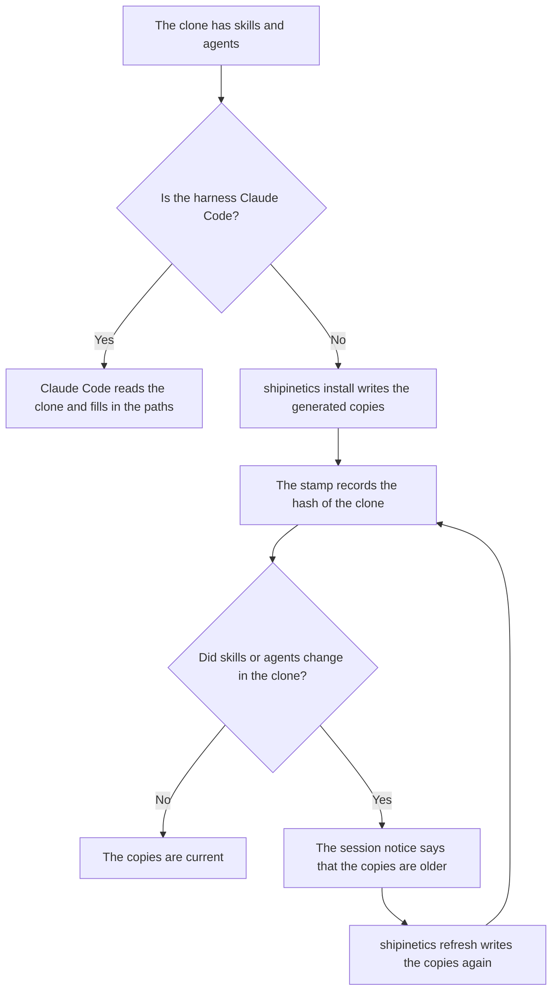

# Each harness gets generated copies of the skills and subagents

Status: accepted. Built for Antigravity in 0.12.0. The model for each model role comes with the model catalog ([0007](0007-models-by-role.md)). Until then, the generated subagents have no model.

The clone's `skills/` and `agents/*.md` stay the one source, and they are written for Claude Code. For each other harness, `shipinetics install <harness>` writes copies in the format of that harness:

- Subagent files in the syntax of the harness, with the model for each model role.
- Skill text in which real paths replace `${CLAUDE_PLUGIN_ROOT}` and `${CLAUDE_SKILL_DIR}`.

We chose this for two reasons:

- Only Claude Code replaces those variables in skill text. Antigravity, Codex and OpenCode don't replace them, and nobody verified Copilot.
- No harness reads the subagent format of a different harness and keeps the models.

The cost is a refresh after each update. For this reason, the session-start notice says when a copy is older than the clone.

This diagram shows how a harness gets the skills, and when the copies need a refresh. The code is in `bin/shipinetics` (`render_skills`, `write_stamp`), `scripts/lib.sh` (`sy_clone_hash`, `sy_copies_state`) and `scripts/companions-notice.sh`.

Checked: 2026-11-22. Sources: [docs/research/harnesses.md](../research/harnesses.md).

## Considered options

- **Link the clone's files, as the Antigravity installer did.** This needs no refresh. But the paths in skill text don't resolve, and the subagents lose their model.
- **Change every skill so that it uses no plugin paths** (for example, with a command that prints the plugin folder). This works in every harness. But it changes 23 files, and each time the agent reads a template, it needs one more step.
