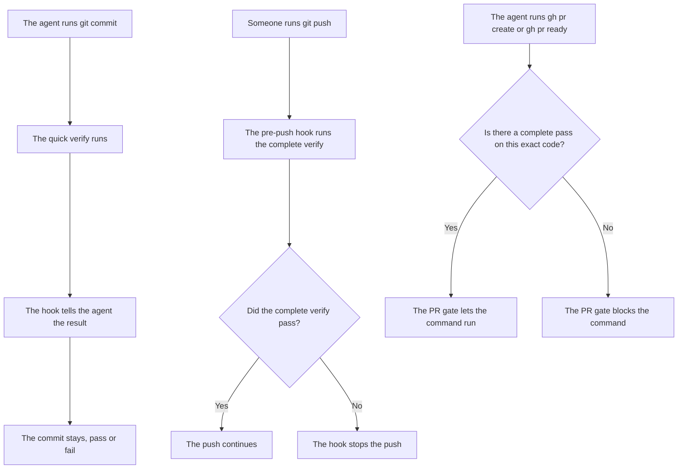

# The push is the hard verify gate, and the check after a commit only reports

The complete verify blocks a push (the pre-push hook) and a pull request (the PR gate). No earlier step blocks on a test. The quick verify that runs after each commit only tells the agent the result.

We chose this for two reasons:

- The task loop needs commits with failing tests. The agent commits the code before test-writer updates the tests of the changed behaviour.
- Before 0.8.0, a Stop hook ran verify each time the agent stopped. On flaky tests, it kept the agent in loops. On simple questions, it cost minutes. Version 0.8.0 removed it.

A push is the last step before the code gets to other people. Thus a complete pass must be true at the push.

This diagram shows where verify runs and which steps it can block. The code is in `scripts/verify-after-commit.sh`, `skills/setup/templates/pre-push` and `scripts/guard-pr.sh`.

The diagram does not show two exceptions. The pre-push hook runs no checks when the repo has no `bin/verify`. The PR gate needs no verify for a branch that changes only docs and Markdown.

## Considered options

- **Verify in a pre-commit hook that blocks.** This stops the commit that test-writer needs. It makes commits slow, and it teaches people to use `--no-verify`.
- **Verify each time the agent stops** (Shipinetics up to 0.7). Removed because of the loops and the cost.
