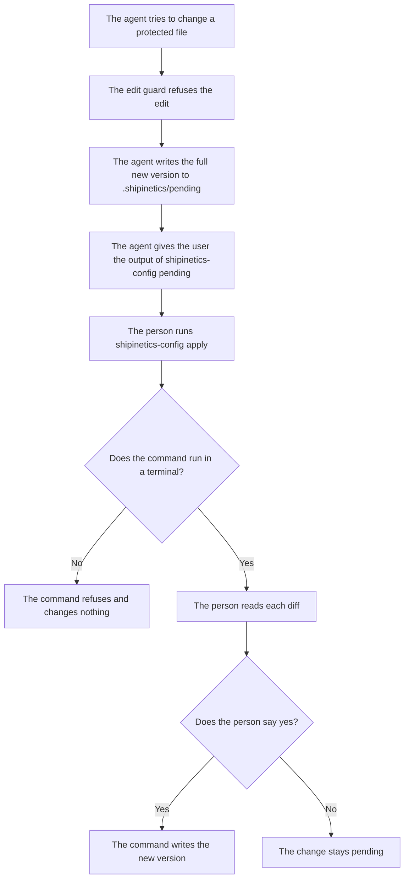

# Protected files change only through a person at a terminal

An agent can create a protected file (an acceptance test, a baseline, a policy list). But the agent can't change or delete one. Changes to the settings of the harness itself go by the same route, because the harness keeps those settings from agents. The agent writes a pending change. Then a person applies it with `shipinetics-config apply`. That command refuses to run without a terminal.

We chose this because these files define what "done" means. Without this rule, an agent under pressure to pass can change the target instead of the code. The cost is a For you item after each setup or update that touches these files.

This diagram shows the route of a change to a protected file. The code is in `scripts/guard-edits.sh` and `bin/shipinetics-config` (`apply_pending`).

