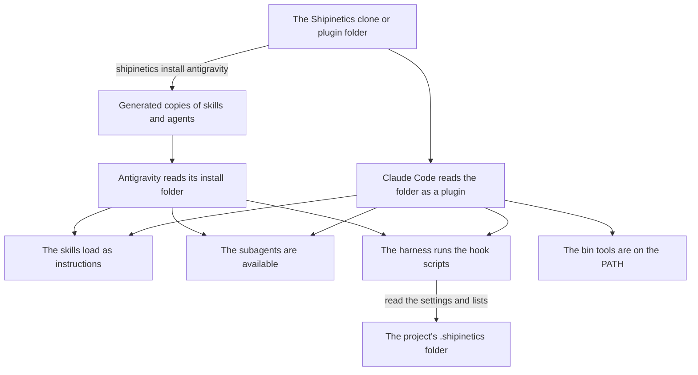
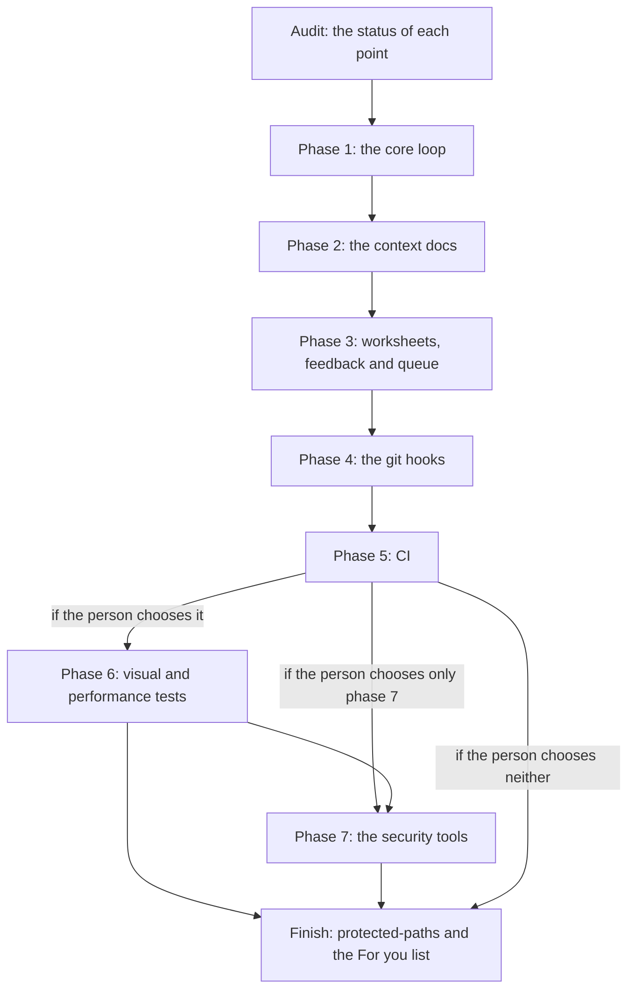
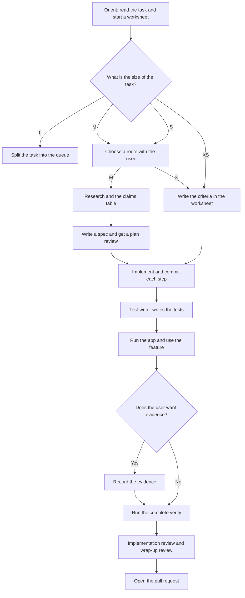
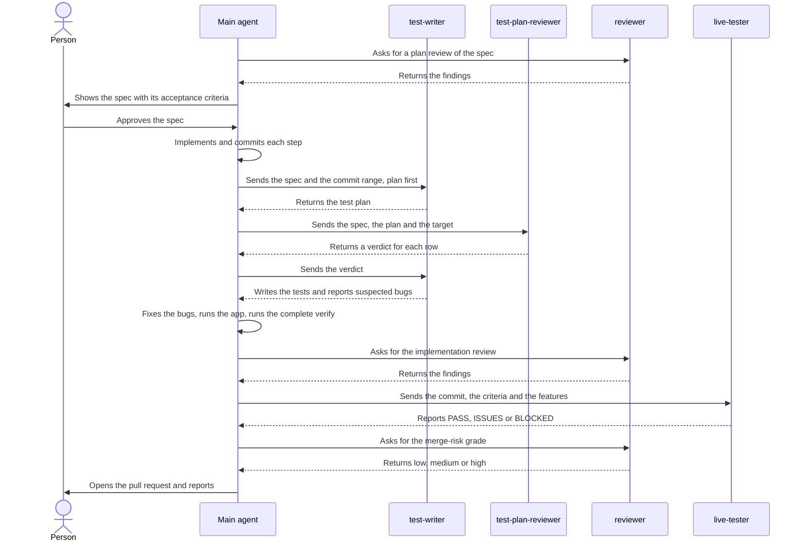
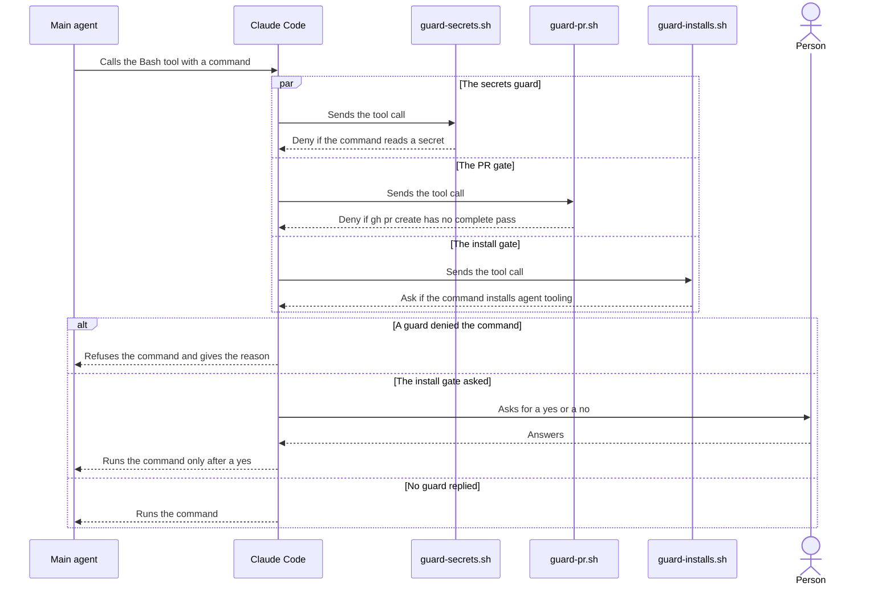
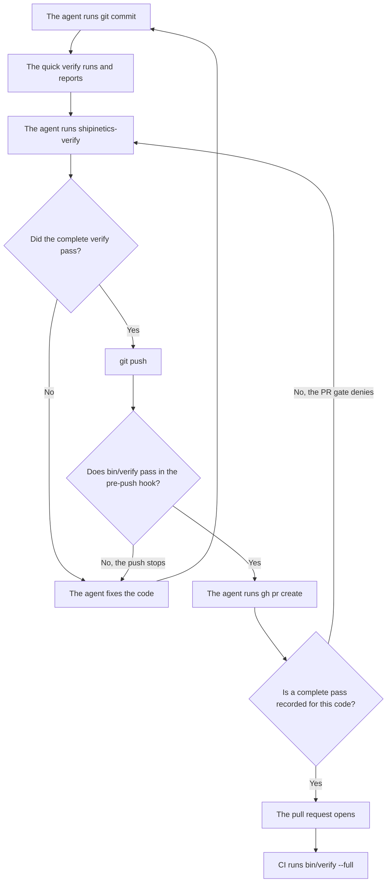
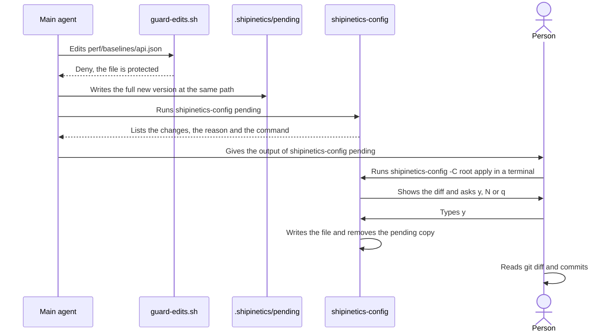
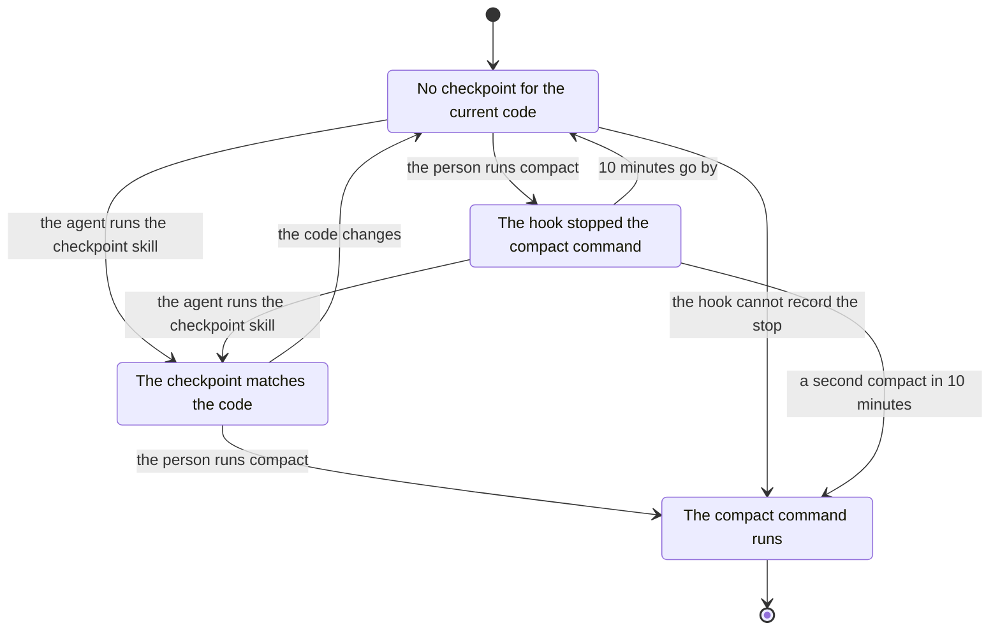
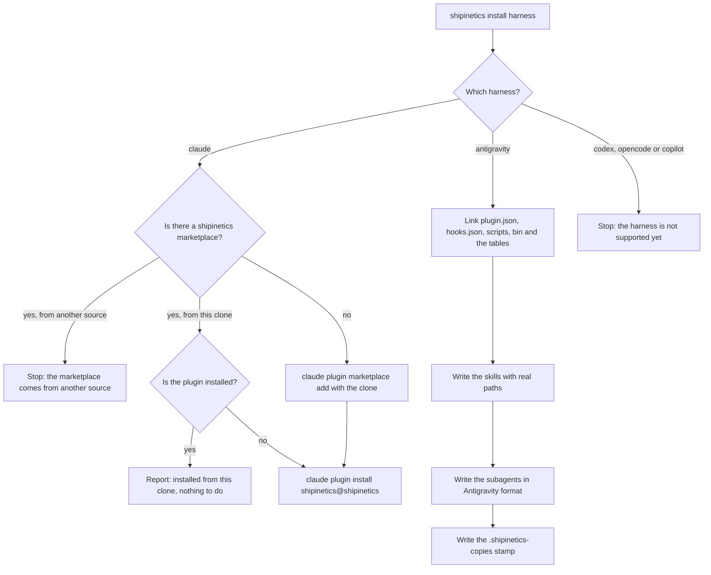

# How Shipinetics works

This page explains how Shipinetics works, from the install to the pull request. It is for a new user who wants to know what happens in a session, and for a new contributor who wants to know which file does what. The terms are in [GLOSSARY.md](../GLOSSARY.md), and the decisions are in [docs/adr/](adr/README.md).

Shipinetics has two kinds of rules:

- An [instruction](../GLOSSARY.md#rules-and-how-they-hold) is a rule that a skill tells the agent to follow. Nothing stops the agent when it does not follow it.
- An [enforcement](../GLOSSARY.md#rules-and-how-they-hold) is a rule that code checks every time. The code blocks the action and gives the reason when the check fails.

Most of the task loop is instructions. The guards, the gates and the git hooks are enforcement. This page says which is which.

## 1. The parts

Shipinetics is one folder: a clone of the repo, or the copy that Claude Code installs from its marketplace. The folder holds these parts:

| Part | Where | What it does |
|---|---|---|
| Skills | [`skills/*/SKILL.md`](../skills/) | Instructions that the agent loads for a job: the task loop, setup, testing, review and others |
| Subagents | [`agents/*.md`](../agents/) | Separate agents with a fresh context, their own tools and their own model: test-writer, test-plan-reviewer, reviewer, security-reviewer, ui-reviewer and live-tester |
| Hook lists | [`hooks/hooks.json`](../hooks/hooks.json) for Claude Code, [`hooks.json`](../hooks.json) for Antigravity | They tell the harness which script to run at each hook event |
| Hook scripts | [`scripts/*.sh`](../scripts/), with the shared helpers in [`scripts/lib.sh`](../scripts/lib.sh) | The guards, the gates and the notices |
| Tools | [`bin/`](../bin/) | Commands for the agent and for the person: `shipinetics-verify`, `shipinetics-config`, `worksheet`, `evidence` and others |
| Tables | [`companions.tsv`](../companions.tsv), [`harnesses.tsv`](../harnesses.tsv) | The companions, and what each harness enforces |
| Manifests | [`.claude-plugin/plugin.json`](../.claude-plugin/plugin.json), [`plugin.json`](../plugin.json) | The plugin name and version for Claude Code and for Antigravity |

A project gets its own part when a person runs setup: the `.shipinetics/` folder. That folder holds the project's settings and policy lists. A project with that folder is a [set-up project](../GLOSSARY.md#projects), and the folder that holds it is the [Shipinetics root](../GLOSSARY.md#projects).

The diagram shows how a harness loads the parts, and how the hooks read the project's folder.

Claude Code reads the plugin folder directly. It fills in `${CLAUDE_PLUGIN_ROOT}` and `${CLAUDE_SKILL_DIR}` in the skill text itself, and it puts `bin/` on the PATH of its Bash tool. Antigravity does not fill in those paths, so it gets [generated copies](../GLOSSARY.md#where-it-runs) ([ADR 0001](adr/0001-generated-copies-per-harness.md), and section 9).

## 2. Set up a project

A person runs `/shipinetics:setup` in the project. The skill is [`skills/setup/SKILL.md`](../skills/setup/SKILL.md), and its templates are in [`skills/setup/templates/`](../skills/setup/templates/). Setup audits the project first. It never overwrites a file: it merges into a file that exists and shows the diff. It asks all its questions in one message. Then it runs the phases, and each phase ends with a proof that the new part works.

The diagram shows the phases in order and the main files that each phase writes.

| Phase | What it writes |
|---|---|
| Audit | `docs/shipinetics-setup.md`, the setup log. It holds the status table, the proof of each phase and the For you list |
| 1 | `bin/verify` with three verify tiers. `.shipinetics/config`, `test-paths`, `ui-paths`, `secrets.list` and, when needed, `secret-paths`. The `.gitignore` and `.gitattributes` lines. `AGENTS.md` with the Shipinetics block, and `CLAUDE.md` that imports it. `bin/with-secrets` for Google Secret Manager or Infisical. The testing guide and test index in `docs/testing/`. A smoke test, which test-writer writes from `docs/specs/smoke.md`. The verification map in `docs/verification/`. A pending change for `.claude/settings.json` |
| 2 | `docs/systems/*.md`, `docs/conventions.md`, and for UI projects `DESIGN.md` |
| 3 | `docs/worksheets/_template.md`, `docs/agent-feedback.md`, `TODOS.md` |
| 4 | `.githooks/pre-commit`, `.githooks/commit-msg`, `.githooks/pre-push`, `bin/lint-fix`, `bin/llm-fix`, and `git config core.hooksPath .githooks` |
| 5 | `.github/workflows/verify.yml`, which runs `bin/verify --full` |
| 6 | One visual test and one benchmark, with baselines |
| 7 | The security targets in `AGENTS.md` and `security_audit_every` in the config |
| Finish | `.shipinetics/protected-paths`. Setup writes it last, because the list protects `.shipinetics/` itself |

The Shipinetics block is the part of `AGENTS.md` between the `shipinetics:begin` and `shipinetics:end` lines. Shipinetics replaces it at each update (`/shipinetics:setup update`). The project's own text outside the block stays.

The [For you list](../GLOSSARY.md#rules-and-how-they-hold) holds only the steps that the person must do: a login, a choice, an apply in their own terminal, or a change outside the repo.

## 3. The task loop

The workflow skill, [`skills/workflow/SKILL.md`](../skills/workflow/SKILL.md), is the standard loop for each [task](../GLOSSARY.md#the-task-loop). The loop is instructions, but the guards and gates enforce some steps.

The main agent gives each task a [size](../GLOSSARY.md#the-task-loop): XS, S, M or L. The size sets which steps the task can skip. An L task does not start: the agent splits it into smaller tasks in the [task queue](../GLOSSARY.md#the-task-loop) ([`skills/task-queue/SKILL.md`](../skills/task-queue/SKILL.md)). Verify, running the app, test-writer and the gates apply to every size.

The diagram shows the loop and its decisions.

The steps, in short:

1. **Orient.** The agent reads the task, starts or resumes a [worksheet](../GLOSSARY.md#the-task-loop) with `worksheet new`, and reads the system docs, the glossary and the ADRs for the area. It runs `shipinetics-verify` once, so it knows about failures that were there before.
2. **Route.** For S and up, the agent offers two or three [routes](../GLOSSARY.md#the-task-loop) with the companion skills that each route uses, and the user chooses one.
3. **Research** (M and up). The agent reads the code paths and writes each claim with its evidence in the worksheet.
4. **Spec and plan.** For M and up, the agent writes a [spec](../GLOSSARY.md#the-task-loop) with [acceptance criteria](../GLOSSARY.md#the-task-loop) (`AC1`, `AC2` ...) and gets a plan review. For S and XS, the criteria go in the worksheet.
5. **Implement.** The agent makes small steps and commits each one with a `Worksheet:` trailer. The pre-commit hook refuses a commit over 400 changed lines, by default.
6. **Tests.** Test-writer writes the tests, not the main agent (section 4).
7. **Run the app.** The agent starts the app from the [verification map](../GLOSSARY.md#checks) and uses the feature through each entry point. Then it asks the user once whether to record [evidence](../GLOSSARY.md#checks) ([ADR 0005](adr/0005-evidence-is-the-users-choice.md)).
8. **Verify.** The agent runs `shipinetics-verify`. "Done" means that the complete verify passed on the final code (section 6).
9. **Review.** Each task above XS gets an implementation review. Tasks S and up get a wrap-up review ([`skills/review/SKILL.md`](../skills/review/SKILL.md)). For M and up, and for each change to UI, live-tester also uses the change in the app.
10. **Wrap up.** The agent updates the docs and the queue, writes the [feedback log](../GLOSSARY.md#the-task-loop), gets the [merge-risk grade](../GLOSSARY.md#checks) and opens the pull request.

## 4. Who does what

The [main agent](../GLOSSARY.md#agents) writes the code and runs the loop. It never reviews its own work and never writes its own tests. [Subagents](../GLOSSARY.md#agents) do that work, each in a fresh context:

| Subagent | File | Model and effort | What it does |
|---|---|---|---|
| test-writer | [`agents/test-writer.md`](../agents/test-writer.md) | Opus, medium | Writes and changes tests from the acceptance criteria. It is the only agent that can edit test files ([ADR 0003](adr/0003-only-test-writer-writes-tests.md)). It reports suspected bugs, and does not fix source |
| test-plan-reviewer | [`agents/test-plan-reviewer.md`](../agents/test-plan-reviewer.md) | Sonnet, high | Reviews test-writer's plan against the spec before any test is written. It gives KEEP, CUT, MERGE, MOVE or REWRITE for each row |
| reviewer | [`agents/reviewer.md`](../agents/reviewer.md) | Opus, high | Reviews research, plans, diffs, docs and wrap-ups, with a persona when one applies. It also gives the merge-risk grade. It never edits files |
| security-reviewer | [`agents/security-reviewer.md`](../agents/security-reviewer.md) | Opus, medium | Reviews a change that touches security, with the `security-audit` companion |
| ui-reviewer | [`agents/ui-reviewer.md`](../agents/ui-reviewer.md) | Opus, medium | Reviews a change that touches UI against `DESIGN.md`, with the Impeccable companion and real screenshots |
| live-tester | [`agents/live-tester.md`](../agents/live-tester.md) | Sonnet, medium | Uses the change in the real running app at wrap-up. It reports PASS, ISSUES or BLOCKED for each feature |

The subagent files name Claude models today. [ADR 0007](adr/0007-models-by-role.md) plans a model role for each subagent in place of a model, but that is not built yet.

The diagram shows the order of the work in one M task, from the spec to the pull request.

The main agent sends the verdict to the same test-writer with SendMessage, so test-writer keeps its context. For S tasks, and for a request with only `regression` mode, the plan review does not run ([`skills/testing/SKILL.md`](../skills/testing/SKILL.md)). The main agent answers each review finding in the worksheet: fixed, disagree, deferred or spec updated.

## 5. The hooks

A hook is how a harness runs a script at an event. The scripts read the event as JSON on stdin, with `jq` or `python3`. If neither runs on the machine, the guards let every action through, and the session-start notice warns about it.

A PreToolUse script gives one of three replies:

- **No reply.** The script has no opinion, and the harness asks its normal permission questions.
- **Deny.** The harness refuses the tool call and shows the agent the reason.
- **Ask.** The harness asks the person before it runs the tool call. Only the install gate uses this reply.

The diagram shows one Bash command in Claude Code, and the three PreToolUse guards that read it.

Each hook in [`hooks/hooks.json`](../hooks/hooks.json) (Claude Code) and [`hooks.json`](../hooks.json) (Antigravity):

| Event | Script | Name in `hooks_off` | What it checks | Result |
|---|---|---|---|---|
| SessionStart | [`companions-notice.sh`](../scripts/companions-notice.sh) | `notice` | Missing companions, no JSON parser, a project that names a newer Shipinetics version, generated copies older than the clone | Informs |
| SessionStart | [`shims-auto.sh`](../scripts/shims-auto.sh) | `shims` | Writes or refreshes the short commands in `~/.local/bin` when that folder is on the PATH | Informs |
| SessionStart | [`worktree-notice.sh`](../scripts/worktree-notice.sh) | `worktrees` | A git worktree where Shipinetics cannot find the project's settings | Informs |
| PreToolUse, file edits | [`guard-edits.sh`](../scripts/guard-edits.sh) | `edits` | A change to a protected file. A test file edit by an agent that is not test-writer. A source edit by test-writer | Denies |
| PreToolUse, Bash and Read | [`guard-secrets.sh`](../scripts/guard-secrets.sh) | `secrets` | Environment dumps, inline scripts that read the environment, a print of a secret-looking variable, vault reads, secret files | Denies |
| PreToolUse, Bash | [`guard-pr.sh`](../scripts/guard-pr.sh) | `pr` | `gh pr create` or `gh pr ready` without a complete pass on the exact code | Denies |
| PreToolUse, Bash | [`guard-installs.sh`](../scripts/guard-installs.sh) | `installs` | An install or update of a skill, plugin, marketplace or MCP server, `shipinetics-update merge` and `shipinetics install` | Asks the person |
| PostToolUse, Bash (Claude Code only) | [`verify-after-commit.sh`](../scripts/verify-after-commit.sh) | `verify` | Runs the quick verify after a `git commit` | Informs, never blocks |
| PreCompact, manual (Claude Code only) | [`compact-checkpoint.sh`](../scripts/compact-checkpoint.sh) | `compact` | A docs checkpoint for the current code | Stops `/compact` once (section 8) |
| SessionEnd (Claude Code), Stop (Antigravity) | [`usage-record.sh`](../scripts/usage-record.sh) | `usage` | Records the tokens of the session from its transcript. No model runs | Records, and says nothing |

In Claude Code, the SessionStart scripts run only for a new session (the matcher `startup`). The secrets guard and the install gate act in every project. The edit guard acts when the project that holds the file has the lists. The PR gate, the verify after a commit and the docs check before `/compact` act only in a set-up project.

The edit guard sees only the file tools of the harness. A Bash command such as `sed -i` or `mv` can still change a protected file or a test file. That is a gap in the enforcement, not a permission: the reviewers check the diffs for it.

## 6. The gates

[Verify](../GLOSSARY.md#checks) runs the project's own checks through Shipinetics, so that Shipinetics records the pass. [`bin/shipinetics-verify`](../bin/shipinetics-verify) runs one [verify tier](../GLOSSARY.md#checks):

| Tier | Command | Who runs it, and when |
|---|---|---|
| quick | `verify_quick_cmd` (for example `bin/verify --quick`) | The agent, after each step. It checks only the changed files, which it gets from `$SHIPINETICS_CHANGED_FILES`. Without a quick tier, quick runs the complete command. In Claude Code, a hook also runs it after each `git commit`, but only when the project has a quick tier |
| complete | `verify_cmd` (default `bin/verify`) | The agent, before it says a task is done. The PR gate needs a recorded pass of this tier. The pre-push hook runs `bin/verify` itself on each push |
| full | `bin/verify --full` | CI, on each pull request. Shipinetics does not record it |

A [recorded pass](../GLOSSARY.md#checks) is a fingerprint of the code's contents, in `.shipinetics/.cache/pass-quick` or `pass-complete`. The fingerprint does not depend on the commit, so a commit of verified code keeps the pass. A change to only the worksheets, the evidence or the feedback log also keeps it. Any other change needs a new run. A complete pass also counts as a quick pass.

The push is the hard gate, and the check after a commit only reports ([ADR 0002](adr/0002-push-is-the-hard-verify-gate.md)). The task loop needs commits with failing tests: the agent commits the code before test-writer changes the tests of the changed behaviour.

The diagram shows the checks between a commit and a merged pull request.

What each gate checks:

- **The pre-push hook** ([`skills/setup/templates/pre-push`](../skills/setup/templates/pre-push)) runs `bin/verify` on each push and shows each check with its time. It stops the push when a check fails. It is a git hook in the project, so it works without the plugin. `git push --no-verify` skips it for one push.
- **The PR gate** ([`scripts/guard-pr.sh`](../scripts/guard-pr.sh)) denies `gh pr create` and `gh pr ready` until a complete pass is recorded for the exact code. A branch that changes only `docs/` and Markdown files passes with no verify. The gate does not ask for evidence.
- **CI** ([`skills/setup/templates/github/workflows/verify.yml`](../skills/setup/templates/github/workflows/verify.yml)) runs `bin/verify --full` on each pull request and on each push to `main`.

A test that fails and then passes on a re-run is a [flaky test](../GLOSSARY.md#checks). It counts as a failure. [`bin/known-failing`](../bin/known-failing) names it, and the check still fails.

## 7. Protected files and pending changes

A [protected file](../GLOSSARY.md#rules-and-how-they-hold) defines what "done" means: an acceptance test, a baseline or a policy list. `.shipinetics/protected-paths` lists them, and `.shipinetics/*` is on the list, so an agent cannot change its own rules. An agent can create a protected file, but it cannot change one. Only a person applies a change, in a terminal ([ADR 0004](adr/0004-protected-files-change-through-a-person.md)). Changes to `.claude/settings.json` take the same route, because Claude Code stops agents from editing it.

The diagram shows how a [pending change](../GLOSSARY.md#rules-and-how-they-hold) goes from the agent to the file.

The rules of the flow, from [`bin/shipinetics-config`](../bin/shipinetics-config) and [`scripts/guard-edits.sh`](../scripts/guard-edits.sh):

- A pending change is the full new version of the file at `.shipinetics/pending/<path>`. The edit guard never protects a file in the pending folder. The guard checks the test rules on a pending file as if it was the file that it replaces, so only test-writer writes a pending change to a test.
- To delete a protected file, the agent adds its path, relative to the root, as a line in `.shipinetics/pending/.delete`. `apply` asks about each deletion after the new versions, and only if the person did not type `q`. `apply` does not delete a folder: the person deletes it.
- `apply` refuses to run without a terminal on stdin. So an agent's Bash tool cannot run it. It is an obstacle that slows the agent, not a lock.
- `apply` refuses a path that leads outside the root, and a target that is a symlink.
- At the end of the task, the agent gives the person the output of `shipinetics-config pending`. That output gives the reason and the exact command, with the full path when the short commands are not installed.

**Worktrees.** A git worktree of a set-up repo can have no `.shipinetics/config` of its own, for example when the settings are not committed. Then the first Shipinetics script that runs there copies the main checkout's `.shipinetics/` into the worktree ([`sy_root` and `sy_wt_sync` in `scripts/lib.sh`](../scripts/lib.sh)). The copy does not include `.cache/`, `pending/` or `explainers/`, because each checkout has its own. The copy holds a `.gitignore` with the line `*`, so git ignores the copy in that worktree only. When the worktree's branch tracks files in `.shipinetics/`, Shipinetics stops the copy and uses the tracked files. `.shipinetics/.copied-from` names the source, and the copy refreshes when the source changes. In a worktree with such a copy, `apply` writes a change to a file under `.shipinetics/` to the main checkout's file, and the worktree's copy follows at the next run. A change to any other file goes to the worktree's file.

## 8. Docs before /compact

`/compact` replaces the conversation with a summary, and a summary keeps less than the docs do. So in Claude Code, `/compact` waits for a [docs checkpoint](../GLOSSARY.md#the-task-loop). The person runs `/shipinetics:checkpoint` ([`skills/checkpoint/SKILL.md`](../skills/checkpoint/SKILL.md)). The agent then writes the session's terms to `GLOSSARY.md`, its decisions to `docs/adr/`, the changed system docs and the worksheet. Last, it runs `shipinetics-checkpoint record` ([`bin/shipinetics-checkpoint`](../bin/shipinetics-checkpoint)).

The checkpoint is the fingerprint of the code, in `.shipinetics/.cache/docs-checkpoint`. It uses the same fingerprint as a verify pass.

The diagram shows the states of the check in [`scripts/compact-checkpoint.sh`](../scripts/compact-checkpoint.sh).

When the hook stops `/compact`, it exits with code 2 and tells the person the two steps. When `/compact` runs, the hook prints a list of what the summary must keep: the current worksheet, the open criteria, the settled decisions, the uncommitted files and the next step. The hook does nothing for an automatic compaction. No compaction hook is known for Antigravity, so there the checkpoint is an instruction only.

## 9. Install on each harness

[`bin/shipinetics`](../bin/shipinetics) installs Shipinetics from a clone into a [harness](../GLOSSARY.md#where-it-runs) ([ADR 0006](adr/0006-local-clone-on-every-harness.md)). Claude Code can also install it from GitHub: `claude plugin marketplace add DreKwasi/shipinetics`, then `claude plugin install shipinetics@shipinetics`.

| Command | What it does |
|---|---|
| `shipinetics install <harness>` | Installs into the harness. The install gate asks the person first |
| `shipinetics refresh [<harness>]` | Makes the generated copies match the clone again |
| `shipinetics status [<harness>]` | Shows what is installed, whether the copies are current, and what each harness enforces, from `harnesses.tsv` |
| `shipinetics uninstall <harness>` | Removes the files that the install wrote. Another file in the folder stays |
| `shipinetics uninstall --all` | Removes Shipinetics from this machine, after one confirmation. The README section [Remove Shipinetics](../README.md#remove-shipinetics) also gives the steps for a project |
| `shipinetics link-skills antigravity` | Adds `~/.agents/skills` and `~/.claude/skills` to Antigravity's `skills.json` |
| `--dry-run` | Says what the command would do, and changes nothing |

The diagram shows what `shipinetics install` does for each harness.

For Antigravity, the install folder is `~/.gemini/config/plugins/shipinetics`. The installer links the scripts and tools to the clone, so they always come from the clone. It writes generated copies of `skills/` with `${CLAUDE_PLUGIN_ROOT}` and `${CLAUDE_SKILL_DIR}` replaced by real paths. It writes each subagent with Antigravity's tool names. The stamp holds a hash of the clone's `skills/` and `agents/`. When the clone changes, the session-start notice says that the copies are older than the clone, and gives `shipinetics refresh antigravity`. `shipinetics-update merge` runs the refresh after an update.

What each harness enforces today, from [`harnesses.tsv`](../harnesses.tsv):

| Check | Claude Code | Antigravity |
|---|---|---|
| Secrets guard, edit guard, PR gate, install gate | Enforced | Enforced |
| Quick verify after a commit | Informs | Instruction: the agent runs `shipinetics-verify quick` |
| Docs before `/compact` | Enforced | Instruction: run `/shipinetics:checkpoint` before you compact |
| Notices, short commands, usage log | Work | Work |

Codex, OpenCode and Copilot have no adapter yet. `shipinetics status` shows what each one can enforce when its adapter exists. In each harness, the git hooks and CI still check the code.

Antigravity sends no agent type for main agents or subagents. So the edit guard enforces the test-writer rule there only when the hook input has an agent type.

## 10. Where state lives, and how to turn a hook off

| Path | What it holds | In git |
|---|---|---|
| `.shipinetics/config` | The project's settings, as `key = value` lines. `shipinetics-config` prints them | Yes |
| `.shipinetics/protected-paths`, `test-paths`, `ui-paths` | The policy lists for the edit guard and for evidence | Yes |
| `.shipinetics/secrets.list`, `secret-paths` | The names of the secrets, and the secret files that the secrets guard blocks | Yes |
| `.shipinetics/known-failing` | The quarantined test IDs | Yes |
| `.shipinetics/pending/` | Pending changes, and `.delete` for pending deletions | Not ignored. `apply` removes each file that it applies |
| `.shipinetics/.cache/` | Recorded passes, `docs-checkpoint`, `compact-blocked`, `current-worksheet`, `verify-times.tsv`, `flaky.tsv` and the verify log | No |
| `.shipinetics/.copied-from` | In a worktree with a copy of the settings: the main checkout that they came from | No. The worktree's git ignores the copy |
| `.shipinetics/.gitignore` (in a worktree with a copy) | The line `*`, so that git ignores the copy in that worktree only | No |
| `docs/worksheets/` | The worksheets | Yes |
| `docs/evidence/` | `EVIDENCE.md` and terminal logs. Recordings never go in git | Yes |
| `docs/specs/`, `docs/systems/`, `docs/verification/`, `docs/adr/`, `GLOSSARY.md` | Specs, system docs, the verification map, decisions and terms | Yes |
| `TODOS.md`, `docs/agent-feedback.md` | The task queue and the feedback log | Yes |
| `~/.config/shipinetics/config`, `~/.config/shipinetics/secret-paths` | The person's own settings for every project | No |
| `~/.local/share/shipinetics/usage.tsv` | The usage log | No |
| `~/.cache/shipinetics/` | The weekly stamp of the companions notice, and on Windows the Python that Shipinetics found | No |
| `~/.local/bin/shipinetics-*` | The short commands from `shipinetics-shims` | No |
| `~/.gemini/config/plugins/shipinetics/` | The Antigravity install, with its `.shipinetics-copies` stamp | No |
| `~/.gemini/config/skills.json` | The entries `~/.agents/skills` and `~/.claude/skills`, when `shipinetics link-skills antigravity` added them | No |

The paths under `docs/` are the defaults. A project can map them to other paths in `.shipinetics/config`.

**Turn a hook off.** Each hook has a name: `edits`, `secrets`, `pr`, `installs`, `worktrees`, `shims`, `verify`, `compact`, `notice` and `usage`. [`sy_hook_off` in `scripts/lib.sh`](../scripts/lib.sh) reads the names from three places:

1. `SHIPINETICS_HOOKS_OFF` in the environment, for one session. It always applies.
2. `hooks_off` in the project's `.shipinetics/config`, for the whole team.
3. `hooks_off` in `~/.config/shipinetics/config`, for every project. It applies only when the project config does not set `hooks_off`.

For example, `hooks_off = installs compact` turns off the install gate and the docs check before `/compact`.

Some guards also have a variable for one session. The person sets it when they start the harness:

| Variable | Effect |
|---|---|
| `SHIPINETICS_UNLOCK=1` | Agents can edit protected files |
| `SHIPINETICS_ALLOW_AUTHOR_TESTS=1` | Any agent can edit test files |
| `SHIPINETICS_ALLOW_ENV_READ=1` | The secrets guard is off |
| `SHIPINETICS_SKIP_VERIFY=1` | The PR gate is off |
| `SHIPINETICS_ALLOW_INSTALLS=1` | The install gate is off |
