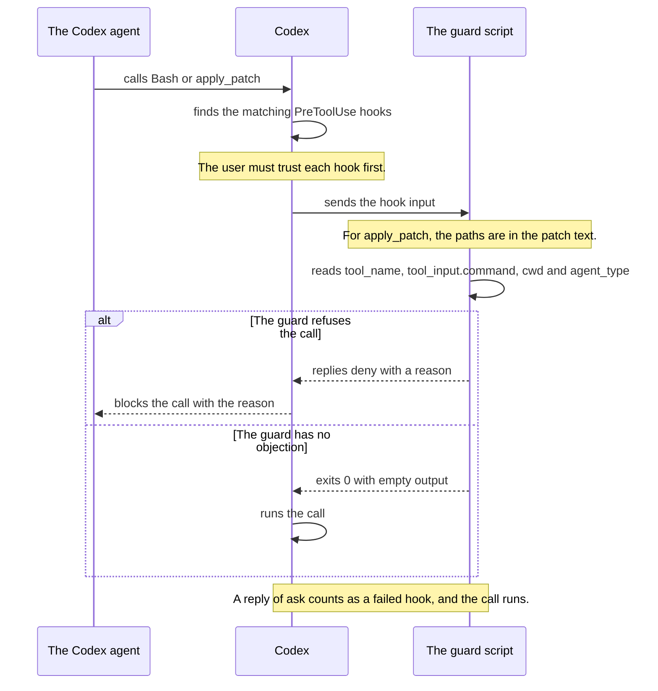

# OpenAI Codex as a harness for Shipinetics

Checked: 2026-11-22

Sources:

- The official Codex docs. They now live at `learn.chatgpt.com/docs`. `developers.openai.com/codex/*` returns a 308 redirect there. For example, `https://developers.openai.com/codex/hooks` goes to `https://learn.chatgpt.com/docs/hooks`. I read the Markdown version of each page (add `.md` to the URL).
- The plugin packaging docs at `developers.openai.com/plugins`.
- The source code of the repository `openai/codex` at commit `ba1c17f9600a44d7dadb0b867690a9d936150e8d` (branch `main`, 2026-11-22). In the source links below, `SRC` stands for `https://github.com/openai/codex/blob/ba1c17f9600a44d7dadb0b867690a9d936150e8d`.

The latest stable release is `rust-v0.171.0` (2026-11-20, https://github.com/openai/codex/releases). Where `main` and the docs differ, I checked the release tag too, and I say so. I checked every claim on 2026-11-22.

## Summary

Shipinetics can move to Codex and keep most of its enforcement, because Codex copied the Claude Code hook protocol on purpose.

Codex reads a Claude-style plugin:

- It finds `.claude-plugin/plugin.json` and `.claude-plugin/marketplace.json`.
- It loads `skills/` and `hooks/hooks.json` from the plugin root.
- It sets `CLAUDE_PLUGIN_ROOT` for hook commands.

The hook input uses the same snake_case fields (`tool_name`, `tool_input.command`, `cwd`, `session_id`, `agent_type`). A `PreToolUse` hook denies a call with the same `hookSpecificOutput.permissionDecision: "deny"` reply. So the secrets guard, the PR gate and the install gate stay enforced for shell commands. The edit guard also stays enforced, because the `PreToolUse` input inside a subagent holds `agent_type` (the name of the custom agent).

Shipinetics needs four changes:

1. The edit guard must read the file paths from the `apply_patch` text. There is no `file_path` field.
2. The install gate must reply `deny`, not `ask`. Codex treats `ask` as a failed hook and lets the command run.
3. Codex limits `SessionEnd` hooks to 3 seconds.
4. The user must review and trust each hook in `/hooks`. Until then, the hook doesn't run.

The quick verify after a commit, the companions notice and the usage log map to `PostToolUse`, `SessionStart` and `SessionEnd`. The transcripts are JSONL with token counts.

These parts become instructions only, or they need more work:

- The tool list of each agent. A custom agent can't get a read-only tool list. It can only turn off the shell or other features. A `PreToolUse` hook can still deny edits by agent type.
- The Claude Code deny rules. They become Codex `.rules` files.
- The custom agents. A plugin can't ship them, so an installer must write them as TOML into `~/.codex/agents/`.

The default sandbox also blocks writes to `.git`, all network access and all local ports. So `git commit`, `gh pr create` and the runs of the live app need an approval or a wider permission profile.

## Table

| Row | Supported? (yes, partly, no, unverified) | How | Source (URL) |
|---|---|---|---|
| 1. Instruction files | yes | Codex reads `~/.codex/AGENTS.override.md` or `~/.codex/AGENTS.md` (global). Then it reads one file in each folder from the project root down to the working folder (`AGENTS.override.md`, `AGENTS.md`, then `project_doc_fallback_filenames`). It joins them with the root first. `project_doc_max_bytes` limits the project files together (32 KiB by default). Codex skips the project files in untrusted projects | https://learn.chatgpt.com/docs/agent-configuration/agents-md , SRC/codex-rs/core/src/agents_md.rs |
| 2. Skills | yes | `SKILL.md` folders with `name` and `description` (and an optional `metadata.short-description`). Codex reads them from `.agents/skills` in each folder from the working folder up to the repo root, `~/.agents/skills`, `$CODEX_HOME/skills` (deprecated), the project `.codex/skills`, `/etc/codex/skills`, the built-in skills and the enabled plugins. The model starts a skill by itself (implicit), or the user starts it with `$name` or `/skills` (explicit). The name of a plugin skill is `plugin:skill` | https://learn.chatgpt.com/docs/build-skills , SRC/codex-rs/ext/skills/src/host_roots.rs , SRC/codex-rs/skills/src/parser.rs |
| 3. Custom slash commands | partly | Custom prompts in `~/.codex/prompts/*.md` (frontmatter `description` and `argument-hint`, and the arguments `$1`..`$9`, `$ARGUMENTS` and named `$KEY`) run as `/prompts:<name>`. Codex deprecated them, and skills replace them. At install, Codex changes the Claude-style `commands/` folder of a plugin into skills | https://learn.chatgpt.com/docs/custom-prompts , SRC/codex-rs/core-plugins/src/command_migration/plugin.rs |
| 4. Subagents | partly | Custom agents are TOML files in `~/.codex/agents/` or `.codex/agents/`, with `name`, `description`, `developer_instructions`, and an optional `model` and `model_reasoning_effort`. There is no tool allowlist. An agent can only turn off `features.shell_tool`, `apps`, `plugins`, `memories`, `request_permissions_tool` and skills. The main agent calls the `spawn_agent` tool with `agent_type`. A subagent starts with a fresh context by default (`fork_context` omitted). The sandbox and the approvals always come from the parent. Plugins can't ship agents | https://learn.chatgpt.com/docs/agent-configuration/subagents , SRC/codex-rs/core/src/tools/handlers/multi_agents_spec.rs , SRC/codex-rs/agent-roles/src/agent_role_config.rs |
| 5. Hooks | yes | `hooks.json` (the same shape as in Claude Code) in `/etc/codex/`, `$CODEX_HOME/`, a trusted `.codex/`, or the `hooks/hooks.json` of a plugin. Or `[hooks]` in `config.toml`. Events: `SessionStart`, `SessionEnd`, `PreToolUse`, `PermissionRequest`, `PostToolUse`, `PreCompact`, `PostCompact`, `UserPromptSubmit`, `SubagentStart`, `SubagentStop`, `Stop`, `Interrupt`, `PreModelRequest`, `PostModelRequest`. `PreToolUse` denies with `permissionDecision: "deny"`, `{"decision":"block"}` or exit 2. Codex doesn't support `ask`. `PostToolUse` adds `additionalContext`. The default timeout is 600 seconds. For `SessionEnd` and `Interrupt`, it is 1 second, with a maximum of 3 seconds. The user must trust each hook in `/hooks` | https://learn.chatgpt.com/docs/hooks , SRC/codex-rs/hooks/schema/generated/ |
| 6. Plugins | yes | A portable `plugin.json` with the Agent Plugins `$schema`, or `.codex-plugin/plugin.json`, `.claude-plugin/plugin.json` or `.cursor-plugin/plugin.json`. Marketplaces: `.agents/plugins/marketplace.json` or `.claude-plugin/marketplace.json`. Local install: `codex plugin marketplace add <local folder>`, then `codex plugin add <plugin>@<marketplace>`. The install puts a copy under `~/.codex/plugins/cache/`. A public directory exists, but it can't list plugins that have hooks | https://developers.openai.com/plugins/build/plugins , SRC/codex-rs/utils/plugins/src/plugin_namespace.rs , SRC/codex-rs/core-plugins/src/marketplace.rs , SRC/codex-rs/cli/src/plugin_cmd.rs |
| 7. MCP | yes | Codex is a client for stdio servers (`command`, `args`, `env`) and streamable HTTP servers (`url`, bearer token, headers, OAuth), set in `[mcp_servers.<name>]` of `~/.codex/config.toml` or of a trusted `.codex/config.toml`. Commands: `codex mcp add`, `codex mcp login`, `/mcp`. Plugins can include `mcp.json` or `.mcp.json` | https://learn.chatgpt.com/docs/extend/mcp |
| 8. Model selection | yes | `model` and `model_reasoning_effort` in `config.toml`. `--model` or `-m`. `/model`. Profiles in `~/.codex/<name>.config.toml`, with `--profile`. For each subagent: in the agent TOML, or in `[agents] default_subagent_model`. `codex debug models` prints the catalog. Current models: `gpt-6.2-astra`, `gpt-6.2-sol`, `gpt-6.1-sol`, `gpt-6.1-terra`, `gpt-6-astra`, `gpt-6-luna`. Efforts, which depend on the model: `low`, `medium`, `high`, `xhigh`, `max`, `ultra` | https://learn.chatgpt.com/docs/models , https://learn.chatgpt.com/docs/config-file/config-advanced , https://learn.chatgpt.com/docs/developer-commands |
| 9. Plans and usage | yes | Plus ($20) and higher plans include Codex in the CLI, the IDE, the web and iOS. Free and Go get GPT-6 Luna in the desktop app, subject to rollout. Pro costs $100, $200 or $500. Business costs $20 per user per month (annual). Plus and Standard Business get a usage allowance for each five-hour window. Pro has no five-hour limit now. Weekly limits may apply. Credits add to the allowance. Use with an API key costs API prices and has no cloud features | https://learn.chatgpt.com/docs/pricing |
| 10. Transcripts | yes | JSONL rollouts at `$CODEX_HOME/sessions/YYYY/MM/DD/rollout-<timestamp>-<thread id>.jsonl`. Each line is `{"timestamp", "type", "payload"}`. The token counts are in `event_msg` lines of type `token_count` (`info.total_token_usage`, `info.last_token_usage`) and in `token_usage_record` lines. Each subagent has its own rollout file. Hooks get the path as `transcript_path`, but the format is not a stable interface | https://learn.chatgpt.com/docs/hooks , SRC/codex-rs/rollout/src/recorder.rs , SRC/codex-rs/history/src/rollout_payload.rs , SRC/codex-rs/protocol/src/protocol.rs |
| 11. Sandbox and approvals | yes | `sandbox_mode` (`read-only`, `workspace-write`, `danger-full-access`) and `approval_policy` (`on-request`, `never`, granular). The default is `workspace-write`. It allows writes only in the workspace and the temp folders. `.git`, `.agents`, `.codex` and `.aws` stay read-only. It allows no network and no local ports (`allow_local_binding = false`). `.rules` files (Starlark `prefix_rule`) allow, prompt for or forbid command prefixes | https://learn.chatgpt.com/docs/sandboxing , https://learn.chatgpt.com/docs/agent-approvals-security , https://learn.chatgpt.com/docs/agent-configuration/rules |
| 12. Headless and git/PR | yes | `codex exec` (read-only sandbox by default, `--json` JSONL events, `--output-schema`, `-o`, `resume`), `codex review` (`--uncommitted`, `--base`, `--commit`), the `openai/codex-action` GitHub Action, and cloud reviews on GitHub PRs (`@codex review`, automatic reviews, `## Code Review Rules` in `AGENTS.md`). Codex has no PR gate of its own. The Shipinetics gate stays a `PreToolUse` hook on `gh pr create` | https://learn.chatgpt.com/docs/non-interactive-mode , https://learn.chatgpt.com/docs/developer-commands , https://learn.chatgpt.com/docs/github-action , https://learn.chatgpt.com/docs/code-review |

## 1. Instruction files

Source: https://learn.chatgpt.com/docs/agent-configuration/agents-md (checked 2026-11-22).

- Global: Codex reads `~/.codex/AGENTS.override.md` if it exists. If not, it reads `~/.codex/AGENTS.md`. `CODEX_HOME` moves `~/.codex`. "Codex uses only the first non-empty file at this level."
- Project: "Starting at the project root (typically the Git root), Codex walks down to your current working directory." In each folder, Codex takes the first file that exists: `AGENTS.override.md`, then `AGENTS.md`, then the names in `project_doc_fallback_filenames`. "Codex includes at most one file per directory."
- Merge: "Codex concatenates files from the root down, joining them with blank lines. Files closer to your current directory override earlier guidance because they appear later in the combined prompt."
- Size: "Codex skips empty files and stops adding files once the combined size reaches the limit defined by `project_doc_max_bytes` (32 KiB by default)."
  - The config page (https://learn.chatgpt.com/docs/config-file/config-advanced#project-instructions-discovery) says "how much to read from each `AGENTS.md` file". This conflicts with the sentence above.
  - The source gives the answer. All the project files share one budget, and Codex cuts the file that goes past it (SRC/codex-rs/core/src/agents_md.rs, the `remaining` budget and `data.truncate(remaining)`).
  - The global file doesn't count against the budget ("The limit applies only to project files", SRC/codex-rs/core/src/agents_md_manager.rs).
- Trust: the source returns no project docs when the project is untrusted (`if config.active_project.is_untrusted() || config.project_doc_max_bytes == 0`, SRC/codex-rs/core/src/agents_md.rs line 65).
- Other files: Codex doesn't read `CLAUDE.md` by default. Add it with the fallback list:

```toml
# ~/.codex/config.toml
project_doc_fallback_filenames = ["TEAM_GUIDE.md", ".agents.md"]
project_doc_max_bytes = 65536
```

- Codex builds the chain again at the start of each run or TUI session. `/init` writes a scaffold `AGENTS.md`. The GitHub code review reads a `## Code Review Rules` section from the nearest `AGENTS.md`.
- What this means for Shipinetics: our setup already writes an `AGENTS.md` block. Codex loads it with no change. Codex doesn't need a `CLAUDE.md` that only imports `AGENTS.md`.

## 2. Skills

Sources: https://learn.chatgpt.com/docs/build-skills (2026-11-22), SRC/codex-rs/ext/skills/src/host_roots.rs, SRC/codex-rs/skills/src/parser.rs.

- Format: a folder with `SKILL.md`, and optionally `scripts/`, `references/`, `assets/` and `agents/openai.yaml`. "The `SKILL.md` file must include `name` and `description`."

```md
---
name: skill-name
description: Explain exactly when this skill should and should not trigger.
---

Skill instructions for ChatGPT or Codex to follow.
```

- The parser reads this frontmatter: `name` (the folder name by default, with a maximum length), `description` (required) and `metadata.short-description`. It ignores other keys. The parser repairs frequent YAML mistakes such as `description: Build for AWS: ECS`. Source: `SkillFrontmatter` in SRC/codex-rs/skills/src/parser.rs.
- More settings go in `agents/openai.yaml`: `interface` (display name, icons, `default_prompt`), `policy.allow_implicit_invocation` (`true` by default) and `dependencies.tools` (for example, an MCP server).
- Folders (from the docs table, and the source agrees):
  - `$CWD/.agents/skills`, the `.agents/skills` of each parent folder, up to `$REPO_ROOT/.agents/skills` (scope `REPO`).
  - `$HOME/.agents/skills` (scope `USER`).
  - `$CODEX_HOME/skills`, that is `~/.codex/skills`. The source calls it "Deprecated user skills location (`$CODEX_HOME/skills`), kept for backward compatibility". The bundled `skill-installer` still installs there (SRC/codex-rs/skills/src/assets/samples/skill-installer/SKILL.md).
  - The project `.codex/skills` (the project config layer). Only the source names it. The docs table doesn't.
  - `/etc/codex/skills` (scope `ADMIN`).
  - The bundled system skills (`skill-creator`, `skill-installer`).
  - The skills inside enabled plugins. Each one gets the name `<plugin>:<skill>` (SRC/codex-rs/ext/skills/src/loader/namespace.rs: `format!("{namespace}:{base_name}")`). So `shipinetics:workflow` keeps its name.
  - Skill folders that are symlinks work.
- Invocation: "Explicit invocation: ... In Codex CLI or the IDE extension, run `/skills` or type `$` to mention a skill." "Implicit invocation: ... Codex can choose a skill when your task matches the skill `description`." The model first sees the name, the description and the file path of each skill. This list uses at most 2% of the context window (or 8,000 characters). `skills.max_context_tokens` sets the limit, up to 10,000 tokens.
- Turn off a skill:

```toml
[[skills.config]]
path = "/path/to/skill/SKILL.md"
enabled = false
```

- Codex doesn't replace `${CLAUDE_PLUGIN_ROOT}` and `${CLAUDE_SKILL_DIR}` in skill text. A search of the source found these names only in the hook discovery (SRC/codex-rs/hooks/src/engine/discovery.rs). The model gets the file path of each skill, so paths relative to the skill folder can work.

## 3. Custom slash commands or prompts

Sources: https://learn.chatgpt.com/docs/custom-prompts (2026-11-22), https://learn.chatgpt.com/docs/developer-commands (2026-11-22).

- "Custom prompts are deprecated. Use skills for reusable instructions that Codex can invoke explicitly or implicitly."
- Format and location: top-level Markdown files in `~/.codex/prompts/`. They can't be in the repo or in subfolders. The user starts one as `/prompts:<name>` in the CLI and the IDE extension.

```markdown
---
description: Prep a branch, commit, and open a draft PR
argument-hint: [FILES=<paths>] [PR_TITLE="<title>"]
---

Create a branch named `dev/<feature_name>` for this work.
If files are specified, stage them first: $FILES.
```

- Placeholders: `$1`..`$9`, `$ARGUMENTS`, named uppercase placeholders such as `$FILE` (given as `KEY=value`), and `$$` for a literal `$`.
- `/presets` saves a prompt or a slash command in a numbered slot (CLI).
- Plugins: at install, Codex changes the `commands/` folder of a plugin that is not portable into skills named `source-command-<name>`. Each command must have a frontmatter `description` and can have at most 4,000 bytes. Source: SRC/codex-rs/core-plugins/src/command_migration/plugin.rs and SRC/codex-rs/core-plugins/src/store.rs line 644.
- `/import` changes Claude Code slash commands into skills (https://learn.chatgpt.com/docs/import).
- What this means for Shipinetics: our entry points are already skills (in the `/shipinetics:spec` style). In Codex, the user types `$shipinetics:spec` or selects it in `/skills`.

## 4. Subagents

Sources: https://learn.chatgpt.com/docs/agent-configuration/subagents (2026-11-22), SRC/codex-rs/core/src/tools/handlers/multi_agents_spec.rs, SRC/codex-rs/agent-roles/src/agent_role_config.rs, SRC/codex-rs/features/src/lib.rs.

- Built-in agents: `default`, `worker`, `explorer`.
- Custom agents: "add standalone TOML files under `~/.codex/agents/` for personal agents or `.codex/agents/` for project-scoped agents." Required keys: `name`, `description`, `developer_instructions`. Optional keys: `model`, `model_reasoning_effort`, `model_reasoning_summary`, `model_verbosity`, `nickname_candidates`, and other config keys.

```toml
name = "reviewer"
description = "PR reviewer focused on correctness, security, and missing tests."
model = "gpt-6.2-sol"
model_reasoning_effort = "medium"
developer_instructions = """
Review code like an owner.
Do not edit files.
"""
```

- Own model and effort: yes. "If a custom agent file sets `model` or `model_reasoning_effort`, the value in the file takes precedence." If the file doesn't set them, Codex uses the spawn call, then `[agents] default_subagent_model` and `default_subagent_reasoning_effort`, then the parent.
- Tools: there is no allowlist for each tool. "To reduce a custom agent's capabilities, set supported feature keys to `false`: `features.shell_tool`, `features.apps`, `features.plugins`, `features.memories`, or `features.request_permissions_tool`." `skills.config` can turn off skills. No key removes `apply_patch` (file edits).
- Permissions: "Subagents inherit the parent turn's current sandbox and approval settings ... A custom agent file can't replace those settings." "Custom agent instructions can ask an agent to avoid edits, but they don't create a separate read-only sandbox." The MCP servers also come from the parent.
- How the main agent calls them: with the `spawn_agent` tool and its `message`, `agent_type`, `fork_context`, `model` and `reasoning_effort`. Then with `wait_agent`, `send_input` and `close_agent`. The tool text says: "Do not spawn sub-agents unless the user or applicable AGENTS.md/skill instructions explicitly ask for sub-agents, delegation, or parallel agent work." So a skill that says "spawn the test-writer agent" counts as permission.
- Fresh context: yes, by default. `fork_context`: "True forks the current thread history into the new agent; false or omitted starts with only the initial prompt." This is multi-agent v1, the default. `multi_agent_v2` is `default_enabled: false`. In v2, `fork_turns` is `all` by default. So a v2 user gets the parent history unless the call passes `none`.
- Plugins can't ship agents. The plugin manifest has no `agents` field (`RawPluginManifest` in SRC/codex-rs/core-plugins/src/manifest.rs lists `skills`, `mcp_servers`, `apps`, `hooks`, `interface`, `extensions`). An installer must write `~/.codex/agents/*.toml`, as `bin/shipinetics-antigravity` does for Antigravity.
- `/import` from Claude Code changes subagents, but it drops `tools` and `model`. It keeps these:
  - `name` and `description`.
  - The body, as `developer_instructions`.
  - `effort`. It changes `max` to `xhigh`.
  - `permissionMode`. It changes `acceptEdits` to `workspace-write` and `readOnly` to `read-only`.

  Source: SRC/codex-rs/external-agent-migration/src/subagents.rs.
- Surfaces: the CLI (`/subagents`), the IDE extension and the desktop app. ChatGPT Work on the web has subagents, but no custom agent files.

## 5. Hooks

Sources: https://learn.chatgpt.com/docs/hooks (2026-11-22), the generated schemas at SRC/codex-rs/hooks/schema/generated/, and SRC/codex-rs/hooks/src/. I also checked the `agent_type` field in the release tag (https://raw.githubusercontent.com/openai/codex/rust-v0.171.0/codex-rs/hooks/src/events/pre_tool_use.rs). The field is also in `rust-v0.168.0`.

### Events

| When | Hooks |
|---|---|
| During a turn | `PreToolUse`, `PermissionRequest`, `PostToolUse`, `PreCompact`, `PostCompact`, `UserPromptSubmit`, `SubagentStop`, `Stop` |
| For each try of a model request | `PreModelRequest`, `PostModelRequest` |
| When you interrupt an active turn | `Interrupt` (it doesn't run for subagents) |
| When a session or a subagent starts | `SessionStart`, `SubagentStart` |
| When the main thread ends | `SessionEnd` (it doesn't run for subagents) |

The `SessionStart` matcher values are `startup`, `resume`, `clear`, `compact` and `fork`. `SessionEnd` runs when a conversation closes, when the user archives or deletes it, or after 30 minutes with no activity. Its `reason` is always `other`.

### Location and format

- Codex reads hooks from `/etc/codex/hooks.json`, `$CODEX_HOME/hooks.json` (`~/.codex/hooks.json`), a trusted project `.codex/hooks.json`, or an inline `[hooks]` table in `config.toml` at each layer. Each enabled plugin adds the `hooks/hooks.json` from its root, or the `hooks` entry of its manifest.
- The file has the same three levels as in Claude Code: event, matcher group and handlers. `type` is `command` or `mcp_tool`. Codex reads `prompt` and `agent`, but it skips them ("parsed but skipped"). The fields are `command`, `timeout` (seconds), `statusMessage`, `async`, `additionalContextLimit` and `commandWindows`.

```json
{
  "hooks": {
    "PreToolUse": [
      {
        "matcher": "Bash",
        "hooks": [
          {
            "type": "command",
            "command": "/usr/bin/python3 \"$(git rev-parse --show-toplevel)/.codex/hooks/pre_tool_use_policy.py\"",
            "statusMessage": "Checking Bash command"
          }
        ]
      }
    ]
  }
}
```

- Codex runs the commands through `$SHELL -lc` (or `/bin/sh` if `$SHELL` is not set), so `"${CLAUDE_PLUGIN_ROOT}"/scripts/x.sh` expands (SRC/codex-rs/hooks/src/engine/command_runner.rs). "Commands run with the session `cwd` as their working directory." The source starts hooks as plain processes. The docs don't say if the tool sandbox applies to them (see "Open questions").
- Plugin hooks get `PLUGIN_ROOT` and `PLUGIN_DATA`, and "Codex also sets `CLAUDE_PLUGIN_ROOT` and `CLAUDE_PLUGIN_DATA` for compatibility with existing plugin hooks."
- Codex runs the matching hooks from all sources, and it runs them at the same time ("launched concurrently").
- Trust: "Before a non-managed hook can run, Codex requires you to review and trust the exact hook definition. Codex records trust against the hook's current hash, so new or changed hooks are marked for review and skipped until trusted." The user trusts hooks in `/hooks` in the CLI, or in Settings > Hooks in the desktop app. "If a plugin update changes a bundled script, Codex requires a new review even if the hook definition stays the same." `--dangerously-bypass-hook-trust` skips the trust step for one run.
- Hooks are on by default (`[features] hooks = true`).

### Matchers and tool names

- `matcher` is a regex on the tool name.
  - Shell commands and `exec_command` match as `Bash`.
  - File edits use `apply_patch`. They also match `Edit` or `Write`, but the input still says `tool_name: "apply_patch"`.
  - MCP tools match as `mcp__server__tool`.
  - `spawn_agent` also matches `Agent`.
  - Hosted tools such as `WebSearch` don't run hooks.
- The table of tools that hooks cover names no tool that reads files. Codex reads files with shell commands.
- "Some specialized tool paths can opt out of the default hook path. Treat tool hooks as a useful guardrail, not a complete enforcement boundary."

### Input payload

The common fields are `session_id` ("Subagent hook uses the parent session id"), `transcript_path` (a string or null), `cwd`, `hook_event_name` and `model`. Turn events add `turn_id`. Most events add `permission_mode` (`default`, `acceptEdits`, `plan`, `dontAsk`, `bypassPermissions`).

The `PreToolUse` input, from the generated schema (`pre-tool-use.command.input.schema.json`):

| Field | Required | Meaning |
|---|---|---|
| `session_id` | yes | The session ID |
| `turn_id` | yes | A field that only Codex adds |
| `transcript_path` | yes (string or null) | The rollout path |
| `cwd` | yes | The working folder. For local commands, this is the working folder of the command |
| `hook_event_name` | yes | `"PreToolUse"` |
| `model` | yes | The model slug |
| `permission_mode` | yes | See above |
| `tool_name` | yes | `Bash`, `apply_patch`, `mcp__fs__read`, ... |
| `tool_use_id` | yes | The call ID |
| `tool_input` | yes | For `Bash` and `apply_patch`: `{"command": "..."}`. For MCP and other tools: their arguments |
| `agent_id` | no | It is present only inside a spawned subagent |
| `agent_type` | no | It is present only inside a spawned subagent. Its value is the `name` of the custom agent, or `default` |

The `agent_type` value comes from the role of the spawned agent: `agent_role.clone().unwrap_or_else(|| DEFAULT_ROLE_NAME)` (SRC/codex-rs/core/src/hook_runtime.rs line 1103). The docs table for `PreToolUse` doesn't list `agent_id` and `agent_type`. The schema and the released source list them. `PostToolUse` has the same fields and also `tool_response`.

For `apply_patch`, `tool_input.command` holds the patch text, not a path. The file paths come after these markers (SRC/codex-rs/apply-patch/src): `*** Begin Patch`, `*** Add File: `, `*** Delete File: `, `*** Update File: `, `*** Move to: `, `*** End Patch`.

A `SessionEnd` example from the docs:

```json
{
  "session_id": "thr_123",
  "transcript_path": "/workspace/.codex/rollout.jsonl",
  "cwd": "/workspace",
  "hook_event_name": "SessionEnd",
  "reason": "other"
}
```

### Replies

A `PreToolUse` deny:

```json
{
  "hookSpecificOutput": {
    "hookEventName": "PreToolUse",
    "permissionDecision": "deny",
    "permissionDecisionReason": "Destructive command blocked by hook."
  }
}
```

Codex also accepts `{"decision": "block", "reason": "..."}`, or exit code `2` with the reason on stderr. Codex ignores plain text on stdout. `additionalContext` adds text that the model sees, and it doesn't block. `permissionDecision: "allow"` with `updatedInput` changes the call.

Codex doesn't support some replies: "`permissionDecision: "ask"`, legacy `decision: "approve"`, `continue: false`, `stopReason`, and `suppressOutput` are parsed but not supported yet. Codex marks the hook run as failed, reports the error, and continues the tool call." Empty output with exit 0 is a success. For hooks that the cloud runs, the docs add: "A `PreToolUse` error, timeout, or malformed response can let the tool run."

`PermissionRequest` runs only when Codex is about to ask for approval. It can allow or deny:

```json
{
  "hookSpecificOutput": {
    "hookEventName": "PermissionRequest",
    "decision": { "behavior": "deny", "message": "Blocked by repository policy." }
  }
}
```

`PostToolUse` adds context. It can also replace the result with feedback:

```json
{
  "decision": "block",
  "reason": "The Bash output needs review before continuing.",
  "hookSpecificOutput": {
    "hookEventName": "PostToolUse",
    "additionalContext": "The command updated generated files."
  }
}
```

"That `additionalContext` text is added as extra developer context." `PostToolUse` also runs after a Bash command that exits with a code other than zero.

`SessionStart`: Codex adds plain text on stdout, or `hookSpecificOutput.additionalContext`, as developer context. `systemMessage` shows a warning to the user.

`Stop` and `SubagentStop`: the reply `{"decision": "block", "reason": "..."}` makes Codex continue, with the reason as a new prompt.

### Timeouts and limits

- "If `timeout` is omitted, Codex uses `600` seconds for most hooks." "`SessionEnd` and `Interrupt` use `1` second by default and support up to `3` seconds."
- By default, Codex cuts the hook output that the model sees at about 2,500 tokens. It saves the rest under `<temp_dir>/hook_outputs/<session_id>/`.
- `async: true` runs a hook in the background (at most eight at a time). A background hook can't block.

### Shipinetics mapping

| Shipinetics hook | Codex | Change needed |
|---|---|---|
| `guard-edits.sh` on `Edit\|Write\|NotebookEdit` | `PreToolUse`, matcher `Edit\|Write` (matches `apply_patch`) | The guard must read the paths from the patch text in `tool_input.command`. `agent_type` works for the test-writer rule |
| `guard-secrets.sh` on `Bash\|Read` | `PreToolUse`, `Bash` | No change for Bash. Codex has no Read tool |
| `guard-pr.sh` on `Bash` | `PreToolUse`, `Bash` | No change. `cwd` is present |
| `guard-installs.sh` on `Bash` (uses `ask`) | `PreToolUse`, `Bash` | The gate must reply `deny` with a reason, or a `.rules` `prompt` rule must replace the ask. With `ask`, the gate fails open |
| `verify-after-commit.sh` | `PostToolUse`, `Bash`, `additionalContext` | No change, but `git commit` first needs write access to `.git` (row 11) |
| `companions-notice.sh` | `SessionStart`, matcher `startup` | No change |
| `usage-record.sh` (timeout 5) | `SessionEnd` | The timeout can be 3 seconds at most |

This diagram shows how Codex would run a Shipinetics guard before a tool call, from the facts in this section.



Source: the sections "Input payload", "Replies" and "Shipinetics mapping" above. The guards are `scripts/guard-edits.sh`, `scripts/guard-secrets.sh`, `scripts/guard-pr.sh` and `scripts/guard-installs.sh`, registered in `hooks/hooks.json`. They read the input with the `sy_hook_*` functions and reply with `sy_hook_pretool_reply` in `scripts/lib.sh`.

`sy_hook_harness` in `scripts/lib.sh` returns `claude` under Codex. The reason is that Codex sets both `PLUGIN_ROOT` and `CLAUDE_PLUGIN_ROOT` and sends no Antigravity keys. If Shipinetics must tell the two harnesses apart, fields that only Codex sends, such as `turn_id`, can do it.

## 6. Plugins or extensions

Sources: https://developers.openai.com/plugins/build/plugins (2026-11-22), https://learn.chatgpt.com/docs/plugins (2026-11-22), SRC/codex-rs/utils/plugins/src/plugin_namespace.rs, SRC/codex-rs/exec-server-protocol/src/protocol.rs, SRC/codex-rs/core-plugins/src/marketplace.rs, SRC/codex-rs/core-plugins/src/loader.rs, SRC/codex-rs/cli/src/plugin_cmd.rs.

- Manifest: the portable form is a root `plugin.json` with `"$schema": "https://agent-plugins.org/schemas/1.0.0/plugin.schema.json"`, and `skills/` and `mcp.json`. The OpenAI settings (hooks, apps, interface) go in `extensions.com.openai`. "OpenAI also accepts legacy and Claude-compatible manifests."
- The source looks for the manifest in this order:
  1. The root `plugin.json`, but only if its `$schema` is an Agent Plugins URL.
  2. `.codex-plugin/plugin.json`.
  3. `.claude-plugin/plugin.json`.
  4. `.cursor-plugin/plugin.json`.

  The Shipinetics root `plugin.json` has no `$schema`. So Codex skips it and reads `.claude-plugin/plugin.json`.
- The default component paths for legacy manifests are `skills`, `hooks/hooks.json`, `.mcp.json` and `.app.json` (SRC/codex-rs/core-plugins/src/loader.rs).
- Codex reads these marketplace files: `.agents/plugins/marketplace.json`, `.agents/plugins/api_marketplace.json`, `.claude-plugin/marketplace.json` and `.cursor-plugin/marketplace.json`. A local `source` of `"./"` means the marketplace root, and `policy` has a default value. So Codex can read our `.claude-plugin/marketplace.json` entry (`"source": "./"`).
- Install from a local folder (CLI):

```bash
codex plugin marketplace add ./local-marketplace-root
codex plugin add sample@debug
```

`codex plugin add` takes `PLUGIN@MARKETPLACE`. `codex plugin list` and `codex plugin remove` also exist. The docs add: "These commands support plugin authoring and catalog setup. Use the ChatGPT desktop app to install and test a local plugin."
- Install location: "`~/.codex/plugins/cache/$MARKETPLACE_NAME/$PLUGIN_NAME/$VERSION/`. For local plugins, `$VERSION` is `local`, and ChatGPT loads the installed copy from that cache path." So after an edit in the clone, the install needs a refresh. The symlinks of `shipinetics-antigravity` don't need one.
- Turn on a plugin for one project: `[plugins."my-plugin@local-repo"] enabled = true` in `.codex/config.toml`.
- Hooks in plugins: "Lifecycle hooks are supported for plugins installed manually in Codex desktop. Plugins containing lifecycle hooks aren't eligible for the public plugin directory." The hooks page says that enabled plugins give hooks to local Codex in general. "Installing or enabling a plugin doesn't automatically trust its hooks."
- Marketplace: there is one public "universal plugin directory shared by ChatGPT and Codex" (with a submission portal). Private marketplaces can use git, local and npm sources.
- `/import` from Claude Code can import plugins (https://learn.chatgpt.com/docs/import).

## 7. MCP

Source: https://learn.chatgpt.com/docs/extend/mcp (2026-11-22).

- Client: yes. The transports are STDIO and streamable HTTP.
- The config goes in `~/.codex/config.toml` or in a trusted project `.codex/config.toml`:

```toml
[mcp_servers.context7]
command = "npx"
args = ["-y", "@upstash/context7-mcp"]
env_vars = ["LOCAL_TOKEN"]

[mcp_servers.figma]
url = "https://mcp.figma.com/mcp"
bearer_token_env_var = "FIGMA_OAUTH_TOKEN"
```

- Options: `startup_timeout_sec` (10 by default), `tool_timeout_sec` (60 by default), `enabled_tools`, `disabled_tools`, `required`, and the OAuth settings.
- CLI: `codex mcp add <name> -- <command>`, `codex mcp add <name> --url <url>`, `codex mcp login <name>`. TUI: `/mcp`.
- Hooks can call MCP tools (`type: "mcp_tool"`).

## 8. Model selection

Sources: https://learn.chatgpt.com/docs/models, https://learn.chatgpt.com/docs/model-selection, https://learn.chatgpt.com/docs/config-file/config-advanced#profiles, https://learn.chatgpt.com/docs/config-file/config-reference, https://learn.chatgpt.com/docs/developer-commands (all 2026-11-22).

- Global: `model = "gpt-6.2-sol"` and `model_reasoning_effort` in `~/.codex/config.toml`. `[models.new_thread]` sets the defaults for new threads. CLI: `codex --model gpt-6.2-sol`, `codex exec -m ...`. TUI: `/model` (and "More reasoning…" for Max or Ultra).
- Profiles: since 0.134.0, a profile is a separate file `~/.codex/<name>.config.toml`. The user selects it with `--profile <name>`. Codex no longer reads `[profiles.x]` tables in `config.toml`.
- For each subagent: `model` and `model_reasoning_effort` in the agent TOML, or `[agents] default_subagent_model` and `default_subagent_reasoning_effort`, or the `spawn_agent` call.
- List the models: `codex debug models` "Print the raw model catalog Codex sees as JSON." (`--bundled` gives the catalog in the binary.)
- The models that the docs name today:
  - `gpt-6.2-astra` (a default context of 272,000 tokens in Codex).
  - `gpt-6.2-sol` (500,000 tokens).
  - `gpt-6.1-sol`.
  - `gpt-6.1-terra` (CLI 0.159.0 or later).
  - `gpt-6-astra`.
  - `gpt-6-luna`.

  Astra 6.2 and Sol 6.2 accept up to 1 million tokens with `model_context_window`. With ChatGPT sign-in, these models are retired: `gpt-5.5` (2026-10-14), `gpt-5.4` and `gpt-5.4-mini` (2026-08-31), and `gpt-5.3-codex-spark` (2026-09-14). `gpt-5.2` and `gpt-5.3-codex` are deprecated. Sessions with an API key use the API catalog.
- Efforts: `model_reasoning_effort` is "Reasoning effort advertised by the selected model, such as `low`, `medium`, `high`, `xhigh`, `max`, or `ultra`. Available levels depend on the model and client." The schema type is any string that is not empty. GPT-6 Luna accepts efforts up to Max, but not Ultra. Ultra uses subagents.
- A possible mapping for our agents. This is my reading of the guidance in the docs, not a mapping from OpenAI:
  - Claude `opus` to `gpt-6.2-astra` or `gpt-6.2-sol`.
  - Claude `sonnet` to `gpt-6.2-sol` or `gpt-6-luna`.
  - The Claude `effort` values `medium` and `high` exist in Codex with the same names.

## 9. Plans and usage

Source: https://learn.chatgpt.com/docs/pricing (2026-11-22). The docs also point to the Help Center article https://help.openai.com/en/articles/20001275-chatgpt-work-and-codex. I didn't read it.

- "ChatGPT Work and Codex share pricing, credits, and usage limits."
- Free ($0) and Go ($8 per month): "GPT-6 Luna at Standard speed in the desktop app, subject to rollout."
- Plus ($20 per month): "Codex on the web, in the CLI, in the IDE extension, and on iOS", cloud integrations (automatic code review, Slack), GPT-6.1 Sol and GPT-6 Luna. Credits add to the usage.
- Pro: "Plans at $100, $200, or $500 USD per month". Ultrafast mode is on Pro $500.
- Business: $20 per user per month with annual billing (2 or more users), or $25 with monthly billing.
- Enterprise and Edu: contact sales. The GPT-6.2 models are off by default until an admin turns them on.
- GPT-6.2 Astra and GPT-6.2 Sol are available on Plus, Pro, Business, Enterprise and Edu, in the Codex app and the CLI.
- Limits: "The estimates below show local messages per five-hour period for Plus and Standard Business. Pro plans currently have no five-hour limit." "Local messages and cloud chats share your plan's usage allowance. Weekly limits may also apply." Enterprise and Edu with flexible pricing have no fixed rate limits. The usage depends on the model, the context, the reasoning and the tools. The Fast and Ultrafast modes cost 2 to 8 times more.
- API key: "Codex in the CLI, SDK, or IDE extension", "No cloud-based features (GitHub code review, Slack, etc.)", "Pay for Codex usage based on API pricing". `CODEX_API_KEY` works with `codex exec`, `codex review` and the SDK.
- `/status` shows the token usage and the rate limits. `/usage` shows the account usage.

## 10. Transcripts

Sources: SRC/codex-rs/rollout/src/recorder.rs (lines 1710-1713), SRC/codex-rs/rollout/src/lib.rs, SRC/codex-rs/rollout/src/rollout_file_name.rs, SRC/codex-rs/history/src/rollout_payload.rs, SRC/codex-rs/rollout/src/policy.rs, SRC/codex-rs/protocol/src/protocol.rs, https://learn.chatgpt.com/docs/hooks, https://learn.chatgpt.com/docs/non-interactive-mode (all 2026-11-22). I also checked the token records in the release tag (https://raw.githubusercontent.com/openai/codex/rust-v0.171.0/codex-rs/rollout/src/policy.rs).

- Location: `$CODEX_HOME/sessions/<year>/<month>/<day>/` and `$CODEX_HOME/archived_sessions/`. The file name is `rollout-<YYYY-MM-DDTHH-MM-SS>-<thread id>.jsonl`. Reverted threads add `_<rollout id>`. The docs pages don't give this layout. It comes from the source. `codex exec --ephemeral` writes no rollout. `/rollout` in the TUI prints the current path.
- `~/.codex/history.jsonl` is a different file. It holds the prompt history (`[history] persistence = "none"` turns it off).
- Format: JSONL. Each line is `{"timestamp": ..., "ordinal"?: ..., "type": ..., "payload": ...}`. `type` is one of `session_meta`, `response_item`, `turn_context`, `token_usage_record`, `event_msg`, `compacted`, `inter_agent_communication`, and others.
- Token usage: yes, in two shapes.
  - `event_msg` with the payload type `token_count`: `info.total_token_usage` and `info.last_token_usage`, each with `input_tokens`, `cached_input_tokens`, `cache_write_input_tokens`, `output_tokens`, `reasoning_output_tokens` and `total_tokens`. It also has `info.model_context_window` and `rate_limits`.
  - `token_usage_record`: `thread_id`, `turn_id`, `session_id`, `root_turn_id`, `response_id`, `usage`, `turn_token_usage`, `thread_token_usage`.
- The model of each turn: in the `turn_context` lines.
- Subagents: each spawned agent is a separate thread with its own rollout file. In `session_meta`, "session_id is equal to the root thread's ID", and `parent_thread_id` links to the parent. `SubagentStop` hooks get `agent_transcript_path`.
- `codex exec --json` prints `turn.completed` events with `usage` (`input_tokens`, `cached_input_tokens`, `output_tokens`, `reasoning_output_tokens`).
- Stability: "`transcript_path` points to a chat transcript for convenience, but the transcript format isn't a stable interface for hooks and may change over time."
- Two features in development can change the files. Both are `default_enabled: false` (SRC/codex-rs/features/src/lib.rs):
  - `local_thread_store_compression` compresses rollouts that are older than 7 days to `.jsonl.zst`.
  - `background_paginated_rollout_migration` moves legacy rollouts to paginated history.

  A `codex migrate-rollouts` command exists.
- `PostModelRequest` hooks get `token_usage` for each model request. Shipinetics can use them for a live log in place of reading the files.

## 11. Sandbox and approvals

Sources: https://learn.chatgpt.com/docs/sandboxing, https://learn.chatgpt.com/docs/agent-approvals-security, https://learn.chatgpt.com/docs/agent-configuration/rules, https://learn.chatgpt.com/docs/permissions (all 2026-11-22), SRC/codex-rs/sandboxing/src/seatbelt.rs, SRC/codex-rs/sandboxing/src/seatbelt_base_policy.sbpl.

- Model: the sandbox sets what commands can touch. The approval policy sets when Codex asks. "The sandbox applies to spawned commands, not just to built-in file operations."
- Sandbox modes: `read-only`, `workspace-write` (the default for folders under version control) and `danger-full-access`. Approval policies: `on-request`, `never` and `granular`. `untrusted` is retired. `approvals_reviewer = "auto_review"` sends the prompts that qualify to a reviewer agent. Named permission profiles exist (`[permissions.<name>]`).
- Platforms: macOS Seatbelt (`sandbox-exec`), bubblewrap on Linux and WSL2, and a native Windows sandbox.
- In `workspace-write`, a command in the sandbox can't do these things:
  - Write outside the workspace. The workspace is the current folder and temp folders such as `/tmp`. `sandbox_workspace_write.writable_roots` adds more folders.
  - Write to protected paths: "`<writable_root>/.git` is protected as read-only whether it appears as a directory or file". `.agents`, `.codex` and `.aws` are also protected, recursively. So `git commit` and `git push` need an approval or a rule.
  - Use the network: "the default `workspace-write` sandbox mode keeps network access turned off unless you enable it" (`sandbox_workspace_write.network_access = true`).
  - Bind or reach local ports. With the network on and the proxy on, "`allow_local_binding = false` blocks loopback, link-local, and private destinations". With the network off, the macOS profile starts with `(deny default)` and adds no `network-bind` or `network-inbound` rule (SRC/codex-rs/sandboxing/src/seatbelt.rs, `dynamic_network_policy_for_network`). So a dev server can't listen, and a test can't reach `localhost`.
- Rules: Starlark files in a `rules/` folder next to a config layer (`~/.codex/rules/default.rules`, or a trusted `<repo>/.codex/rules/`). They control "which commands Codex can run outside the sandbox".

```python
prefix_rule(
    pattern = ["gh", "pr", "view"],
    decision = "prompt",            # allow | prompt | forbidden
    justification = "Viewing PRs is allowed with approval",
)
```

  The match with the most restrictions applies (`forbidden` > `prompt` > `allow`). Codex splits simple `&&`, `||`, `;` and `|` chains. It matches a script with redirects, `$(...)`, variables or globs as one `bash -lc` string. `codex execpolicy check` tests a rule.
- Subagents get the sandbox and the approvals of the parent.
- Trust: untrusted projects skip the project `.codex/` layers: "project-local config, hooks, and rules" (config reference, `projects.<path>.trust_level`).

## 12. Non-interactive mode and git/PR features

Sources: https://learn.chatgpt.com/docs/non-interactive-mode, https://learn.chatgpt.com/docs/developer-commands, https://learn.chatgpt.com/docs/github-action, https://learn.chatgpt.com/docs/code-review, https://learn.chatgpt.com/docs/agent-configuration/agents-md (all 2026-11-22).

- `codex exec "<task>"` sends the progress to stderr and prints the final message to stdout. "By default, `codex exec` runs in a read-only sandbox." Use `--sandbox workspace-write` or `--approve-for-me` for more access. Codex removed `--full-auto`.
- `--json` gives JSONL events (`thread.started`, `turn.started`, `turn.completed`, `turn.failed`, `item.*`, `error`). `--output-schema` and `-o` give a structured final output. `codex exec resume --last` continues a run. `--ephemeral` writes no rollout. Codex needs a git repo, unless you give `--skip-git-repo-check`.
- Trust: "Local `codex exec` and `codex review` runs load project configuration and project-defined MCP servers only for trusted projects". `--trust` saves the trust. `--ignore-rules` skips the `.rules` files.
- `codex review` runs a non-interactive review with one of `--uncommitted`, `--base`, `--commit`, or a custom prompt. `/review` in the TUI does the same.
- GitHub: `openai/codex-action` runs Codex in Actions through an API-key proxy. The ChatGPT Codex connector gives cloud reviews on GitHub PRs: automatic reviews or `@codex review` comments. These reviews read `## Code Review Rules` from `AGENTS.md`. The cloud features need a ChatGPT plan, not an API key.
- PR gate: Codex has no built-in rule that blocks `gh pr create`. Shipinetics keeps its own gate as a `PreToolUse` hook on `Bash`. In the default sandbox, `gh pr create` also needs network access, so it already goes through an approval or a rule.

## Open questions

- Do hooks run inside the tool sandbox? The source starts them as plain processes (SRC/codex-rs/hooks/src/engine/command_runner.rs), but the docs don't say. `guard-pr.sh` runs `gh` and `shipinetics-verify`, which need network and file access. Unverified.
- Does a `forbidden` entry in `.rules` block a command that runs inside the sandbox, or only an escalation? The page says that rules control "which commands Codex can run outside the sandbox". The answer matters if `.rules` files are to replace the `.claude/settings.json` deny rules. Unverified.
- Do hooks run in the IDE extension? The hooks page names only the CLI (`/hooks`) and the desktop app (Settings > Hooks). Unverified.
- Do repo hooks, `.codex/agents/` and skills run in Codex Cloud tasks? The hooks page says that cloud orchestration "does not support command ... handlers, hooks from local configuration, plugins, or local directories". I didn't check the Codex Cloud environments in depth. Unverified.
- Does `codex plugin add` from the CLI turn on the bundled hooks of a plugin, or does only the desktop app do this? The plugin page says that hooks are "supported for plugins installed manually in Codex desktop". The hooks page says that enabled plugins give hooks. Unverified until tested.
- Where does Codex store hook trust, and can an installer approve hooks before the user opens `/hooks`? I found only `--dangerously-bypass-hook-trust` and managed hooks in `requirements.toml`. Unverified.
- Does the copy in the plugin cache keep symlinks? Does `codex plugin marketplace upgrade` refresh a local plugin after the clone changes? Unverified.
- Does a `SessionEnd` hook with `timeout: 5` fail to load, or does Codex limit it to 3 seconds? The docs say only "support up to `3` seconds". Unverified.
- `project_doc_max_bytes`: the AGENTS.md page and the source say that the limit is for all files together. The config page says that it is for each file. The source is correct, but OpenAI should fix one of the pages.
