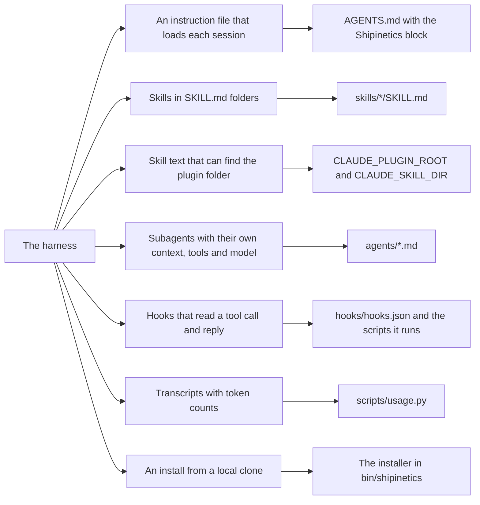
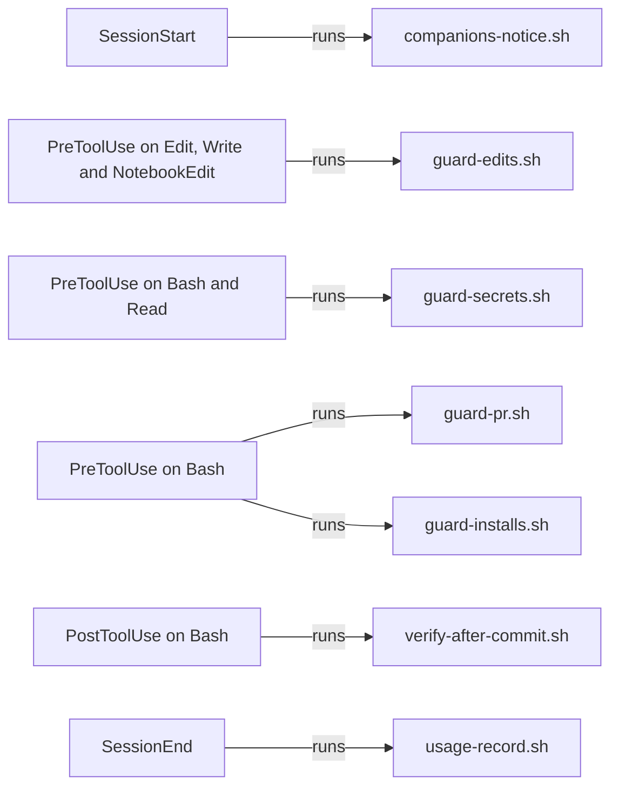
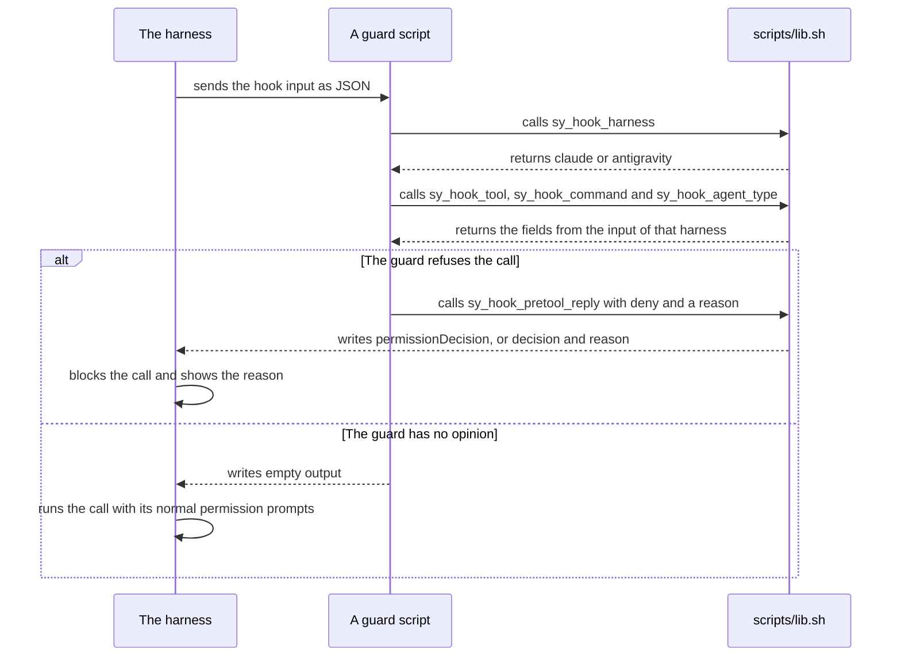

# What Shipinetics needs from a harness

Checked: 2026-11-22, against this repo at branch `post-commit-verify-and-evidence-setting`.

This note lists what Shipinetics uses from the harness that runs it. Each harness adapter must give each item on the list, or say which guard becomes an instruction only. The adapters are for Claude Code and Antigravity, and later for Codex, OpenCode and Copilot. The research notes `harness-codex.md`, `harness-opencode.md` and `harness-copilot.md` compare each harness with this list.

The diagram shows what a harness must give, and which Shipinetics part uses each item.

Source: the tables below, `hooks/hooks.json`, `scripts/usage.py`, and `bin/shipinetics` (the installer in the current code).

## Parts that need no harness

Git, CI or a shell runs these parts, so they work the same for every harness:

- The git hooks from setup: `pre-commit` (lint fix, 400-line limit), `commit-msg` (`Worksheet:` trailer) and `pre-push` (complete verify). Source: `skills/setup/templates/`.
- CI: `skills/setup/templates/github/workflows/verify.yml`.
- The tools in `bin/` (`shipinetics-verify`, `evidence`, `worksheet`, `shipinetics-config`, `known-failing`, `bench-compare` and the others). These tools need the plugin's `bin/` on the PATH.

## Parts that need the harness

| Need | Where Shipinetics uses it | What happens without it |
|---|---|---|
| An instruction file that loads each session | `AGENTS.md` with the Shipinetics block (`skills/setup/templates/AGENTS.md`). `CLAUDE.md` imports it | The agent does not know the rules. |
| Skills (SKILL.md folders) | `skills/*/SKILL.md` (22 skills) | The agent does not know the task loop or any procedure. |
| Skill text that can find the plugin folder | 32 uses of `${CLAUDE_PLUGIN_ROOT}` and 4 uses of `${CLAUDE_SKILL_DIR}`, in 23 files under `skills/` and `agents/` | The paths to the templates, the plain-language guide and the scripts do not resolve. Antigravity has this gap today: `bin/shipinetics-antigravity` replaces the variable only in the generated agents. It does not replace it in the skills that it links. |
| Subagents with their own context, tools and model | `agents/*.md`: test-writer, test-plan-reviewer, reviewer, security-reviewer, ui-reviewer and live-tester. The frontmatter sets `tools`, `model` (opus or sonnet) and `effort` | The task loop gets no independent tests or reviews. Antigravity drops `model` and `effort` today. |
| A hook before a shell command, that can deny the command with a reason | `scripts/guard-secrets.sh`, `scripts/guard-pr.sh`, `scripts/guard-installs.sh` | The secrets guard, the PR gate and the install gate become instructions only. |
| A hook before a file edit, that can deny the edit | `scripts/guard-edits.sh` (test files, protected files) | Independent tests and protected files become instructions only. |
| The hook knows which subagent made the call | `guard-edits.sh` lets only an agent type that ends in `test-writer` edit tests (`sy_hook_agent_type`, `scripts/lib.sh`) | The edit guard cannot tell test-writer from the main agent. So it blocks test-writer too, or it cannot enforce the rule. |
| A hook after a shell command, that can add text for the model | `scripts/verify-after-commit.sh` (Claude Code only) | The agent runs `shipinetics-verify quick` itself, as the workflow skill says. |
| A hook at session start, that can show a message and add context | `scripts/companions-notice.sh` | The session shows no notice about missing companions. |
| A hook at session end or stop | `scripts/usage-record.sh` | Shipinetics writes no automatic token log. `shipinetics-usage` can still backfill the log from transcripts. |
| Readable transcripts with token counts | `scripts/usage.py` reads Claude Code and Antigravity transcripts | Shipinetics has no usage report for that harness. |
| A way to install from a local clone | `bin/shipinetics-antigravity install` linked the clone and generated native agents (at the time of this note; since 0.12.0, `bin/shipinetics install antigravity` writes generated copies) | A person copies the files by hand. |

The diagram shows which hook event runs which Shipinetics script, for the hooks in the table above.

Source: `hooks/hooks.json`. Each script is in `scripts/`. In the current `hooks/hooks.json`, `guard-secrets.sh` also runs on Read calls, and some hooks that this note does not list also run.

## Hook input fields that Shipinetics reads

The `sy_hook_*` functions in `scripts/lib.sh` read these fields. A new harness needs a mapping for each field:

| Meaning | Claude Code | Antigravity |
|---|---|---|
| Tool name | `tool_name` | `toolCall.name` |
| Shell command | `tool_input.command` | `toolCall.args.CommandLine` |
| File path of an edit | `tool_input.file_path`, `tool_input.notebook_path` | `toolCall.args.Path`, `TargetFile`, `AbsolutePath`, `NotebookPath` |
| Working folder | `cwd` | `workspacePaths[0]` |
| Subagent type | `agent_type` | `agentType` |

## Hook replies that Shipinetics sends

| Reply | Claude Code | Antigravity |
|---|---|---|
| No opinion | Empty output | Empty output |
| Deny or ask before a tool | `hookSpecificOutput.permissionDecision` with a reason | `{decision, reason}` |
| Message and context at session start | `systemMessage` and `hookSpecificOutput.additionalContext` | `injectSteps` |
| Context after a tool | `hookSpecificOutput.additionalContext` (PostToolUse) | Not wired |

The diagram shows how one guard reads the hook input and writes its reply in the format of the harness.

Source: `sy_hook_harness`, `sy_hook_tool`, `sy_hook_command`, `sy_hook_agent_type`, `sy_hook_noop` and `sy_hook_pretool_reply` in `scripts/lib.sh`.

## Models in use today

`agents/*.md` names Claude models only:

- `opus` for test-writer, reviewer, security-reviewer and ui-reviewer.
- `sonnet` for test-plan-reviewer and live-tester.

The plan-aware design replaces these names with model roles and a model catalog for each harness.
