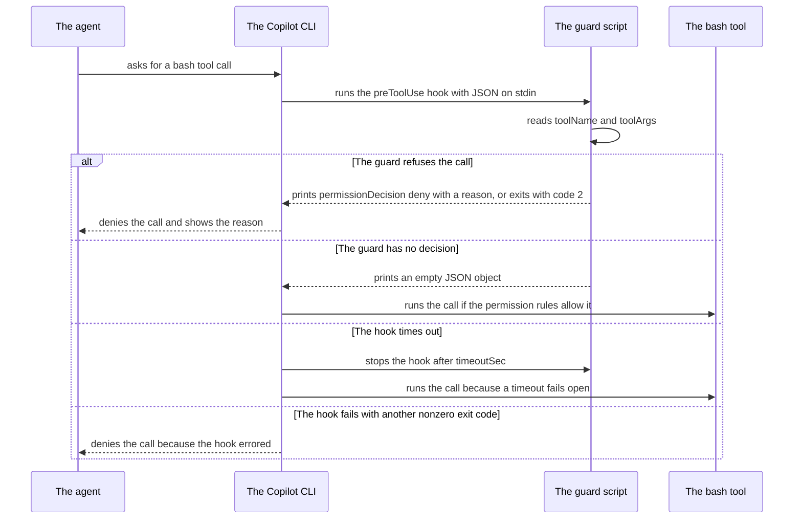
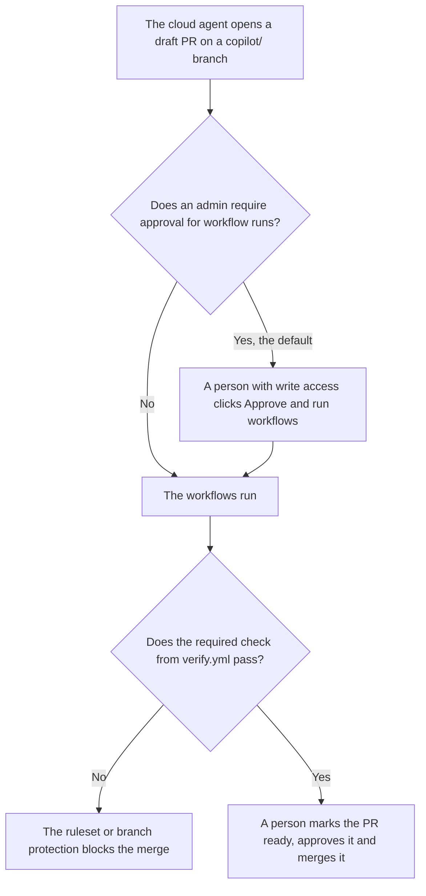

# GitHub Copilot as a harness for Shipinetics

Checked: 2026-11-22

Sources:

- docs.github.com: the raw article Markdown from `https://docs.github.com/api/article/body?pathname=...`, fetched on 2026-11-22.
- code.visualstudio.com/docs: the Markdown source from `microsoft/vscode-docs` branch `main`, pages marked `DateApproved: 11/18/2026`. I spot-checked the live pages on 2026-11-22.
- The `github/copilot-cli` changelog: `changelog.md` on `main`, latest entry 1.0.114 on 2026-11-18.
- github.blog/changelog.

I checked every claim below on 2026-11-22. A URL in the table is the page that owns the claim.

**Surfaces.** In this note, "CLI" is GitHub Copilot CLI. "VS Code" is agent mode in VS Code. "Cloud agent" is the agent that works on GitHub and opens PRs. The docs now use the name "Copilot cloud agent" for the agent that they called "coding agent" before.

**Two facts changed in 2026.**

1. VS Code now runs agents on a "harness" that the user chooses. The **Copilot harness** is the default. It uses the same runtime and hook format as the CLI. The old **Local** harness is deprecated and "will be removed by February 2027". VS Code also has a **Claude** harness (the Claude Agent SDK) and a **Codex** harness.
2. On June 1, 2026, GitHub replaced premium requests with **usage-based billing in GitHub AI Credits**. Premium requests and model multipliers now apply only to old annual Pro and Pro+ plans.

## Summary

Shipinetics can run well on the Copilot CLI, and on VS Code when the session uses the Copilot harness. The reason is that these two surfaces use one hook runtime:

- A `preToolUse` hook can deny a call, with a top-level `permissionDecision: "deny"` or with exit code 2.
- A `postToolUse` hook can add `additionalContext`.
- Subagent payloads carry `agentType`.

So on those two surfaces, hooks can keep these rules enforced: the edit guard (test-writer only, protected files), the secrets guard, the PR gate, the install gate and the quick verify after a commit.

The CLI already reads much of the Claude Code layout: nested Claude hook groups, `.claude/settings.json`, `.claude-plugin/plugin.json`, `${CLAUDE_PLUGIN_ROOT}`, `.claude/skills`, `.claude/agents`, `.claude/commands` and `CLAUDE.md`. But our scripts must learn a third reply shape, with top-level fields and not `hookSpecificOutput`. They must also learn Copilot's tool names and arguments.

On every surface, a hook that times out fails open. The PR gate can take 60 seconds, so it can time out, and then Copilot can skip it. VS Code hooks are still in preview.

The cloud agent runs only `.github/hooks/*.json` from the default branch. It runs them with bash, and by default it has no user hooks and no plugin hooks. So the guards work there only if each repository commits them. The cloud agent also can't run `git push` or `gh pr create` itself. So on the cloud agent, CI required checks and rulesets take the place of the PR gate, and the install gate has nothing to ask about.

The task loop, routes, specs, reviews, evidence recording and writing rules stay instructions only. Shipinetics delivers them as skills, `AGENTS.md` and custom agents. The custom agents need Copilot model IDs such as `claude-opus-5.5` instead of `opus`.

## Table

| Row | Does Copilot have it? (yes, partly, no, unverified) | How | Source (URL) |
|---|---|---|---|
| 1. Instruction files | yes | The CLI reads `.github/copilot-instructions.md`, `.github/instructions/**/*.instructions.md` (`applyTo`), `AGENTS.md`, `CLAUDE.md` (also `.claude/CLAUDE.md`) and `GEMINI.md`. It also reads the global `~/.copilot/copilot-instructions.md` and `~/.copilot/instructions/**/*.instructions.md`. VS Code (Copilot harness) reads `.github/copilot-instructions.md` or `AGENTS.md`, `.github/instructions`, nested `AGENTS.md` files and the same `~/.copilot` user files. The cloud agent reads repository-wide instructions, path-specific instructions, `AGENTS.md`, `CLAUDE.md`, `GEMINI.md` and organization instructions. | https://docs.github.com/en/copilot/how-tos/copilot-cli/customize-copilot/add-custom-instructions , https://docs.github.com/en/copilot/reference/custom-instructions-support , https://code.visualstudio.com/docs/agents/reference/custom-instructions-reference |
| 2. Skills | yes | All three surfaces load `SKILL.md`. The CLI reads project skills from `.github/skills`, `.agents/skills` and `.claude/skills`. It reads personal skills from `~/.copilot/skills` and `~/.agents/skills`, not from `~/.claude/skills`. It also reads plugins and `COPILOT_SKILLS_DIRS`. The agent calls a skill automatically from its description, or the user calls it as `/SKILL-NAME`. The VS Code Copilot harness reads `.github/skills` and `~/.copilot/skills`, and shows the skills in the `/` menu. The cloud agent reads the same project folders. It gets personal skills only through a dotfiles repo. | https://docs.github.com/en/copilot/reference/copilot-cli-reference/cli-command-reference#skills-reference , https://docs.github.com/en/copilot/concepts/customizations/agent-skills , https://code.visualstudio.com/docs/agent-customization/agent-skills |
| 3. Prompt files and slash commands | partly | In VS Code, `.github/prompts/*.prompt.md` files run **only in the deprecated Local harness**. The docs say to convert them to skills. The CLI has no prompt files. It loads `.claude/commands/*.md` as "commands" (an alternative skill format), and plugins can ship `commands`. The cloud agent has no prompt files. | https://code.visualstudio.com/docs/agent-customization/prompt-files , https://docs.github.com/en/copilot/reference/copilot-cli-reference/cli-command-reference#commands-alternative-skill-format , https://docs.github.com/en/copilot/reference/customization-cheat-sheet |
| 4. Custom agents and subagents | yes (cloud agent: partly) | An agent is a `NAME.agent.md` (or `.md`) file with YAML frontmatter. The fields are `description` (required), `name`, `tools`, `model`, `mcp-servers`, `infer` or `disable-model-invocation`, and `user-invocable`. The CLI adds `models`, `modelPolicy`, `reasoningEffort`, `include-custom-instructions` and `hooks`. The locations are `~/.copilot/agents`, `.github/agents`, `.claude/agents`, the plugin `agents/` folder, and `.github(-private)/agents` of an organization or enterprise. The CLI and VS Code give work to a subagent with the `task` tool, and the subagent gets its own context window. The cloud agent ignores `model` and `handoffs`. The cheat sheet marks subagents as not available on GitHub.com. | https://docs.github.com/en/copilot/reference/custom-agents-configuration , https://docs.github.com/en/copilot/reference/copilot-cli-reference/cli-command-reference#custom-agents-reference , https://code.visualstudio.com/docs/agents/reference/custom-agent-file-reference , https://code.visualstudio.com/docs/agents/run/subagents |
| 5. Hooks | yes (VS Code: preview) | The CLI, the VS Code Copilot harness and the cloud agent use one format: JSON `{ "version": 1, "hooks": { ... } }`. The hooks can be in `.github/hooks/*.json`, `~/.copilot/hooks/*.json`, inline `hooks` in `.github/copilot/settings(.local).json` or `~/.copilot/settings.json`, the repo `.claude/settings(.local).json`, plugins and agent frontmatter. The events are `sessionStart`, `sessionEnd`, `userPromptSubmitted`, `userPromptTransformed`, `preToolUse`, `postToolUse`, `postToolUseFailure`, `agentStop`, `subagentStart`, `subagentStop`, `errorOccurred`, `preCompact`, `permissionRequest` (CLI) and `notification` (CLI). The hook gets JSON on stdin with `sessionId`, `timestamp`, `cwd`, `toolName` and `toolArgs`. PascalCase event names give the snake_case fields `tool_name` and `tool_input`. `preToolUse` can deny with `{"permissionDecision":"deny","permissionDecisionReason":"..."}` or with exit 2. `postToolUse` can return `additionalContext`. The default `timeoutSec` is 30, and timeouts fail open. The cloud agent runs only `.github/hooks/*.json` on the default branch, runs only bash, and treats `ask` as deny. | https://docs.github.com/en/copilot/reference/hooks-reference , https://code.visualstudio.com/docs/agent-customization/hooks |
| 6. Plugins | yes (cloud agent: partly) | The CLI installs with `copilot plugin install ./my-plugin` (a local path). It also takes `--plugin-dir=DIR` (load without install), `OWNER/REPO`, a Git URL and `plugin@marketplace`. The manifest is `plugin.json`, `.plugin/plugin.json`, `.github/plugin/plugin.json` or `.claude-plugin/plugin.json`. The CLI has the built-in `awesome-copilot` marketplace, and `copilot plugin marketplace add` takes a repo, a URL or a local folder. VS Code installs from a marketplace, a Git URL or a local folder. Its `chat.pluginLocations` setting (experimental) registers a folder. VS Code reads the Copilot, Claude and Agent Plugins formats, and it sees the plugins that the CLI installed. The cloud agent reads `enabledPlugins` and `extraKnownMarketplaces` in `.github/copilot/settings.json`. | https://docs.github.com/en/copilot/reference/copilot-cli-reference/cli-plugin-reference , https://code.visualstudio.com/docs/agents/reference/agent-plugin-reference , https://docs.github.com/en/copilot/how-tos/use-copilot-agents/cloud-agent/configuring-agent-settings |
| 7. MCP | yes | The CLI reads `~/.copilot/mcp-config.json`, the workspace `.mcp.json` and `.github/mcp.json` (trusted folders only), plugins and `--additional-mcp-config`. The GitHub MCP server is built in. The CLI does not read `.vscode/mcp.json`. The VS Code Copilot harness reads `~/.copilot/mcp-config.json` and the `.mcp.json` at the workspace root (`mcpServers` key). `.vscode/mcp.json` (`servers` key) is for the Local harness only, and VS Code can forward it. The cloud agent reads the repository settings JSON (`mcpServers`, tools only, no OAuth remote servers), secrets with the prefix `COPILOT_MCP_`, or `mcp-servers` in a custom agent. | https://docs.github.com/en/copilot/how-tos/copilot-cli/customize-copilot/add-mcp-servers , https://code.visualstudio.com/docs/agents/reference/mcp-configuration , https://docs.github.com/en/copilot/how-tos/copilot-on-github/customize-copilot/configure-mcp-servers |
| 8. Model selection | yes | The CLI models include `claude-sonnet-5.5` (default), `claude-opus-5.5`, `claude-haiku-5.5`, `claude-haiku-4.5`, `gpt-5.4`, `gpt-5.3-codex`, `gpt-6-astra`, `gpt-6-luna`, `gpt-6.1-sol`, `gpt-6.1-terra`, `gpt-6.2-sol`, `gpt-6.2-astra`, `gemini-3.7-flash`, `gemini-3.8-flash` and `gemini-4-hydrogen`, and also `auto` and `fusion`. The global setting is `/config model`, `/model --global`, `model` in settings or `COPILOT_MODEL`. The setting for one repo is `model` in `.github/copilot/settings.json`, and `.github/allowed_models.txt`. The setting for one session is `/model` or `--model`. The setting for one agent is the `model` or `models` frontmatter. VS Code has a model picker, and the agent `model` and `model-policy` fields. The cloud agent has a picker when the task starts (Auto, Claude, Gemini, GPT, Grok, MAI). Premium requests and multipliers are legacy since 2026-06-01. | https://docs.github.com/en/copilot/reference/copilot-cli-reference/cli-command-reference#supported-models , https://docs.github.com/en/copilot/how-tos/copilot-cli/use-copilot-cli/choose-a-model , https://docs.github.com/en/copilot/how-tos/use-copilot-agents/cloud-agent/changing-the-ai-model , https://docs.github.com/en/copilot/reference/copilot-billing/request-based-billing-legacy/model-multipliers-for-annual-plans |
| 9. Plans and usage | yes | The plans are Free (agent mode yes, cloud agent no, Auto model only), Student, Pro $10 (1,500 AI credits a month), Pro+ $39 (7,000), Max $100 (20,000), Business $19 per seat (1,900 pooled), Enterprise $39 per seat (3,900 pooled) and "Copilot access" (no included credits). 1 AI credit is $0.01. All plans include Copilot CLI and agent mode. The CLI subagent concurrency for each plan is Free 2, Pro and Pro+ 4, Max 8, Business 16 and Enterprise 32. | https://docs.github.com/en/copilot/get-started/plans , https://docs.github.com/en/copilot/concepts/billing-and-usage/individuals/billing , https://github.blog/changelog/2026-06-01-updates-to-github-copilot-billing-and-plans/ |
| 10. Transcripts | partly | The CLI writes `~/.copilot/session-state/<session-id>/events.jsonl` and `~/.copilot/session-store.db` (SQLite). The changelog says that the CLI writes usage metrics (requests, tokens, code changes) to `events.jsonl` when a session ends. The record schema is not documented. `/usage` shows the token totals and AI credits for each model. `transcriptPath` is in the `agentStop`, `subagentStart/Stop` and `preCompact` payloads. VS Code has a local SQLite session store, JSON export, and OTLP export of debug logs with token usage. No file path is documented. The cloud agent keeps a session log on GitHub.com. | https://docs.github.com/en/copilot/reference/copilot-cli-reference/cli-config-dir-reference#session-state , https://docs.github.com/en/copilot/concepts/security-governance-and-network-settings/session-data , https://github.com/github/copilot-cli/blob/main/changelog.md , https://code.visualstudio.com/docs/agents/run/sessions/session-history |
| 11. Permissions and sandbox | yes | The CLI has `--allow-tool` and `--deny-tool` with `shell(git:*)`, `write(path)`, `read(.env)`, `url(host)` and `MCP(tool)`. Deny rules take precedence over allow rules, also with `--allow-all`. The CLI also has `--allow-url` and `--deny-url`, `allowedUrls` and `deniedUrls`, the managed `permissions.deny/ask/allow` rules, `--available-tools` and `--excluded-tools`, and an OS sandbox (`/sandbox`, `--sandbox`). The VS Code Copilot harness has the levels Manual, Assisted and Allow all. It has `chat.tools.terminal.autoApprove` (`false` asks, it does not block), `chat.tools.urls.autoApprove` and a terminal sandbox. The cloud agent has all tools pre-approved, and a firewall limits its network. | https://docs.github.com/en/copilot/reference/copilot-cli-reference/cli-command-reference#tool-permission-patterns , https://docs.github.com/en/copilot/reference/copilot-cli-reference/cli-config-dir-reference , https://code.visualstudio.com/docs/agents/run/approvals |
| 12. Non-interactive mode and PR gate | yes | The CLI has `copilot -p "..."` (or piped stdin), `-s`, `--output-format json` (JSONL), `--no-ask-user`, `--allow-tool`, `--agent`, `--model` and `--share`. It exits with a nonzero status on an interrupt or an empty reply. Repo hooks load only in trusted folders or with `--trust-folder`. The cloud agent opens a draft PR on one `copilot/` branch. It can't run `git push`, and it can't mark a PR ready, approve it or merge it. It "is also subject to any branch protections and required checks". By default, workflows wait for **Approve and run workflows**. A Copilot PR without attribution needs one more approval. | https://docs.github.com/en/copilot/reference/copilot-cli-reference/cli-programmatic-reference , https://docs.github.com/en/copilot/concepts/security-governance-and-network-settings/risks-and-mitigations , https://docs.github.com/en/copilot/how-tos/copilot-on-github/use-copilot-agents/review-copilot-output |

## 1. Instruction files

**CLI.** The CLI reads these files (checked 2026-11-22, https://docs.github.com/en/copilot/how-tos/copilot-cli/customize-copilot/add-custom-instructions):

| Location | Scope and behavior |
|---|---|
| `$HOME/.copilot/copilot-instructions.md` | User-level instructions that apply across repositories. |
| `$HOME/.copilot/instructions/**/*.instructions.md` | Modular user-level instructions. |
| `.github/copilot-instructions.md` | Repository-wide instructions, discovered in the standard locations. |
| `.github/instructions/**/*.instructions.md` | Modular repository instructions, discovered in the standard locations but not intermediate directories. |
| `AGENTS.md` | Agent instructions, discovered in the standard locations. |
| `CLAUDE.md` | Agent instructions. "Copilot CLI also uses `.claude/CLAUDE.md`." |
| `GEMINI.md` | Agent instructions. |
| `COPILOT_CUSTOM_INSTRUCTIONS_DIRS` | Additional `AGENTS.md` and `*.instructions.md` files. |

- "Standard locations" are the repository root, the current directory, the directories between them, and the directories on the path of a file that the CLI works on.
- The CLI combines all the files. It "does not define a general precedence order between these files."
- `@relative/path` in `copilot-instructions.md`, `AGENTS.md` or `CLAUDE.md` includes another file. The CLI does not load absolute paths or `~/` paths.
- `/instructions` lists the files and turns one file on or off. `--no-custom-instructions` turns all of them off.
- This is the frontmatter for a path-specific file:

  ```markdown
  ---
  applyTo: "**/*.ts,**/*.tsx"
  excludeAgent: "code-review"
  ---
  ```

- A custom agent that runs as a subagent does **not** get the repository instructions, unless its frontmatter has `include-custom-instructions: true` (https://docs.github.com/en/copilot/reference/copilot-cli-reference/cli-command-reference#repository-custom-instructions-for-subagents). The `general-purpose` subagent gets them.

**VS Code.** The harness sets which files load (https://code.visualstudio.com/docs/agents/reference/custom-instructions-reference):

| Harness | Project instructions | Targeted instructions |
|---|---|---|
| Copilot | `.github/copilot-instructions.md` or `AGENTS.md` | `.github/instructions/**/*.instructions.md` or nested `AGENTS.md` files |
| Claude | `CLAUDE.md` or `.claude/CLAUDE.md` | Markdown files in `.claude/rules` |
| Codex | `AGENTS.md` | `AGENTS.md` files along the path |
| Local (deprecated) | `.github/copilot-instructions.md`, `AGENTS.md`, or `CLAUDE.md` | `.github/instructions/**` or `.claude/rules` |

The Copilot harness reads user instructions from `~/.copilot/copilot-instructions.md` and `~/.copilot/instructions/**/*.instructions.md`. The editor setting `chat.instructionsFilesLocations` still adds folders, but "Copilot CLI and the GitHub Copilot app don't inherit editor settings."

**Cloud agent.** The cloud agent reads `.github/copilot-instructions.md`, `.github/instructions/**/*.instructions.md`, `AGENTS.md`, `CLAUDE.md`, `GEMINI.md` and organization instructions (https://docs.github.com/en/copilot/reference/custom-instructions-support). Organization instructions need Business or Enterprise (https://docs.github.com/en/copilot/get-started/plans).

## 2. Skills

**CLI** (https://docs.github.com/en/copilot/reference/copilot-cli-reference/cli-command-reference#skills-reference). The CLI reads the locations in this priority order. For a duplicate name, the CLI uses the first skill that it finds.

| Location | Scope |
|---|---|
| `.github/skills/` | Project |
| `.agents/skills/` | Project |
| `.claude/skills/` | Project |
| Parent `.github/skills/` | Inherited (monorepo) |
| `~/.copilot/skills/` | Personal |
| `~/.agents/skills/` | Personal |
| Plugin directories | Plugin |
| `COPILOT_SKILLS_DIRS` | Custom |
| `--add-dir <path>` | Added root |
| Bundled with the CLI | Built-in |
| Organization or enterprise | Remote |

`~/.claude/skills` is **not** in the CLI list. These are the frontmatter fields:

- `name`: letters, numbers, hyphens, underscores, dots, colons and spaces, with 64 characters at most. "Colons allow namespaced names (for example, `my-plugin:search`)".
- `description`: 1024 characters at most.
- `argument-hint`, `allowed-tools`, `user-invocable` and `disable-model-invocation`.

"When invoked (via `/SKILL-NAME` or automatically by the agent), the skill's content is injected into the conversation." When two plugins have a skill with the same name, the skills get "plugin-qualified invocation names such as `/my-plugin/search`". The commands are `/skills list`, `/skills info NAME`, `/skills reload` and `/skills add`. Outside a session, the command is `copilot skill list|add|remove|enable|disable`.

**VS Code** (https://code.visualstudio.com/docs/agent-customization/agent-skills). VS Code documents these folders for each harness:

- Copilot: `.github/skills/` and `~/.copilot/skills/`.
- Claude: `.claude/skills/` and `~/.claude/skills/`.
- Codex: `.agents/skills/` and `~/.agents/skills/`.

The page says that the table gives "a supported project and personal location for each harness, not every directory it recognizes." VS Code shows the skills in the `/` menu. VS Code has stricter rules for `name`: "Only lowercase letters, numbers, and hyphens are allowed ... Do not use slashes, colons, dots, or namespace prefixes. Must match the parent directory name." For a plugin skill, "the plugin name is automatically used as a command prefix (for example, `/my-plugin:test-runner`)."

**Cloud agent** (https://docs.github.com/en/copilot/concepts/customizations/agent-skills). The cloud agent reads project skills in `.github/skills`, `.claude/skills` or `.agents/skills`. "To make personal skills available in cloud sandbox sessions, include them in `.copilot/skills` in your dotfiles repository. This does not apply to GitHub Actions-based sessions."

## 3. Prompt files and custom slash commands

**VS Code.** A prompt file has the format `*.prompt.md`, in `.github/prompts` (workspace) or in the user profile (https://code.visualstudio.com/docs/agent-customization/prompt-files). The frontmatter fields are `description`, `name`, `argument-hint`, `agent`, `model` and `tools`. But the page says: "Prompt files run only in **Local** harness sessions ... The Local harness is deprecated and will be removed by **February 2027**. Before then, convert existing prompt files to skills for use with the Copilot harness."

```markdown
---
name: review-api-security
agent: agent
description: Review a REST API implementation for common security risks
argument-hint: [API folder or file]
---
```

**CLI.** The CLI has no prompt files. The cheat sheet marks prompt files ✗ for Copilot CLI (https://docs.github.com/en/copilot/reference/customization-cheat-sheet). Slash commands come from skills. They also come from "Commands ... stored as individual `.md` files in `.claude/commands/`. The command name is derived from the filename. Command files use a simplified format (no `name` field required) and support `argument-hint`, `description`, `allowed-tools`, and `disable-model-invocation`. Commands have lower priority than skills with the same name." Plugins can ship a `commands` path.

**Cloud agent.** The cloud agent has no prompt files. The cheat sheet marks prompt files ✗ for GitHub.com.

## 4. Custom agents and subagents

**File format.** An agent is a Markdown file with YAML frontmatter, named `NAME.agent.md` or `NAME.md`. The ID is the file name without the extension. A subfolder adds `folder--` to the ID (https://docs.github.com/en/copilot/how-tos/copilot-cli/use-copilot-cli/invoke-custom-agents). The shared fields are `name`, `description` (required), `target` (`vscode` or `github-copilot`), `tools`, `model`, `disable-model-invocation`, `user-invocable`, `infer` (retired), `mcp-servers` and `metadata` (https://docs.github.com/en/copilot/reference/custom-agents-configuration). The body has 30,000 characters at most.

**Tool aliases.** The aliases are not case-sensitive:

- `execute`: `shell`, `Bash`, `powershell`.
- `read`: `Read`, `NotebookRead`.
- `edit`: `Edit`, `MultiEdit`, `Write`, `NotebookEdit`.
- `search`: `Grep`, `Glob`.
- `agent`: `custom-agent`, `Task`.
- `web`: `WebSearch`, `WebFetch`.
- `todo`: `TodoWrite`.

"All unrecognized tool names are ignored." So our `tools: Read, Grep, Glob, Bash` maps directly. `Skill` has no alias. The CLI tool has the name `skill`.

**CLI extra fields** (https://docs.github.com/en/copilot/reference/copilot-cli-reference/cli-command-reference#custom-agent-frontmatter-fields): `include-custom-instructions`, `models` (a priority list), `modelPolicy` (`preferred` or `required`), `reasoningEffort` and `hooks` (for one agent only). The how-to page writes `model-policy: required` and adds `strict-tools-list: true`. The reference writes `modelPolicy`. VS Code uses `model-policy` and `reasoning-effort`.

```markdown
---
name: local-coder
description: >
  Use for small, well-defined coding tasks, such as a
  single-file change or a focused test fix.
model: LOCAL-PROVIDER/LOCAL-MODEL
model-policy: required
tools: ["read", "grep", "glob", "edit", "execute"]
strict-tools-list: true
include-custom-instructions: true
---
```

(https://docs.github.com/en/copilot/how-tos/copilot-cli/customize-copilot/create-custom-agents-for-cli)

**Locations, in the CLI priority order:**

1. `~/.copilot/agents/`
2. `.github/agents/`, from the current folder up to the Git root
3. `.claude/agents/`
4. The `--add-dir` roots
5. `<plugin>/agents/`
6. The remote agents of an organization or enterprise

The CLI does not read `~/.claude/agents`. Organization agents are in `/agents` of the organization's `.github` or `.github-private` repo. Enterprise agents are in a designated `.github-private` repo.

**VS Code locations** (https://code.visualstudio.com/docs/agents/reference/custom-agent-file-reference):

- `.github/agents` and `~/.copilot/agents` hold the Copilot format.
- `.claude/agents` and `~/.claude/agents` hold the Claude format: `tools`, `disallowedTools`, `model: sonnet|opus|haiku|inherit`, `permissionMode`, `skills`, `mcpServers`, `hooks` and `memory`.

When VS Code converts agents for the Copilot runtime, it does not forward `model-policy`, `mcp-servers`, `github`, `deferred-tool-loading`, `strict-tools-list` or `include-custom-instructions`. `handoffs` and `agents` work only in the Local harness.

**Model for each agent.** The CLI docs say: "When unset, inherits the outer agent's model. When the session model is set to `Auto` (server-selected), subagents always inherit the resolved session model regardless of this field." The CLI uses this precedence:

1. The value in the call.
2. The `subagents` override in `~/.copilot/settings.json` (or `/subagents`).
3. The agent's `model`, `models` or `reasoningEffort`.
4. The parent session.

When the CLI can't use the model, it uses the session model, unless the agent has `modelPolicy: "required"`. For the cloud agent, the docs say: "If you are creating and using the agent profile in VS Code, JetBrains IDEs, Eclipse, or Xcode, you can also use the `model` property" (https://docs.github.com/en/copilot/how-tos/copilot-on-github/customize-copilot/customize-cloud-agent/create-custom-agents). So the docs do not document `model` for the cloud agent.

**Handoff and fresh context.** The CLI docs say: "When the main agent delegates work to a custom agent, that work is carried out by a subagent with its own context window." The main agent calls the `task` tool. The tools `list_agents`, `read_agent` and `write_agent` coordinate the agents that run. The user can also choose an agent with `/agent` or `copilot --agent ID -p "..."`. The default depth limit is 6, and the plan sets the concurrency. "Subagents inherit permissions from the parent session and cannot escalate them."

In the VS Code Copilot harness, "Copilot uses its native `task` tool for delegation". A subagent "performs a focused task in its own context and returns a result to the main agent" (https://code.visualstudio.com/docs/agents/run/subagents).

On the cloud agent, the `agent` alias "Allows a different custom agent to be invoked". But the cheat sheet marks subagents ✗ for GitHub.com and ✓ for VS Code and the CLI.

## 5. Hooks

Owner page: https://docs.github.com/en/copilot/reference/hooks-reference (checked 2026-11-22). VS Code says that its Copilot harness, the GitHub Copilot app and the CLI "share this harness and its hook format" (https://code.visualstudio.com/docs/agent-customization/hooks). VS Code hooks are "in public preview" (https://docs.github.com/en/copilot/concepts/customizations/hooks).

**Locations.**

- The CLI loads and combines these sources:
  - Policy files (`/etc/github-copilot/policy.d/*.json`, owned by root).
  - `.github/hooks/*.json`.
  - `~/.copilot/hooks/*.json` (or `$COPILOT_HOME/hooks/`).
  - Inline `hooks` in `.github/copilot/settings.json` and `.github/copilot/settings.local.json`.
  - "Cross-tool `.claude/settings.json` and `.claude/settings.local.json` files in the repository".
  - Inline `hooks` in `~/.copilot/settings.json`.
  - The plugin `hooks.json` or `hooks/hooks.json`.

  The CLI does not read `~/.claude/settings.json`.
- The VS Code Copilot harness reads the same sources. "Local settings such as `chat.useHooks` do not prevent the Copilot harness from loading a configuration."
- On the cloud agent, "the only hook configuration that exists by default is `.github/hooks/*.json` inside the cloned repository. The sandbox does not ship with user-level hook files, `settings.json`, `config.json`, or installed plugins." The file "**must be present** on your repository's default branch" (https://docs.github.com/en/copilot/how-tos/copilot-on-github/customize-copilot/customize-cloud-agent/use-hooks).
- Hooks for one agent: a `hooks` map in the frontmatter of a custom agent. Only the CLI reads it, and VS Code forwards it.
- Repository hooks need folder trust. In `-p` mode, use a trusted folder or `--trust-folder` (https://docs.github.com/en/copilot/reference/copilot-cli-reference/cli-programmatic-reference).

**Config format.**

```json
{
  "version": 1,
  "hooks": {
    "preToolUse": [
      {
        "type": "command",
        "bash": "YOUR_BASH_COMMAND",
        "powershell": "YOUR_POWERSHELL_COMMAND",
        "cwd": "OPTIONAL/WORKING/DIRECTORY",
        "env": { "VAR": "VALUE" },
        "timeoutSec": 30
      }
    ]
  }
}
```

The fields are:

- `type` (default `command`).
- `bash`, `powershell`, and `command` (the fallback for all platforms).
- `exec` and `args` (CLI only).
- `cwd`, `env` and `matcher`.
- `timeoutSec` (default 30) and its alias `timeout`.

There are also `http` hooks, and `prompt` hooks (`sessionStart` only). The CLI changelog adds two facts (https://github.com/github/copilot-cli/blob/main/changelog.md):

- "Hook config files now support Claude Code's nested matcher/hooks structure and optional type field" (1.0.6, 2026-03-16).
- "Plugin hooks receive PLUGIN_ROOT, COPILOT_PLUGIN_ROOT, and CLAUDE_PLUGIN_ROOT env vars with the plugin's installation directory" (1.0.26, 2026-04-14).

**Events and surfaces.**

| Event | Fires when | Output that Copilot uses | Cloud agent |
|---|---|---|---|
| `sessionStart` / `SessionStart` | A session starts or resumes | `additionalContext` | Fires one time for each job |
| `sessionEnd` / `SessionEnd` | The session ends | None | Fires one time for each job |
| `userPromptSubmitted` / `UserPromptSubmit` | The user submits a prompt | Only SDK hooks | Fires one time at most |
| `userPromptTransformed` | Copilot changes the prompt into model content | `modifiedTransformedPrompt` | Fires |
| `preToolUse` / `PreToolUse` | Before each tool | allow, deny, ask, `modifiedArgs` | Fires. `ask` counts as deny |
| `postToolUse` / `PostToolUse` | After a tool succeeds | `modifiedResult`, `additionalContext` | Fires |
| `postToolUseFailure` | After a tool fails | `additionalContext` | Fires |
| `agentStop` / `Stop` | The main agent ends a turn | `decision: "block"` forces another turn | Fires |
| `subagentStart` | Copilot starts a subagent | `additionalContext`, added before the subagent's prompt | Fires |
| `subagentStop` / `SubagentStop` | The subagent is done | block, `modifiedResponse` | Fires |
| `errorOccurred` | An error occurs | None | Fires |
| `preCompact` | Before compaction | None | Only for `auto` |
| `permissionRequest` | Before the permission service | `behavior` allow or deny | No effect (CLI only) |
| `notification` | The CLI sends a notification | `additionalContext` | Does not fire (CLI only) |

For its Copilot harness, VS Code lists `sessionStart`, `userPromptSubmitted`, `preToolUse`, `postToolUse`, `preCompact`, `subagentStart`, `subagentStop`, `agentStop` and `sessionEnd`.

**Payloads.** The event name sets the format. camelCase event names get camelCase fields. PascalCase event names get "VS Code compatible" snake_case fields.

```typescript
// preToolUse (camelCase)
{
    sessionId: string;
    timestamp: number;      // Unix ms
    cwd: string;
    toolName: string;
    toolArgs: unknown;
}

// PreToolUse (VS Code compatible)
{
    hook_event_name: "PreToolUse";
    session_id: string;
    timestamp: string;      // ISO 8601
    cwd: string;
    tool_name: string;
    tool_input: unknown;    // Tool arguments (parsed from JSON string when possible)
}
```

- The test input in the docs gives `toolArgs` as a JSON **string**: `{"timestamp":1704614400000,"cwd":"/tmp","toolName":"bash","toolArgs":"{\"command\":\"ls\"}"}` (https://docs.github.com/en/copilot/how-tos/copilot-cli/customize-copilot/use-hooks). So with camelCase events, a script may have to parse `toolArgs` two times. With PascalCase events, `tool_input` is "parsed from JSON string when possible".
- The shell command is in `command`. The key of the file path for `view`, `create` and `edit` is **unverified**. An SDK example uses `path`.
- The runtime tool names are `bash`, `powershell`, `view`, `create`, `edit`, `apply_patch`, `str_replace_editor`, `glob`, `grep` or `rg`, `web_fetch`, `task`, `ask_user` and `skill`. With PascalCase `PreToolUse`, matchers use the Claude meaning, and `tool_name` is the Claude name:
  - `bash` becomes `Bash`.
  - `view` becomes `Read`.
  - `create` becomes `Write`.
  - `edit`, `str_replace_editor` and `apply_patch` become `Edit`.
  - `task` becomes `Agent`.
- A hook that fires inside a subagent gets three more fields: `agentId` or `agent_id`, `agentType` or `agent_type` ("Subagent type, when known"), and `parentAgentId`. "Root-agent hook inputs are unchanged."
- `postToolUse` adds `toolResult: { resultType: "success"; textResultForLlm: string }`.
- `agentStop`, `subagentStart`, `subagentStop` and `preCompact` carry `transcriptPath`. `sessionEnd` carries only `sessionId`, `timestamp`, `cwd` and `reason`.

**Can a pre-tool hook deny? Yes.** The reply is one top-level JSON object on stdout:

| Field | Values |
|---|---|
| `permissionDecision` | `"allow"`, `"deny"`, `"ask"` |
| `permissionDecisionReason` | "Reason shown to the agent. Required when decision is `"deny"`." |
| `modifiedArgs` | The tool arguments that replace the original arguments |

```json
{
  "permissionDecision": "deny",
  "permissionDecisionReason": "This operation requires manual review."
}
```

- "Return `{}` for no decision." The VS Code page says that `{}` "does not automatically approve the tool".
- Exit code 2 denies the call, "even if that JSON reports `permissionDecision: "allow"`". Each other nonzero exit code also denies the call ("fail-closed"), with "Denied by preToolUse hook (hook errored)".
- "Command hook **timeouts are always fail-open, even for `preToolUse` and admin-deployed policy hooks**."
- HTTP `preToolUse` hooks fail open on network errors.
- The cloud agent and the CLI autopilot mode deny `ask`.
- The hook must print exactly one final JSON object. Copilot ignores two objects, because together they make invalid JSON. The hook can print progress lines `{"type":"progress","message":"..."}` before the final object.
- The VS Code migration guide says: "Use the documented top-level `permissionDecision` ... Return `{}` when there is no hook decision". It also says: "accepting a PascalCase input alias does not establish support for every Local `hookSpecificOutput` field. Emit the documented Copilot output" (https://code.visualstudio.com/docs/agent-customization/migrate-customizations).

This diagram shows how the Copilot CLI would run a Shipinetics guard on a shell command, from the facts above. It shows the reply that Shipinetics must send after the change in Open question 1. Today the scripts send the Claude Code reply in `hookSpecificOutput`.



Source: the "Can a pre-tool hook deny?" and "Timeouts" parts of this section. The Shipinetics side is `hooks/hooks.json` (which runs `scripts/guard-edits.sh`, `scripts/guard-secrets.sh`, `scripts/guard-pr.sh` and `scripts/guard-installs.sh`) and `sy_hook_pretool_reply` in `scripts/lib.sh`.

**Can a post-tool hook add context? Yes.**

```typescript
{
    modifiedResult?: { resultType: "success"; textResultForLlm: string };
    additionalContext?: string;
}
```

"Additional guidance appended to `textResultForLlm` so the model sees it after the tool output on the same turn. When multiple hooks return `additionalContext`, the results are joined with a double newline and capped at 10 KB."

**Timeouts.** `timeoutSec` sets the timeout. The default is 30 seconds. The docs give no maximum. On a timeout, Copilot stops the hook, and the run continues.

**How the Shipinetics hooks map to Copilot events.**

| Shipinetics hook | Copilot event (CLI, VS Code) | Cloud agent |
|---|---|---|
| `companions-notice.sh` (SessionStart) | `sessionStart`, `additionalContext` | Works only if the repo commits it to `.github/hooks/` |
| `guard-edits.sh` (PreToolUse Edit/Write) | `preToolUse`, matcher `edit\|create\|apply_patch\|str_replace_editor`, or PascalCase `Edit\|Write` | The same, when the repo commits it |
| `guard-secrets.sh` (PreToolUse Bash/Read) | `preToolUse`, `bash\|view` | The same, when the repo commits it |
| `guard-pr.sh` (PreToolUse Bash, 60 seconds) | `preToolUse`, `bash`. It needs a `timeoutSec` that is longer than its run time | Not useful, because the agent does not run `gh pr create` |
| `guard-installs.sh` (PreToolUse Bash) | `preToolUse`, `bash` | Not useful, because the cloud agent has no interactive approval |
| `verify-after-commit.sh` (PostToolUse Bash, 180 seconds) | `postToolUse`, `additionalContext` | Possible. Its time counts against the job time |
| `usage-record.sh` (SessionEnd) | `sessionEnd`. It gets no transcript path, so the script must find `~/.copilot/session-state/<sessionId>/` itself | The cloud agent deletes the files when the job ends |

## 6. Plugins and extensions

**CLI** (https://docs.github.com/en/copilot/reference/copilot-cli-reference/cli-plugin-reference).

- The install specs are `plugin@marketplace`, `OWNER/REPO`, `OWNER/REPO:PATH/TO/PLUGIN`, a Git URL, or "Local path `./my-plugin` or `/abs/path`". `--plugin-dir=DIRECTORY` loads a plugin from a folder for one session, without an install.
- "When you install a plugin, its components are cached ... To pick up changes made to a local plugin, install it again" (https://docs.github.com/en/copilot/how-tos/copilot-cli/customize-copilot/plugins-creating). But "Path-sourced plugins in a local (directory-source) marketplace load live from their real directory."
- The CLI keeps installed plugins in `~/.copilot/installed-plugins/MARKETPLACE/PLUGIN-NAME` or `~/.copilot/installed-plugins/_direct/SOURCE-ID/`.
- The legacy manifest locations, in this order, are `.plugin/plugin.json`, `plugin.json`, `.github/plugin/plugin.json` and `.claude-plugin/plugin.json`. The components are `agents/` (`.agent.md`), `skills/`, `commands`, `hooks` (`hooks.json` or `hooks/hooks.json`), `mcpServers` (`.mcp.json`) and `lspServers`.
- Agent Plugins 1.0 (`$schema` `https://agent-plugins.org/schemas/1.0.0/plugin.schema.json`) has the portable parts `skills/` and `mcp.json`. The parts for Copilot only are under `com.github.copilot/`: `agents/`, `commands/`, `rules/`, `hooks/hooks.json` and `lsp.json`.
- Marketplaces: the CLI has the built-in `awesome-copilot`. To add a marketplace, use `copilot plugin marketplace add OWNER/REPO`, a URL, or `/PATH/TO/MARKETPLACE-DIRECTORY`. The manifest is `marketplace.json`, `.plugin/marketplace.json`, `.github/plugin/marketplace.json` or `.claude-plugin/marketplace.json`. The docs use `copilot plugin marketplace add anthropics/claude-code` as an example.
- When a plugin agent or skill has the same ID or name as a project or personal one, the CLI uses the project or personal one.
- Experimental "extensions" (`/extensions`) also exist. They are separate from plugins.

**VS Code** (https://code.visualstudio.com/docs/agents/reference/agent-plugin-reference, https://code.visualstudio.com/docs/agent-customization/agent-plugins).

| Plugin format | Manifest | Hook file | Root token |
|---|---|---|---|
| Agent Plugins 1.0 | `plugin.json` with `$schema` | `com.github.copilot/hooks/hooks.json` | `${PLUGIN_ROOT}` |
| Copilot | `plugin.json` | `hooks.json` (plugin root) | `${PLUGIN_ROOT}` or `${CLAUDE_PLUGIN_ROOT}` |
| Claude | `.claude-plugin/plugin.json` | `hooks/hooks.json` | `${CLAUDE_PLUGIN_ROOT}` |

- VS Code installs from a marketplace, or with "Install a plugin from source": a Git URL or a local folder path (**Chat: Install Plugin from Source**).
- `chat.pluginLocations` (experimental) registers a folder without an install: `{ "chat.pluginLocations": { "/path/to/my-plugin": true } }`.
- `chat.plugins.marketplaces` (experimental) adds marketplaces, also with `file:///` paths.
- VS Code "automatically discovers plugins that you install with the Copilot CLI" from `~/.copilot/installed-plugins/`.
- The hook schema in a plugin must match the target runtime: "For Copilot sessions, use the Copilot hooks reference ... A plugin packages hooks; it does not translate Local harness scripts."

**Cloud agent** (https://docs.github.com/en/copilot/how-tos/use-copilot-agents/cloud-agent/configuring-agent-settings). The cloud agent reads this JSON:

```json
{
  "extraKnownMarketplaces": {
    "MARKETPLACE-NAME": {
      "source": { "source": "github", "repo": "OWNER/REPOSITORY" }
    }
  },
  "enabledPlugins": { "PLUGIN-NAME@MARKETPLACE-NAME": true }
}
```

The JSON is in `.github/copilot/settings.json`. It is unverified whether the hooks of such a plugin run in a cloud job (see Open questions).

## 7. MCP

**CLI** (https://docs.github.com/en/copilot/how-tos/copilot-cli/customize-copilot/add-mcp-servers, https://docs.github.com/en/copilot/reference/copilot-cli-reference/cli-command-reference#mcp-server-loading-priority). The priority order, highest first:

1. `--additional-mcp-config`.
2. Plugin servers.
3. The workspace `.mcp.json` and `.github/mcp.json` (trusted folders only).
4. `~/.copilot/mcp-config.json`.

The GitHub MCP server is built in. The commands are `/mcp` and `copilot mcp add`. "The `.vscode/mcp.json` file for VS Code is not read by Copilot CLI." This command migrates the file: `jq '{mcpServers: .servers}' .vscode/mcp.json > .mcp.json`.

**VS Code Copilot harness** (https://code.visualstudio.com/docs/agents/reference/mcp-configuration). The user file is `$COPILOT_HOME/mcp-config.json` or `~/.copilot/mcp-config.json`. The shared file is `.mcp.json` at the workspace root, with a top-level `mcpServers` object. "For new Copilot configurations, use these native destinations, not `.vscode/mcp.json` or profile `mcp.json`. Those files use the deprecated Local harness's ... `servers` format." VS Code can forward the definitions that qualify.

**Cloud agent** (https://docs.github.com/en/copilot/how-tos/copilot-on-github/customize-copilot/configure-mcp-servers).

- The config is JSON with `mcpServers` in the repository settings. Copilot code review uses the same config.
- The server types are `local`, `stdio`, `http` and `sse`.
- "Only MCP tools" work, not resources or prompts.
- OAuth remote servers do not work.
- Secrets must be Agents secrets with the name `COPILOT_MCP_...`.
- A custom agent can declare `mcp-servers` in its frontmatter.

## 8. Model selection

**Model names, CLI** (https://docs.github.com/en/copilot/reference/copilot-cli-reference/cli-command-reference#supported-models): `claude-sonnet-5.5` ("General-purpose coding (default)"), `gpt-5.4`, `gpt-6.2-sol`, `gpt-6.1-sol`, `gpt-6.1-terra`, `gpt-6.2-astra`, `gpt-6-astra`, `gpt-6-luna`, `claude-opus-5.5`, `claude-haiku-5.5`, `claude-haiku-4.5`, `gpt-5.3-codex`, `gemini-3.7-flash`, `gemini-3.8-flash`, `gemini-4-hydrogen`. Also `auto`, and `fusion` (with `--fusion-tier standard|high|max`). The built-in agents name more models. For example, `explore` runs on `gpt-5.6-luna`.

**Model names, cloud agent** (https://docs.github.com/en/copilot/how-tos/use-copilot-agents/cloud-agent/changing-the-ai-model): Auto, Claude Opus 5.5, Claude Sonnet 5.5, Claude Haiku 4.5, Claude Haiku 5.5, Gemini 3.8 Flash, Gemini 4 Argon, Gemini 4 Carbon, Gemini 4 Hydrogen, Gemini 4 Neon, GPT-5.6 Luna, GPT-5.6 Sol, GPT-6 Astra, GPT-6 Luna, GPT-6 Sol, GPT-6.1 Sol, GPT-6.1 Terra, GPT-6.2 Astra, GPT-6.2 Sol, Grok 4.5, Grok 4.6, Grok 4.7, MAI Code 1.1 Flash, MAI Code 2, MAI Code 2 Flash. "Where a model picker is not available, Auto will be used automatically."

**How to choose a model.**

| Scope | CLI | VS Code | Cloud agent |
|---|---|---|---|
| Global | `/config model`, `/model --global`, `model` in `~/.copilot/settings.json`, `COPILOT_MODEL` | The model picker. An organization can set `chat.defaultModel` | Not listed |
| One repository | `model` in `.github/copilot/settings.json`. The allowlist `.github/allowed_models.txt` | Not listed | Not listed |
| One session | `/model`, `--model=MODEL`. Reasoning: `--effort low\|medium\|high\|xhigh\|max` | The model picker | The picker when the task starts |
| One agent | `model`, `models`, `modelPolicy`, `reasoningEffort`. The `/subagents` override | `model` (a list), `model-policy`, `reasoning-effort` | Not documented |

"An explicit `--model` takes precedence over a custom agent's `model` unless the agent sets `model-policy: required`."

**Premium requests and multipliers.** "As of June 1, 2026, GitHub replaced request-based billing with usage-based billing, where the cost of an interaction depends on two things: the **model** and the **number of tokens consumed**" (https://docs.github.com/en/copilot/reference/copilot-billing/request-based-billing-legacy/what-changed-with-billing). Multipliers "apply only to Copilot Pro and Copilot Pro+ subscribers on an existing **annual plan**". The legacy multipliers are Claude Haiku 4.5 0.33, Claude Opus 4.8 27, Claude Sonnet 4.6 9, GPT-5.3-Codex 6, MAI-Code-1.1-Flash 0.25, MAI Code 2 1 and MAI Code 2 Flash 0.33. Code review is 13 (https://docs.github.com/en/copilot/reference/copilot-billing/request-based-billing-legacy/model-multipliers-for-annual-plans). The prices for each token are at https://docs.github.com/en/copilot/reference/copilot-billing/models-and-pricing (for example, Claude Opus 5.5 costs $4.00 for input and $20.00 for output, for each 1M tokens).

## 9. Plans and usage

These are the official statements from https://docs.github.com/en/copilot/get-started/plans and https://docs.github.com/en/copilot/concepts/billing-and-usage/individuals/billing:

| Plan | Price | AI credits a month | Cloud agent | Agent mode | MCP | Models |
|---|---|---|---|---|---|---|
| Copilot Free | Free | "An allowance" | Not included | Included | Included | Auto model selection only |
| Copilot Student | Free | "An allowance" | Included | Included | Included | Auto model selection only |
| Copilot Pro | $10 | 1,000 base and 500 flex, 1,500 in total | Included | Included | Included | A selection of models |
| Copilot Pro+ | $39 | 3,900 and 3,100, 7,000 in total | Included | Included | Included | Premium models |
| Copilot Max | $100 | 10,000 and 10,000, 20,000 in total | Included | Included | Included | Priority access to premium models |
| Copilot Business | $19 per seat | 1,900 for each user, pooled | Included | Included | Included | Premium models |
| Copilot Enterprise | $39 per seat | 3,900 for each user, pooled | Included | Included | Included | Priority access |
| Copilot access | $0 with GHEC, or $10 | None included | Included | Included | Included | The same as Enterprise |

- "All plans include Copilot CLI and the Copilot app."
- "1 AI credit = $0.01 USD." GitHub bills credits for Copilot Chat, Copilot CLI, the cloud agent, Spaces, Spark and third-party coding agents. "Code completions and next edit suggestions are not billed in AI credits."
- Organization custom instructions, content exclusion and policy management are only in Business and Enterprise. Audit logs are in Pro+, Max, Business and Enterprise.
- "If you are on a paid Copilot plan, you qualify for a 10% discount on model costs while using auto model selection in Copilot Chat, or Copilot cloud agent."
- The announcement is https://github.blog/changelog/2026-06-01-updates-to-github-copilot-billing-and-plans/ ("Usage-based billing is now live for all users", and the new Copilot Max plan).
- The CLI subagent concurrency for each plan is Free and Education 2, Pro and Pro+ 4, Max 8, Business 16, Enterprise 32, and usage-based billing 32 (https://docs.github.com/en/copilot/reference/copilot-cli-reference/cli-command-reference#subagent-limits).

## 10. Transcripts

**CLI.**

- "Copilot CLI and the GitHub Copilot app store the complete record of each session under `~/.copilot/session-state/`. They also store a subset of the data in a local SQLite database, referred to as the session store" (https://docs.github.com/en/copilot/concepts/security-governance-and-network-settings/session-data).
- "Contains session history data, organized by session ID in subdirectories. Each session directory stores an event log (`events.jsonl`) and workspace artifacts (plans, checkpoints, tracked files)" (https://docs.github.com/en/copilot/reference/copilot-cli-reference/cli-config-dir-reference#session-state).
- Token usage: the CLI changelog has two entries (https://github.com/github/copilot-cli/blob/main/changelog.md):
  - "Session usage metrics (requests, tokens, code changes) are now persisted to events.jsonl after each session ends" (0.0.422, 2026-03-05).
  - "A copilot -p run stopped by Ctrl+C or a signal now finishes writing the session's shutdown record (usage and code-change totals)" (1.0.107, 2026-11-06).

  The event schema is not documented. The exact event names and fields are unverified.
- `/usage` shows "per-model token totals. For token-based-billing accounts, each model's row also shows its own AI credit consumption." `/context` shows how much of the context window the session uses. `/chronicle cost-tips` analyzes the token spend.
- By default, the CLI syncs sessions to the GitHub account. The `remoteExport` setting and the organization policy "Store local sessions in the Cloud" control this.
- `--share=PATH` writes a Markdown transcript after a `-p` run.

**VS Code.** The Copilot harness keeps the session history in "a local SQLite database" (https://code.visualstudio.com/docs/agents/run/sessions/session-history). **Chat: Export Chat...** writes JSON. Agent Debug Logs show the token usage, and they export to "an OpenTelemetry JSON file in OTLP format" (https://code.visualstudio.com/docs/agents/agent-troubleshooting/chat-debug-view). The path on disk is not documented. It is unverified whether Copilot harness sessions in VS Code also write `~/.copilot/session-state/`.

**Cloud agent.** "The session log remains available on GitHub.com." Each agent commit links to the session log. The files that hooks write "are discarded when the job ends."

## 11. Permissions and sandbox

**CLI** (https://docs.github.com/en/copilot/reference/copilot-cli-reference/cli-command-reference#tool-permission-patterns, https://docs.github.com/en/copilot/how-tos/copilot-cli/use-copilot-cli/allowing-tools).

| Kind | Example patterns |
|---|---|
| `memory` | `memory` |
| `read` | `read`, `read(.env)` |
| `shell` | `shell(git push)`, `shell(git:*)`, `shell` |
| `url` | `url(github.com)`, `url(https://*.api.com)` |
| `write` | `write`, `write(src/*.ts)` |
| SERVER-NAME | `MyMCP(create_issue)`, `MyMCP` |

```shell
# Allow all git commands except git push
copilot --allow-tool='shell(git:*)' --deny-tool='shell(git push)'
```

- "Deny rules always take precedence over allow rules, even when `--allow-all` is set."
- A `write(PATH)` deny rule is an "exact or trailing-path-segment match; no glob support yet".
- The other flags are `--allow-all-tools`, `--allow-all-paths`, `--allow-all-urls`, `--allow-all` or `--yolo`, `--allow-url`, `--deny-url`, `--available-tools`, `--excluded-tools`, `--add-dir` and `--secret-env-vars`.
- Settings: `allowedUrls` and `deniedUrls` are in `~/.copilot/settings.json`. A repository can add `deniedUrls`, but it can never remove them. The CLI saves approvals in `permissions-config.json`.
- Managed (enterprise) rules are `permissions.deny`, `ask` and `allow`, with `Shell(...)`, `Read(...)`, `Edit(...)`, `Write(...)` and `Domain(...)`. `Edit` and `Write` rules also catch shell redirections and `sed -i`. `permissions.disableBypassPermissionsMode: "disable"` blocks allow-all.
- By default, file access is limited to the working directory and the temp directory. The CLI does a safety analysis of shell commands. It approves read-only commands such as `cat` and `ls` automatically.
- The OS sandbox has `sandbox.enabled`, `/sandbox` and `--sandbox`, with `sandbox.userPolicy.filesystem.readonlyPaths|readwritePaths|deniedPaths` and `network.allowedHosts|blockedHosts`. Hooks also run inside the sandbox. Policy hooks run on the host.
- Plan mode (`/plan`) blocks edits to project files, but "It's a safety net, not a guarantee."

**VS Code Copilot harness** (https://code.visualstudio.com/docs/agents/run/approvals).

- The permission levels are Manual (default), Assisted and Allow all. `chat.defaultConfiguration: { "approvals": "assisted" }` sets the default.
- The terminal rules are in `chat.tools.terminal.autoApprove`, in User settings only. `true` runs the command without a question. `false` "asks for confirmation rather than blocking it".
- The URL approvals are in `chat.tools.urls.autoApprove`.
- The terminal sandbox settings are `chat.agent.sandbox.*` (https://code.visualstudio.com/docs/agents/run/agent-sandboxing).

So in VS Code, only a hook can block a command with no option to continue.

**Cloud agent.** "The agent runs with all tool permissions pre-granted." The network goes through a firewall. By default, the firewall allows only GitHub and Copilot hosts (https://docs.github.com/en/copilot/how-tos/copilot-on-github/customize-copilot/customize-the-firewall).

## 12. Non-interactive mode and the PR gate

**CLI** (https://docs.github.com/en/copilot/reference/copilot-cli-reference/cli-programmatic-reference, https://docs.github.com/en/copilot/how-tos/copilot-cli/automate-copilot-cli/run-cli-programmatically).

```bash
copilot -p 'Write a commit message in plain text for the staged changes' -s \
  --allow-tool='shell(git:*)'
```

- `-p PROMPT` or `--prompt`: "The CLI exits after completion, with a nonzero status if the run is interrupted or the model returns a completely empty final response."
- Useful flags: `-s`, `--output-format json` (JSONL), `--no-ask-user`, `--agent`, `--model`, `--allow-tool`, `--assisted-approval`, `--share`, `--share-gist`, `--autopilot` and `--mode plan|autopilot`.
- `--trust-folder` trusts "the working directory's hooks, workspace MCP servers, and repository plugin settings for a single new non-interactive session". Without trust, prompt mode "warns when untrusted folders skip repository hooks".
- `permissionRequest` hooks can approve or deny. The docs call this "especially useful in CLI pipe mode (`-p`)".
- For auth in CI, the CLI reads `COPILOT_GITHUB_TOKEN`, `GH_TOKEN` or `GITHUB_TOKEN`.
- The CLI also has the commands `/delegate` (give the work to the cloud agent) and `/pr`.

**Cloud agent PRs** (https://docs.github.com/en/copilot/concepts/security-governance-and-network-settings/risks-and-mitigations):

- "In other cases, a new `copilot/` branch is created for Copilot, and the agent can only push to that branch. The agent is also subject to any branch protections and required checks for the working repository."
- "Copilot cloud agent can only perform simple push operations. It cannot directly run `git push` or other Git commands."
- "Draft pull requests created by Copilot cloud agent must be reviewed and merged by a human. Copilot cloud agent cannot mark its pull requests as "Ready for review" and cannot approve or merge a pull request."
- "By default, workflows are not triggered until Copilot cloud agent's code is reviewed and a user with write access to the repository clicks the **Approve and run workflows** button." Admins can turn off **Require approval for workflow runs** (https://docs.github.com/en/copilot/how-tos/use-copilot-agents/cloud-agent/configuring-agent-settings).
- "Prevents the user who asked Copilot cloud agent to create a pull request from approving it." "When Copilot cloud agent opens a pull request under its own app identity, one more approval is required ... enabled by default in rulesets ... and always applies to branch protection rules."
- "If your repository requires pull request approvals, **your approval of a Copilot pull request won't count**" (https://docs.github.com/en/copilot/how-tos/copilot-on-github/use-copilot-agents/review-copilot-output).
- By default, the cloud agent also runs security checks, and it asks Copilot code review for a second opinion before it finishes.

**What this means for the PR gate.** On the CLI and in VS Code, `guard-pr.sh` can continue to block `gh pr create` and `gh pr ready` in a `preToolUse` hook. On the cloud agent, the agent opens the draft PR itself, so there is no shell command to block. There, the gate that GitHub can enforce is our `.github/workflows/verify.yml`, as a required status check in a ruleset or in branch protection. A person then clicks **Approve and run workflows** and marks the PR ready.

This diagram shows the PR gate on the cloud agent, from the facts in this section.



Source: "Cloud agent PRs" and "What this means for the PR gate" above. The Shipinetics side is `skills/setup/templates/github/workflows/verify.yml`, which setup copies to `.github/workflows/verify.yml`.

## Open questions

1. **Reply shape.** Does the Copilot runtime accept Claude's nested `hookSpecificOutput.permissionDecision`, or only the top-level fields? The docs say "emit the documented Copilot output". A safe plan: add a third branch in `sy_hook_pretool_reply` that prints the top-level `permissionDecision`. Then test whether exit code 2 with the same JSON also works in Claude Code.
2. **Harness detection.** How should `sy_hook_harness` recognize Copilot? camelCase payloads have `toolName`, `toolArgs` and `sessionId`. PascalCase payloads look like Claude's (`tool_name`, `tool_input`, `hook_event_name`, `session_id`), so they need another marker. Test whether `COPILOT_HOOK_DEPTH`, `PLUGIN_ROOT` or `COPILOT_PLUGIN_ROOT` is in the environment. The changelog says that plugin hooks get `PLUGIN_ROOT`, `COPILOT_PLUGIN_ROOT` and `CLAUDE_PLUGIN_ROOT`, and that command hooks get `COPILOT_HOOK_DEPTH`.
3. **Tool argument keys.** What are the exact `toolArgs` keys for `view`, `create`, `edit`, `apply_patch` and `str_replace_editor`? Is the file path in `path`? `apply_patch` can change several files in one call, so the edit guard must parse the patch.
4. **Two hooks.json files.** Our repo has a Claude `hooks/hooks.json` and an Antigravity `hooks.json` at the root. For legacy plugins, the CLI reads "`hooks.json` or `hooks/hooks.json`". Which file does the CLI use? Does the Antigravity file (top key `shipinetics`) stop the plugin from loading? VS Code says that a Claude-format plugin uses `hooks/hooks.json`.
5. **`${CLAUDE_PLUGIN_ROOT}` in hook commands.** The CLI sets the variable in the environment. Does it also expand the token inside the `command` string, as Claude Code does? The changelog mentions expansion only for `cwd` and `env` values (`${COPILOT_PLUGIN_ROOT}`, 1.0.111).
6. **Test-writer detection.** What `agentType` does a plugin agent report: `test-writer`, `shipinetics:test-writer`, or another form? Our guard accepts each type that ends in `test-writer`.
7. **Plugin agents with `.md` files and Claude frontmatter.** Do plugin agents load from `agents/*.md` (not `.agent.md`)? What happens to `model: opus`, `effort: high` and `color`? The docs say that the CLI uses the session model when it can't use the agent's model. So we will likely need Copilot IDs (`claude-opus-5.5`) and `reasoningEffort`.
8. **Skill names with a colon.** CLI skill names can contain colons. VS Code rejects them and shows no error. The user calls our skills as `shipinetics:<name>`. Check how each surface names plugin skills.
9. **Cloud agent and plugins.** Repository `enabledPlugins` is "also read by Copilot in the cloud". But the hooks reference says that by default the cloud sandbox has no installed plugins. Do plugin hooks and agents run in a cloud job?
10. **Transcript schema.** What are the event names and token fields in `events.jsonl`? Does a VS Code Copilot harness session also write `~/.copilot/session-state/`?
11. **VS Code Claude harness.** Does the VS Code Claude harness load an installed Claude Code plugin (our `.claude-plugin/` hooks and agents) with the Claude Code behavior? If yes, Shipinetics might run there with no change. The docs only say "Sessions use Claude project configuration", and they link to Claude's hook reference.
12. **Timeout ceiling.** Is there a maximum `timeoutSec`? A `preToolUse` hook that times out fails open. So the verify step of the PR gate must finish in time, or record its pass earlier.
13. **Cloud agent subagents.** The cheat sheet marks subagents as not available on GitHub.com. But the cloud agent maps the `agent` tool alias to "Custom agent" tools. Can the cloud agent call our reviewer and test-writer as subagents?
