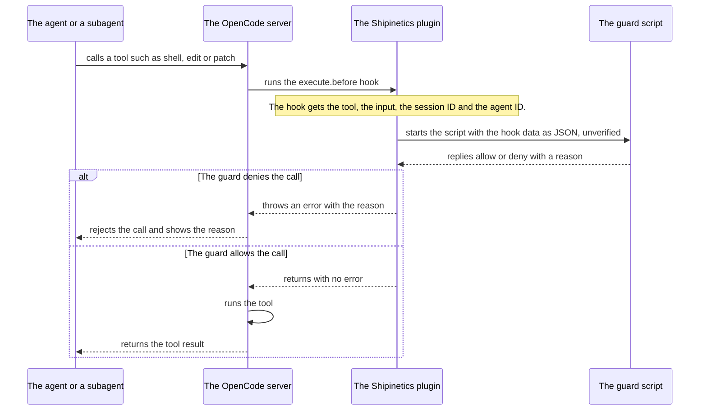

# OpenCode as a harness for Shipinetics

Checked: 2026-11-22

Sources: the docs at opencode.ai/docs (their Markdown versions, fetched on 2026-11-22), the config schema at opencode.ai/config.json, and the repository `anomalyco/opencode` at commit `4332e24fad949f3ec404fddd0050ec5d9606f74a` (branch `dev`, 2026-11-22). `github.com/sst/opencode` now redirects to `github.com/anomalyco/opencode`. I checked every claim below on 2026-11-22. In the source links, `SRC` stands for `https://github.com/anomalyco/opencode/blob/4332e24fad949f3ec404fddd0050ec5d9606f74a`.

**Version warning.** OpenCode now has two release lines:

- OpenCode 2 is the current release (v2.3.2, 2026-11-18). Its docs are at `/docs`.
- OpenCode 1 still gets fixes (v1.19.6, 2026-11-17). Its docs moved to `/v1/docs`.

V2 reads the V1 config, agents, commands and skills. But **V1 plugins do not run in V2**. This note is about V2. A short V1 section is near the end. Releases: https://github.com/anomalyco/opencode/releases. Migration guide: https://opencode.ai/docs/migrate-v1/.

## Summary

An OpenCode 2 adapter can keep almost all of the Shipinetics enforcement. A small TypeScript plugin can hold all the guards. Its `tool.execute.before` hook gets the tool name, the full input (the shell `command`, the edit `path`), the session ID and the **agent ID**. When that hook throws an error, OpenCode rejects the call, and the model sees the message. So these guards stay enforced:

- the edit guard (test-writer only, protected files)
- the secrets guard
- the PR gate

The plugin can call our bash scripts through a process call. The other Shipinetics hooks map to OpenCode as follows:

- The "ask" of the install gate maps to the permission `evaluate` hook. That hook can change a decision to `ask` or `deny`.
- The quick verify after a commit maps to `execute.after`. That hook can change the tool result that the model reads.
- The companions notice and the usage log map to the event stream (`session.created`, `session.idle`, `session.usage.updated`). They also map to the session tokens and cost, which OpenCode keeps in SQLite.

Skills (`SKILL.md`), `AGENTS.md`, commands and subagents all work. Each subagent has its own model, its own permissions and a fresh context. But there are gaps:

- OpenCode doesn't replace `${CLAUDE_PLUGIN_ROOT}`.
- Skill IDs lose the `shipinetics:` prefix.
- The temperature of an agent has no effect in V2.

The main risks:

- The plugin API is new (V2 only, not V1).
- The edit guard must also parse the multi-file `patch` tool.
- The `SHIPINETICS_*` session variables of the guards must reach the shared background server, not only the terminal of the user.

## Table

| Row | Supported? (yes, partly, no, unverified) | How | Source (URL) |
|---|---|---|---|
| 1. Instruction files | yes | OpenCode reads `~/.config/opencode/AGENTS.md`, then every `AGENTS.md` from the workspace up to the project root (or home). It reads `CLAUDE.md` in each folder that has no `AGENTS.md`. It reads `~/.claude/CLAUDE.md` when there is no global `AGENTS.md`. The `instructions` array adds files, globs and URLs. | https://opencode.ai/docs/instructions/ |
| 2. Skills | yes | OpenCode reads `SKILL.md` folders or flat `.md` files from `.opencode/skills`, `~/.config/opencode/skills`, `.claude/skills`, `~/.claude/skills`, `.agents/skills` and `~/.agents/skills`. A `skills` config array of paths or URLs adds more. Frontmatter: `name`, `description`, `metadata.opencode/autoinvoke`, `disable-model-invocation`. The model loads a skill with the `skill` tool. The user types `@skill-id`. | https://opencode.ai/docs/skills/ |
| 3. Custom commands | yes | Markdown in `.opencode/commands/` or `~/.config/opencode/commands/`, or JSON under `commands`. Frontmatter: `description`, `agent`, `model`, `subagent`. A command can use `$ARGUMENTS`, `$1`, and the shell output of `` !`cmd` ``. | https://opencode.ai/docs/commands/ |
| 4. Agents and subagents | yes (temperature: partly) | Markdown in `.opencode/agents/` or `~/.config/opencode/agents/`, or JSON under `agents`. `mode: primary`, `subagent` or `all`. Each agent has an ordered list of `permissions` rules. `model: provider/model#variant` (the variant sets the reasoning effort). The `subagent` tool starts a child session with fresh context, always in the background. OpenCode keeps the agent `request.body` (temperature) but doesn't send it. | https://opencode.ai/docs/agents/ , https://opencode.ai/docs/tools/ |
| 5. Hooks and plugins | yes | A V2 plugin (`Plugin.define({ id, setup(ctx) })`) registers `ctx.tool.hook("execute.before")` and `("execute.after")`, `ctx.permission.hook("evaluate")`, `ctx.shell.hook("create.before")`, session hooks, and `ctx.event.subscribe()`. A throw in `execute.before` rejects the call. `execute.after` can replace the result. The plugin runs in the Bun-based server and can start processes. | https://opencode.ai/docs/build/plugins/server/ , SRC/packages/plugin/src/promise/tool.ts , SRC/packages/core/src/plugin/hooks.ts |
| 6. Packaging and install from a local folder | yes | OpenCode loads local plugin folders in `.opencode/plugins/` or `~/.config/opencode/plugins/` automatically. You can also list a path, an npm name or a git spec in `plugins`. Config: `~/.config/opencode/opencode.json(c)`, `<project>/opencode.json(c)`, `<project>/.opencode/opencode.json(c)`, and a system folder. | https://opencode.ai/docs/plugins/ , https://opencode.ai/docs/config/ |
| 7. MCP | yes | `mcp.servers.<name>` with `type: local` (command, stdio) or `type: remote` (url, OAuth by default). `opencode mcp add/list/auth` | https://opencode.ai/docs/mcp-servers/ |
| 8. Model selection | yes | Root `model: provider/model`. Each agent and each command can set `model: provider/model#variant`. A subagent with no model uses the model of its parent. `opencode run --model`. `opencode models` lists the models. `small_model` is a V1 field that maps to `agents.title.model`. | https://opencode.ai/docs/models/ , https://opencode.ai/docs/agents/ , https://opencode.ai/docs/migrate-v1/ |
| 9. Plans and usage | partly | OpenCode has the MIT License. OpenCode Console sells pay-as-you-go credits for a curated set of models. The Go plans cost $10 per month, $40 per month and $20 per member per month. You can sign in with ChatGPT Plus or Pro. Claude plans work only through "Claude Agent", which runs your installed Claude Code. GitHub Copilot uses device OAuth. The name "Zen" is now only a provider ID on one harness page. | https://opencode.ai/docs/console/ , https://opencode.ai/docs/console/go/ , https://opencode.ai/docs/providers/ , https://opencode.ai/docs/claude-agent/ |
| 10. Transcripts | yes | A SQLite database, usually `~/.local/share/opencode/opencode.db` (`opencode debug paths db`). Each assistant message has `tokens` (input, output, reasoning, cache read and write) and `cost` in USD. `opencode session export`, `opencode stats --cost --json` | https://opencode.ai/docs/troubleshooting/ , https://opencode.ai/docs/cli/ , SRC/packages/schema/src/session-message.ts |
| 11. Permissions | yes (sandbox: no) | An ordered `permissions` list of `{action, resource, effect}`. The last rule that matches decides. Shell rules match each subcommand that a built-in scanner finds. `policies` can deny with no override. The docs describe no OS sandbox: the shell runs with the full authority of the user. | https://opencode.ai/docs/permissions/ , https://opencode.ai/docs/policies/ |
| 12. Non-interactive, server, SDK, GitHub | partly | `opencode run` (with `--format json`, `--agent`, `--model`, `--auto`, `--standalone`). `opencode serve` with an HTTP API, `@opencode/client` and the embedded `@opencode/sdk`. The V2 docs show only a plain GitHub Actions job. Only the V1 docs have the `/opencode` comment app and `opencode github install`. The `github/` action folder is no longer on `dev`. | https://opencode.ai/docs/cli/commands/ , https://opencode.ai/docs/build/sdk/ , https://opencode.ai/v1/docs/github/ |

## 1. Instruction files

Source: https://opencode.ai/docs/instructions/ (checked 2026-11-22).

- **Global and project.** OpenCode loads `~/.config/opencode/AGENTS.md`. Then it loads every `AGENTS.md` from the current workspace folder up to home. For a workspace outside home, it stops at the project root. In the prompt, the global file comes first, then the files from nearest to farthest:

  ```text
  ~/.config/opencode/AGENTS.md
  packages/web/AGENTS.md
  packages/AGENTS.md
  AGENTS.md
  ```

- **Nested files** below the workspace load when the agent reads or lists a file in that folder.
- **Live updates.** When a global or upward `AGENTS.md` changes during a session, OpenCode sends the change as an "instruction update" before the next model request.
- **CLAUDE.md fallback**, quoted: "In any directory without an `AGENTS.md`, OpenCode reads `CLAUDE.md` instead. Without a global `~/.config/opencode/AGENTS.md`, it reads `~/.claude/CLAUDE.md`. A directory's `AGENTS.md` always wins over its `CLAUDE.md`." `OPENCODE_DISABLE_CLAUDE_CODE_PROMPT=1` skips every `CLAUDE.md`. `OPENCODE_DISABLE_CLAUDE_CODE=1` also skips the `.claude` skills.
- **`instructions` config.** This setting adds files, globs, `~/` paths, absolute paths or HTTP(S) URLs. They load after the `AGENTS.md` files.

  ```jsonc
  {
    "$schema": "https://opencode.ai/config.json",
    "instructions": ["CONTRIBUTING.md", "docs/guidelines/*.md", "~/rules/opencode.md", "https://example.com/instructions.md"]
  }
  ```

- **Prompt order:**
  1. The system prompt of the agent or the provider.
  2. The Code Mode guidance.
  3. The MCP and skill guidance.
  4. The `AGENTS.md` files, then the configured instructions.
  5. The date and the environment.
  6. The session entries from the API.

For Shipinetics: the `AGENTS.md` block from the setup template works with no change. A project that has only a `CLAUDE.md` with an `@AGENTS.md` import gets the `CLAUDE.md` text. I did not check whether OpenCode follows `@` imports inside it.

## 2. Skills

Source: https://opencode.ai/docs/skills/ (checked 2026-11-22).

- **Folders searched**: all four folders that we asked about, and also their global forms:

  | Scope | Sources |
  |---|---|
  | Global | `~/.config/opencode/skills` |
  | Global compatibility | `~/.claude/skills`, `~/.agents/skills` |
  | Project | `.opencode/skills` |
  | Project compatibility | `.claude/skills`, `.agents/skills` |

  OpenCode searches the project folders from the current folder up to the project root. V2 also reads the old singular `.opencode/skill/` (https://opencode.ai/docs/migrate-v1/).
- **More sources**: a `skills` array of local paths or HTTP catalogs (a base URL with `index.json`). In V1, these were `skills.paths` and `skills.urls`.

  ```jsonc
  { "skills": ["./team-skills", "~/shared/opencode-skills", "https://example.com/opencode/skills/"] }
  ```

- **Forms**: `<source>/name.md` at the root, or `<source>/.../name/SKILL.md` at a depth of up to six levels. OpenCode skips hidden folders and `node_modules`.
- **ID**: the file path sets the ID, not `name`. The ID of `skills/teams/release/SKILL.md` is `release`. The docs recommend `^[a-z0-9]+(-[a-z0-9]+)*$`, but V2 doesn't enforce it. When two sources have the same ID, the later source is used. Precedence, from low to high: built-in, `.claude/skills`, `.agents/skills`, `~/.config/opencode/skills`, project `.opencode/skills`, then the `skills` entries.
- **Frontmatter**:

  | Field | Behavior |
  |---|---|
  | `name` | The display name. The default is the ID from the path. |
  | `description` | The summary that the model sees. Without it, OpenCode doesn't show the skill to the model. |
  | `metadata.opencode/autoinvoke` | `false` hides the skill from the list of the model. |
  | `disable-model-invocation` | `true` has the same effect. |

  OpenCode accepts `license` and `compatibility` and ignores them. The docs don't mention `argument-hint` (Shipinetics uses it). The docs don't describe unknown fields, so OpenCode probably ignores them (unverified).
- **Invocation**: at each step, the model sees the ID, the name and the description of each skill. The model calls the `skill` tool with `{ "id": "git-release" }`. Then OpenCode does these steps:
  1. It checks the `skill` permission of the agent.
  2. It adds the body without the frontmatter.
  3. It gives "the skill's base directory and a sample of up to ten supporting file paths".

  The user can type `@skill-id` in a prompt.
- **Permissions**: `{ "action": "skill", "resource": "internal-*", "effect": "deny" }`.

For Shipinetics:
- The skill IDs become `evidence`, `workflow` and so on. Text that says `shipinetics:evidence` must change. If it doesn't, the names can collide with other skills.
- OpenCode doesn't replace `${CLAUDE_PLUGIN_ROOT}` and `${CLAUDE_SKILL_DIR}` (the docs describe no substitution). The skill gets its base directory, so paths relative to the skill folder work.
- Our skills aren't in a searched folder. So the install adds the `skills/` folder of the clone to a `skills` entry in the global config.

## 3. Custom commands

Source: https://opencode.ai/docs/commands/ (checked 2026-11-22).

- Markdown: `~/.config/opencode/commands/<name>.md` (global) and `.opencode/commands/<name>.md` (project). `command/` (singular) still works. A nested path becomes a command such as `/team/review`.
- JSON: under `commands` in any config file. Each command needs `template`.
- Fields: `template` (JSON only), `description`, `agent`, `model` (`provider/model#variant`), `subagent` (`true` runs the command in a background child session). `subtask` is a deprecated alias.
- Arguments: `$ARGUMENTS`, `$1`, `$2`. When the command has no placeholder, OpenCode adds the arguments after a blank line.
- Shell: `` !`git diff --stat` `` puts the output of the command into the prompt. Quote: "Shell blocks run when OpenCode evaluates the command, outside the agent's tool permission flow."

```md
---
description: Review code for correctness
agent: plan
model: anthropic/claude-sonnet-5-5#high
---

Review $ARGUMENTS. Report bugs first.
```

A plugin can also register commands with `ctx.command.transform(editor => editor.add({ name, description, execute }))` (https://opencode.ai/docs/build/plugins/server/).

## 4. Agents and subagents

Sources: https://opencode.ai/docs/agents/ , https://opencode.ai/docs/tools/ , https://opencode.ai/docs/migrate-v1/ (checked 2026-11-22).

- **Where**: `~/.config/opencode/agents/<name>.md` and `.opencode/agents/<name>.md`, or JSON under `agents`. A nested path becomes part of the ID: the ID of `.opencode/agents/team/reviewer.md` is `team/reviewer`. The body is the system prompt.
- **Native V2 frontmatter** (the same fields as a JSON entry): `description`, `mode`, `model`, `system` (JSON only), `permissions`, `steps`, `hidden`, `color` (six-digit hex), `disabled`, `request`.

  ```md
  ---
  description: Reviews changes for correctness and regressions
  mode: subagent
  model: anthropic/claude-sonnet-5-5#high
  permissions:
    - action: edit
      resource: "*"
      effect: deny
    - action: shell
      resource: "*"
      effect: deny
  ---

  Review the current changes. List findings in severity order with file and line references.
  ```

- **Modes**: `primary` (the default for a new custom agent), `subagent` (only in a child session through the `subagent` tool), `all`.
- **Tools for each agent**: V2 has no tool list. You deny actions in `permissions` (`shell`, `edit`, `read`, `glob`, `grep`, `webfetch`, `websearch`, `skill`, `subagent`). OpenCode adds the rules of the agent after the global rules. Quote: "A custom subagent uses its own permissions, not a subset of its parent's permissions."
- **Model and reasoning**: `model: provider/model#variant`. A variant usually stands for a reasoning effort (`#high`). You can define your own variants in the provider config (https://opencode.ai/docs/models/). "A subagent uses its configured model, or inherits the parent session's model when none is configured."
- **Temperature**: V2 has no temperature for each agent. Quote: "Agent `request.body` is kept but not sent to the model, so V1 `temperature`, `top_p`, and `options` have no effect there. Set them on a model variant instead."
- **V1 frontmatter** (`tools`, `permission`, `temperature`, `prompt`, `name`) is deprecated, but OpenCode still translates it. When a file uses a V2 field (`permissions`, `request`, `system`, `disabled`), OpenCode reads it as V2 and ignores its V1 fields.
- **How the main agent calls a subagent**: the `subagent` tool takes `agent`, `description` and `prompt`. It also takes an optional `sessionID` for a follow-up (source: SRC/packages/core/src/tool/plugin/subagent.ts). Quote from the tools page: "Subagents always run in the background. The call returns immediately with a `sessionID`, and the parent receives a `<subagent>` message when the child goes idle". The `subagent` permission of the parent (resource = the agent ID) controls which agents the parent can start.
- **Fresh context**: yes. Quote: "Subagents run with fresh context in their own child sessions." The default nesting depth is 1 (`experimental.subagent_depth`).
- **Built-in agents**: `build`, `plan` (primary), `general`, `explore` (subagent).

For Shipinetics: an installer must generate native agent files, as `bin/shipinetics-antigravity` does. The installer maps these fields:

- the Claude `tools:` to `permissions` deny rules
- `model: opus|sonnet` with `effort` to `anthropic/<model>#<variant>`
- the color names to hex

The guard can read the ID `test-writer` from the file name. A plugin can't add agents: `AgentEditor` has `list`, `get`, `default`, `update` and `remove`, but no `add` (SRC/packages/plugin/src/promise/agent.ts). So the agents ship as files.

## 5. Hooks and plugins

Sources: https://opencode.ai/docs/build/plugins/ , https://opencode.ai/docs/build/plugins/server/ , https://opencode.ai/docs/build/plugins/migrate-v1/ , and source code (checked 2026-11-22).

### Shape and loading

```ts
import { Plugin } from "@opencode/plugin"

export default Plugin.define({
  id: "example",
  async setup(ctx) {
    await ctx.storage.set("loaded", true)
  },
})
```

`setup` runs when the plugin loads. It can return a cleanup function. `ctx` is a full server client (sessions, permissions, agents, skills, MCP, storage), with hooks and transforms. `ctx.location.directory` is the folder where the plugin loaded. `ctx.options` holds the options from the config. The host gives `effect` and `@opencode/plugin` to plugins (SRC/packages/plugin/src/runtime-modules.ts). So a local plugin needs no `npm install` for the SDK. That is my reading of the code. The docs don't state it.

### Hooks that exist (V2)

| Domain | Hook | What it does |
|---|---|---|
| `ctx.tool.hook` | `execute.before` | It reads or replaces `tool` and `input` before a call. A throw rejects the call. |
| `ctx.tool.hook` | `execute.after` | It reads the result or the error of the call. It can replace `result`. |
| `ctx.permission.hook` | `evaluate` | It runs after the config rules for `allow` and `ask` decisions. It can set `effect` to `allow`, `ask` or `deny`, with `message`. A configured `deny` is final, and OpenCode skips the hook for it. |
| `ctx.shell.hook` | `create.before` | It changes `command`, `cwd`, `timeout`, `shell` and `env` before a shell process starts. |
| `ctx.session.hook` | `prompt`, `context`, `compaction`, `generate`, `title`, `fork`, `model.request`, `http.request`, `http.response`, `retry`, `experimental.model.resolve`, `experimental.ws.*` | These hooks act on prompt admission, on the system prompt and the messages before each model call, and on the raw requests. |

The exact argument types, from SRC/packages/plugin/src/promise/tool.ts:

```ts
export interface ToolHooks {
  readonly "execute.before": {
    tool: string
    readonly info?: Info
    readonly codemode: boolean
    readonly sessionID: Session.ID
    readonly agent: Agent.ID
    readonly messageID: SessionMessage.ID
    readonly id: Tool.CallID
    input: unknown
  }
  readonly "execute.after": {
    readonly tool: string
    readonly info?: Info
    readonly codemode: boolean
    readonly sessionID: Session.ID
    readonly agent: Agent.ID
    readonly messageID: SessionMessage.ID
    readonly id: Tool.CallID
    readonly input: unknown
  } & (
    | { readonly status: "completed"; result: Tool.Result }
    | { readonly status: "error"; error: Tool.Error }
  )
}
```

`Tool.Result` is `{ output?, content?: string | Content[], metadata? }` (SRC/packages/schema/src/tool.ts).

The names and inputs of the built-in tools (https://opencode.ai/docs/tools/ and SRC/packages/core/src/tool/plugin/*.ts):

| Tool | Input fields | Permission action, resource |
|---|---|---|
| `shell` | `command`, `workdir`, `timeout`, `background` | `shell`, each subcommand from the scanner |
| `read` | `path`, `offset`, `limit` | `read`, the path |
| `edit` | `path`, `oldString`, `newString`, `replaceAll` | `edit`, the path |
| `write` | `path`, `content` | `edit`, the path |
| `patch` (some GPT models only) | `patchText` with `*** Add File`, `*** Update File`, `*** Delete File` sections | `edit`, every path in the patch |
| `subagent` | `agent`, `description`, `prompt`, `sessionID` | `subagent`, the agent ID |
| `skill` | `id` | `skill`, the skill ID |

The V1 example in the migration guide reads `input.filePath`. The V2 tools use `path`.

### Can a before-hook block a call?

Yes. A comment in SRC/packages/core/src/plugin/hooks.ts says: "Only tool execute.before may fail: a Tool.Error rejects the call before it runs." The Promise adapter changes any thrown error into a `Tool.Error` with the message of the error (`toolError`, SRC/packages/plugin/src/promise/adapter.ts). The guard example in the docs:

```ts
await ctx.tool.hook("execute.before", (event) => {
  const input = event.input as { filePath?: string }
  if (event.tool === "read" && input.filePath?.includes(".env")) {
    throw new Error("Do not read .env files")
  }
})
```

The hook can also change `event.input` or `event.tool`. To ask instead of deny, a plugin has two choices:

- Use the permission `evaluate` hook, and set `event.effect = "ask"`.
- Call `ctx.permission.assert(...)` with a custom action, and add a config rule for that action.

The permissions doc says that a denial carries the reason "so the model sees it and continues".

The core tool executor runs the hook for every call. This includes the tools inside Code Mode `execute` programs (`codemode: true`, SRC/packages/core/src/tool.ts). So the calls from child sessions (subagents) also go through it. I read this from the code and didn't test it.

The diagram shows how a Shipinetics plugin for OpenCode 2 would run a guard on one tool call. It uses only what this note found.



Source: this section and "Can a plugin run our bash scripts?" below. The guards it maps to are `scripts/guard-secrets.sh`, `scripts/guard-pr.sh`, `scripts/guard-installs.sh` and `scripts/guard-edits.sh`, which read the hook input through the `sy_hook_*` functions in `scripts/lib.sh`. Open question 3 asks whether a V2 plugin can start a child process. So the step from the plugin to the guard script is unverified.

### Can an after-hook add text the model sees?

Yes. In SRC/packages/core/src/tool.ts, the executor runs `execute.after`. Then it builds the returned content of the tool from `afterEvent.result.content`. A plugin can add a line to `event.result.content`. Docs example:

```ts
await ctx.tool.hook("execute.after", (event) => {
  if (event.status === "completed") event.result = { ...event.result, metadata: { observed: true } }
})
```

A plugin can also give the model context in these ways:

- `ctx.session.synthetic({ sessionID, text })`
- `ctx.session.instructions.entry.put({ sessionID, key, value })`, which shows as a `<context key="...">` block

### Events (for session start and end)

`ctx.event.subscribe({ types: [...] })` gives the event stream of the server. The event types in SRC/packages/schema/src (session-event.ts, permission.ts and other files) include `session.created`, `session.idle`, `session.status`, `session.error`, `session.deleted`, `session.updated`, `session.tool.called`, `session.tool.success`, `session.tool.failed`, `session.usage.updated`, `session.usage.recorded`, `session.step.ended`, `session.compaction.ended`, `permission.asked`, `permission.replied`, `message.updated` and `config.updated`. The docs give no complete list. They refer to the `V2EventEncoded` schema in the API reference.

### Can a plugin run our bash scripts?

Yes, most likely. The build makes the server with `Bun.build` and `compile` (SRC/packages/cli/script/build.ts), so plugins run on Bun. The migration guide replaces the V1 `$` Bun shell helper with "import and manage the process API your plugin uses". A small plugin can call `Bun.spawn` or `node:child_process` and send the data of the hook as JSON on stdin. Then it can change the reply of the script into a throw or into `effect = "ask"`. No official example starts a child process, so this is my inference.

### Where plugins live

- Automatic: OpenCode loads `.ts` or `.js` files and plugin folders directly in every `.opencode/plugins/` folder and in `~/.config/opencode/plugins/`.
- Configured: `plugins` in `opencode.json(c)`, as an npm name, a version, a git spec, a relative or absolute folder, or a `file://` URL. A configured local path must be a folder. OpenCode skips a path to a single file. It resolves relative paths from the config file.
- A local folder with a `package.json` (`name`, `exports`) loads through its exports. When the folder has no `package.json`, OpenCode uses `server` (else `index`) with the extension `.ts`, `.tsx` or `.js` at the root of the folder.
- `"-id"` turns a plugin off. The `*` and `.*` wildcards work. When a watched folder changes, OpenCode reloads it automatically. `opencode plugin add|list|check|update|remove` install, list, check, update and remove package plugins.

## 6. Packaging and install from a local folder

Sources: https://opencode.ai/docs/plugins/ , https://opencode.ai/docs/config/ , https://opencode.ai/config.json (checked 2026-11-22).

- **Config files**, from low to high precedence:
  1. `~/.config/opencode/opencode.json(c)`.
  2. The `opencode.json(c)` files, from the farthest folder to the nearest.
  3. The `.opencode/opencode.json(c)` files, in the same order.

  The system folder (`/Library/Application Support/opencode` on macOS, `/etc/opencode` on Linux) and the macOS managed preferences have precedence over all of these. OpenCode also loads `agents/`, `commands/`, `skills/` and `plugins/` from the system folder and the global folder.
- **Local plugin**: list the plugin folder of the clone in the global config. Or link it into `~/.config/opencode/plugins/<name>/`.

  ```jsonc
  {
    "$schema": "https://opencode.ai/config.json",
    "plugins": ["/Users/me/Projects/shipyard/opencode", { "package": "./plugins/local", "options": { "strict": true } }],
    "skills": ["/Users/me/Projects/shipyard/skills"]
  }
  ```

- **npm or git**: `opencode plugin add @scope/name@1.2.0` or `opencode plugin add github:acme/plugin#main`. An exact version stays pinned. OpenCode updates ranges and branches every 24 hours.
- **Schema**: `opencode.ai/config.json` has both the V1 keys and the V2 keys. These include `agent` and `agents`, `command` and `commands`, `plugin` and `plugins`, `permission` and `permissions`, `instructions`, `skills`, `mcp`, `model`, `small_model` and `policies`.

A Shipinetics installer for OpenCode would do these steps:

1. Link or list the folder of the Shipinetics plugin.
2. Add the `skills/` path.
3. Generate `~/.config/opencode/agents/*.md` from `agents/*.md`.
4. Put `bin/` on the PATH of the server process (see "Open questions").

## 7. MCP

Source: https://opencode.ai/docs/mcp-servers/ (checked 2026-11-22).

- The client can use tools, prompts, resources and instructions from a server.
- The V2 config uses `mcp.servers.<name>`. `disabled` replaces the V1 `enabled`. The config has two timeouts: `timeout.catalog` and `timeout.execution`.

  ```jsonc
  {
    "mcp": {
      "servers": {
        "everything": {
          "type": "local",
          "command": ["npx", "-y", "@modelcontextprotocol/server-everything"],
          "environment": { "MCP_API_KEY": "{env:MCP_API_KEY}" }
        },
        "context7": { "type": "remote", "url": "https://mcp.context7.com/mcp" }
      }
    }
  }
  ```

- CLI: `opencode mcp add <name> --url <url>`, `opencode mcp add <name> [--global] -- <command>`, `opencode mcp list`, `opencode mcp auth <name>`, `opencode mcp logout <name>`. Remote servers use OAuth by default.
- By default, agents use MCP tools through Code Mode (`execute`). `codemode: false` shows them as direct tools. Permission action: `<server>_<tool>` (https://opencode.ai/docs/tools/).
- Plugins can add servers with `ctx.mcp.transform`.

The install gate matches `claude mcp add`. It would also need to match `opencode mcp add` and `opencode plugin add`.

## 8. Model selection

Sources: https://opencode.ai/docs/models/ , https://opencode.ai/docs/providers/ , https://opencode.ai/docs/cli/commands/ , https://opencode.ai/docs/migrate-v1/ (checked 2026-11-22).

- **Providers**: a catalog from models.dev, and also Bedrock, Vertex, Azure, Copilot, Ollama, LM Studio, vLLM, any OpenAI-compatible endpoint, and custom packages. Connect with `/connect` or `opencode auth login <provider>`.
- **Global default**: `"model": "anthropic/claude-sonnet-5-5"`. The root value has no `#variant`.
- **For an agent**: `model: provider/model#variant` in the frontmatter, or `{ "providerID", "model", "variant" }` in JSON.
- **For a subagent**: the same field on the subagent. When the field isn't set, the subagent uses the model of the parent session.
- **For a command**: `model:` in the command. It has precedence over the model of the agent.
- **For a run**: `opencode run --model openai/gpt-6.1-sol#high "..."`.
- **List models**: `opencode models`, or `/models` in the TUI.
- **small_model**: the schema still has it as a V1 field. Quote: "`small_model` becomes the `model` selection for the built-in `title` agent. Native V2 configuration should use `agents.title.model` instead."
- **Variants**: named settings for one model, often a reasoning effort. You define them in `providers.<id>.models.<id>.variants[]` with `settings`, `headers` and `body`.

## 9. Plans and usage

Sources: https://github.com/anomalyco/opencode/blob/4332e24fad949f3ec404fddd0050ec5d9606f74a/LICENSE , https://opencode.ai/docs/console/ , https://opencode.ai/docs/console/go/ , https://opencode.ai/docs/console/models/ , https://opencode.ai/docs/console/billing/ , https://opencode.ai/docs/providers/ , https://opencode.ai/docs/claude-agent/ , https://opencode.ai/docs/models/ (checked 2026-11-22).

- **OpenCode itself**: MIT License. You bring a provider.
- **OpenCode Console** ("optional"): it sells pay-as-you-go credits for "a list of models tested and verified by the OpenCode team". It also has workspaces, budgets, policies and web search. Quote: "Console is free for any team size, with no seat fees. You pay only for usage, from prepaid credits".
- **Free models**: Console has free models. They need OpenCode. `OPENCODE_DISABLE_FREE_MODELS=1` hides them.
- **OpenCode Go**: Go costs $10/month, Go Plus $40/month, and Go Teams $20/member/month (with a minimum of 2 members). These plans are for open coding models.
- **Zen**: the current docs don't use "OpenCode Zen" as a product name. The name shows only as the provider ID `opencode-zen` ("Pay-as-you-go") on the Hermes harness page (https://opencode.ai/docs/console/harnesses/hermes/). It is possibly the old name of the Console pay-as-you-go credits (unverified).
- **ChatGPT**: quote: "Use a ChatGPT Plus or Pro plan instead of an OpenAI API key. Connect OpenAI, then choose Sign in with ChatGPT … Usage counts against your plan, so these models show no cost." The context has the same limit as in Codex.
- **Claude**: through "Claude Agent". Its page has `noindex` in its frontmatter, but the page is live. Quote: "Use your Claude plan or another Claude Code login. Claude Agent runs Claude Code on your machine, so install Claude Code 2.1.248 or later and sign in first." The tools, permissions and plugin hooks of OpenCode stay in control. OpenCode doesn't load the hooks, `CLAUDE.md`, skills and MCP of Claude Code. With a Claude subscription, OpenCode shows no cost. The docs describe no direct Anthropic OAuth sign-in for Claude plans.
- **GitHub Copilot**: device OAuth with a Copilot Chat entitlement.

## 10. Transcripts

Sources: https://opencode.ai/docs/troubleshooting/ , https://opencode.ai/docs/cli/ , https://opencode.ai/docs/cli/commands/ , source (checked 2026-11-22).

- **Where**: a SQLite database, usually `~/.local/share/opencode/opencode.db`. `XDG_DATA_HOME`, the release channel and `OPENCODE_DB` can change the path. `opencode debug paths db` prints the path and doesn't start a server. The docs say: do not edit the database, and make a backup before you look into it.
- **Format**: the tables `session`, `session_message` (with a JSON `data` column) and `session_part` (SRC/packages/core/src/session/sql.ts).
- **Tokens and cost**: the schema of an assistant message has `cost: Money.USD` and `tokens: { input, output, reasoning, cache: { read, write } }`, and also `agent` and `model` (SRC/packages/schema/src/session-message.ts, SRC/packages/schema/src/token-usage.ts). Compaction, title and generate calls write a `session.usage.recorded` event with their own cost and tokens (SRC/packages/schema/src/session-event.ts).
- **Tools**: `opencode session list --format json`, `opencode session export <id>` (JSON, with `--sanitize`), `opencode stats --cost --models --json`. I didn't check the fields inside `session export`.

`scripts/usage.py` can read the database in read-only mode, or call `opencode stats --json`. Neither way adds a model call.

## 11. Permissions

Sources: https://opencode.ai/docs/permissions/ , https://opencode.ai/docs/policies/ , https://opencode.ai/docs/tools/ (checked 2026-11-22).

- **V2 format**: an ordered list. The last rule that matches decides. When no rule matches, the effect is `ask`.

  ```jsonc
  {
    "$schema": "https://opencode.ai/config.json",
    "permissions": [
      { "action": "shell", "resource": "*", "effect": "ask" },
      { "action": "shell", "resource": "git status *", "effect": "allow" },
      { "action": "shell", "resource": "git push *", "effect": "deny" }
    ]
  }
  ```

- **Wildcards**: `*` (it also matches `/`) and `?`, over the full value. A shell pattern that ends in ` *` also matches the command with no arguments.
- **For each bash pattern**: each shell resource is a "scanner-produced command string; compound commands may produce several". When the scanner can't parse a command (`eval`, bad syntax), the command fails if any shell deny rule applies. When an operation has more than one resource, one `deny` is enough to deny it.
- **Defaults**: every agent starts with allow-all, and with `ask` for reads of `*.env` and `*.env.*` (`*.env.example` is allowed). V2 allows `external_directory` by default. V1 asked.
- **For an agent**: `agents.<id>.permissions`, added after the global rules.
- **V1 names**: `permission`, `bash`, `task` and `write`/`patch` became `permissions`, `shell`, `subagent` and `edit`.
- **Approvals**: `once`, `always` (saved as an allow for the project, never over a configured deny), `reject`.
- **Policies**: `policies` can change `allow` or `ask` to `deny` after all the rules. Global policies and Console policies have precedence over the project config.
- **Sandbox**: the docs describe none. The tools page says "`shell` executes a command in the host user's shell" with "the host user's filesystem, process, and network authority". Snapshots (a separate git object store) let you undo file changes (https://opencode.ai/docs/snapshots/).

The deny rules in `.claude/settings.json` (`git push --force`, `git reset --hard`, `gh pr merge`, `npm publish`, the `~/.ssh` reads) map directly to `shell` and `read` deny rules. Shell rules match each subcommand. So OpenCode catches `cd x && git push --force` better than Claude Code does.

## 12. Non-interactive mode, server, SDK and GitHub

Sources: https://opencode.ai/docs/cli/commands/ , https://opencode.ai/docs/cli/ , https://opencode.ai/docs/build/sdk/ , https://opencode.ai/docs/build/client/ , https://opencode.ai/v1/docs/github/ (checked 2026-11-22).

- **`opencode run "<prompt>"`** has these flags: `--model`, `--agent`, `--continue`, `--session <id>`, `--file`, `--format json` (newline-delimited JSON), `--auto` ("Auto-approve permissions that are not explicitly denied"), `--archived`, `--standalone` (a private server).
- **Server**: by default, all the clients of a user use one shared background server. Quote: "which owns sessions, configuration, integrations, permissions, and tool execution." The commands are `opencode serve [--hostname --port --cors]`, `opencode service start|stop|restart|set env`, `opencode reload` and `opencode api <op>`. HTTP Basic auth uses `OPENCODE_PASSWORD`.
- **SDK**: `@opencode/client` is the HTTP client. `@opencode/sdk` (`OpenCode.create()`) runs OpenCode inside your process with no HTTP listener. Both are new in V2. The V1 server API has a breaking change.
- **ACP**: `opencode acp` serves editors over stdio.
- **GitHub and PRs**:
  - The V2 docs show only a plain GitHub Actions job. The job runs `opencode run --standalone --model ... "Review this repository..."` on `pull_request`.
  - Only the V1 docs have the `/opencode` and `/oc` comment bot, `opencode github install`, the `opencode-agent` GitHub app and `uses: anomalyco/opencode/github@latest`.
  - The `github/` folder with `action.yml` exists at the tag `v1.19.6` but not on `dev`. The V2 CLI source has no `github` command.
  - Agents open PRs with `gh` through the shell tool, so the PR gate still applies.

## OpenCode 1 differences (for users who stay on V1)

Source: https://opencode.ai/v1/docs/plugins/ and https://opencode.ai/docs/build/plugins/migrate-v1/ (checked 2026-11-22).

- **Plugins**: a V1 plugin is a function that returns hooks by name: `"tool.execute.before": async (input, output) => {...}`, with `input.tool` and `output.args`. A throw blocks the call. V1 lists events such as `session.created`, `session.idle`, `permission.asked`, `tool.execute.before/after`, `shell.env` and `file.edited`. The context has a `$` Bun shell helper.
- **Config**: `plugin` (singular), `permission` with `bash`, agent `tools` maps and `temperature`.
- **One package for both lines**: a package can serve both lines from one default export, with `server()` for V1 and `setup()` for V2. V1 accepts this from 1.18.29.

## Open questions

1. **Session env variables.** The guards read `SHIPINETICS_*` variables for each session. In OpenCode, the shared background server runs the tools and the plugin. So the variables that the user sets in a terminal may not reach the server. The docs say to use `opencode service set env` or `--standalone`. Check which `process.env` the plugin sees, and which env a shell call gets.
2. **PATH for `bin/`.** The same problem applies when we put the Shipinetics `bin/` on the PATH. A `shell` `create.before` hook could add it to `event.env.PATH`. That needs a test.
3. **Process calls from a plugin.** No official example starts a child process from a V2 plugin. Test that `Bun.spawn` or `node:child_process` works in the compiled server. Compare its timing with the timeouts of 10 to 60 seconds that our hooks use.
4. **Hooks in child sessions.** The code suggests that `execute.before` runs for subagent calls and Code Mode calls. Test it with a test-writer subagent.
5. **Edit and patch paths.** The `path` of `edit` and `write` can be relative. `patch` lists more than one file in `patchText`. The edit guard must resolve the paths against the session folder and parse the patch headers. Check whether `info` or `ctx.session.get` gives the session folder.
6. **`argument-hint` and unknown skill fields.** The docs don't describe them. Check that OpenCode ignores them and that they don't stop a skill from loading.
7. **`CLAUDE.md` imports.** The docs don't say whether OpenCode follows `@AGENTS.md` imports inside a fallback `CLAUDE.md`.
8. **Skill ID collisions.** Shipinetics IDs such as `review`, `testing` and `workflow` can have the same name as other skills in `.claude/skills` or `.agents/skills`. The `skills` config entries load last and are used, but a prefix may still be safer.
9. **Live docs and repository.** For every page that I checked (skills, agents, permissions, plugins server), the live Markdown page was the same as the docs in the repository. The full event list is in the API reference (`/docs/api`, a redirect). I didn't read it.
10. **V1 transcripts.** I didn't check where V1 keeps sessions or in which format.
