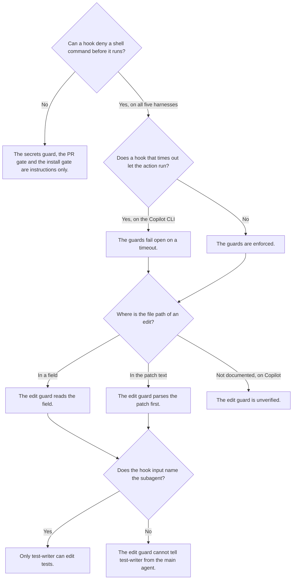

# Shipinetics on each harness: comparison

Checked: 2026-11-22. This table merges [harness-contract.md](harness-contract.md) (what Shipinetics needs) with the research notes [harness-codex.md](harness-codex.md), [harness-opencode.md](harness-opencode.md) and [harness-copilot.md](harness-copilot.md). Each cell comes from those notes, and the notes cite the sources. "Copilot" means the Copilot CLI, unless a cell names a different surface.

## What each harness gives Shipinetics

| Need | Claude Code | Antigravity | Codex | OpenCode 2 | Copilot |
|---|---|---|---|---|---|
| `AGENTS.md` loads each session | Yes, through `@AGENTS.md` in `CLAUDE.md` | Yes | Yes. Codex caps the project files together at 32 KiB | Yes. OpenCode reads `CLAUDE.md` where no `AGENTS.md` exists | Yes, together with `copilot-instructions.md` and `CLAUDE.md` |
| Skills (`SKILL.md`) | Yes, as `shipinetics:<name>` | Yes, as generated copies (`shipinetics install antigravity`, from 0.12.0) | Yes, from the plugin. The prefix stays | Yes, from `.claude/skills` and `.agents/skills`. The prefix is lost | Yes, from `.github/skills`, `.agents/skills`, `.claude/skills` and plugins |
| `${CLAUDE_PLUGIN_ROOT}` in skill text | Replaced | Not replaced. The generated copies hold real paths (from 0.12.0) | Not replaced. Codex sets it for hook commands only | Not replaced | Copilot sets it for hooks. In skill text, this is unverified |
| Subagents with their own model | Yes (`model`, `effort`, `tools`) | Yes, but our installer drops `model` and `effort` | Yes, as TOML in `~/.codex/agents/`, with `model` and `model_reasoning_effort`. Codex has no tool allowlist. A plugin cannot ship subagents | Yes, as Markdown agents, with `model: provider/model#variant` and permissions for each agent. A plugin cannot add agents | Yes, as `*.agent.md` with `model`, `tools` and `reasoningEffort` (CLI) |
| A hook before a shell command that can deny it | Yes | Yes | Yes, in the same format as Claude Code. Codex counts `ask` as a failed hook, so the guard must reply `deny` | Yes, through a TypeScript plugin. A throw rejects the call | Yes (CLI, and VS Code in preview), with a top-level `permissionDecision: "deny"` or exit code 2. A hook that times out lets the action run |
| A hook before a file edit that can deny it | Yes (`file_path`) | Yes | Yes, but the path is inside the `apply_patch` text | Yes (`path`). The guard must parse the multi-file `patch` tool | Yes. The docs do not name the path key of the edit tool, and `toolArgs` may be a JSON string |
| The hook knows the subagent | `agent_type` | `agentType` | `agent_type` | Agent ID | `agentType`. The value for a plugin agent is unverified |
| A hook after a command that adds context | Yes | Not wired | Yes | Yes. `execute.after` can replace the result | Yes |
| Session start and end hooks | Yes | Yes (Stop) | Yes. `SessionEnd` gets 3 seconds at most | The events are `session.created`, `session.idle` and `session.usage.updated` | Yes |
| Install from a local clone | `claude plugin marketplace add <clone>` (`shipinetics install claude`) | `shipinetics install antigravity` | `codex plugin marketplace add <clone>`, then `codex plugin add`. Codex installs a copy, so edits need a refresh. You approve each hook once in `/hooks` | A plugin folder in `~/.config/opencode/plugins/`, or a path in `plugins` | `copilot plugin install <clone>`. Our repo has two `hooks.json` files. Which one Copilot reads is unverified |
| Transcripts with token counts | JSONL | JSONL | JSONL rollouts. The format is not stable | SQLite, with the tokens and the cost of each message | `events.jsonl`. The docs do not describe its format |
| Sandbox | Optional (Seatbelt on macOS) | None known | On by default: no network, no local ports, and `.git` is read-only | None | Optional (`--sandbox`) |

## What this means for each guard

| Guard | Claude Code | Antigravity | Codex | OpenCode 2 | Copilot CLI |
|---|---|---|---|---|---|
| Secrets guard | Enforced | Enforced | Enforced | Enforced through the plugin | Enforced, but the guard fails open on a timeout |
| PR gate | Enforced | Enforced | Enforced. Without network, the sandbox blocks `gh` | Enforced through the plugin | Enforced, but the gate fails open on a timeout. The gate can take up to 60 seconds |
| Install gate | Enforced (`ask`) | Enforced | Enforced as `deny`, not as `ask` | Enforced through the permission hook | Enforced, but the gate fails open on a timeout |
| Edit guard (test-writer only, protected files) | Enforced | Enforced | Enforced, after the guard parses `apply_patch` | Enforced, after the guard parses `patch` | Enforced if `agentType` matches. This is unverified |
| Quick verify after a commit | Yes | No | Yes | Yes | Yes |
| Docs before `/compact` | Yes | No known hook | A PreCompact hook exists. It is unverified whether the hook can stop a compaction | Unverified | `preCompact` exists, but it cannot stop a compaction, and it runs only for automatic compactions |
| Git hooks and CI | The same everywhere | | | | |

The Copilot cloud agent is the surface that opens PRs on GitHub. It runs only `.github/hooks/*.json` from the default branch, and it cannot push or open PRs itself. On that surface, CI required checks and rulesets take the place of the PR gate.

The diagram shows the questions that decide how the guards hold on a harness, with the answer for each harness on the edges.

Source: the two tables above, and `scripts/guard-edits.sh` and `sy_hook_agent_type` in `scripts/lib.sh` for the subagent check. Claude Code, Antigravity and OpenCode 2 (`path`) give the path in a field. Codex (`apply_patch`) and the OpenCode 2 `patch` tool give it in the patch text. All five harnesses name the subagent in the hook input, but on Copilot the value for a plugin agent is unverified.

## Open questions that need a real install to answer

1. Codex: do hooks run inside the sandbox, so that the PR gate can reach GitHub? Can an installer approve the hooks before the first session?
2. OpenCode: can a plugin start a child process (our bash scripts)? Do hooks run for the tool calls of a subagent?
3. Copilot: which `hooks.json` does it read from our plugin? Is `toolArgs` a string? What `agentType` does a plugin agent report? Does Copilot accept the nested reply format of Claude Code?
