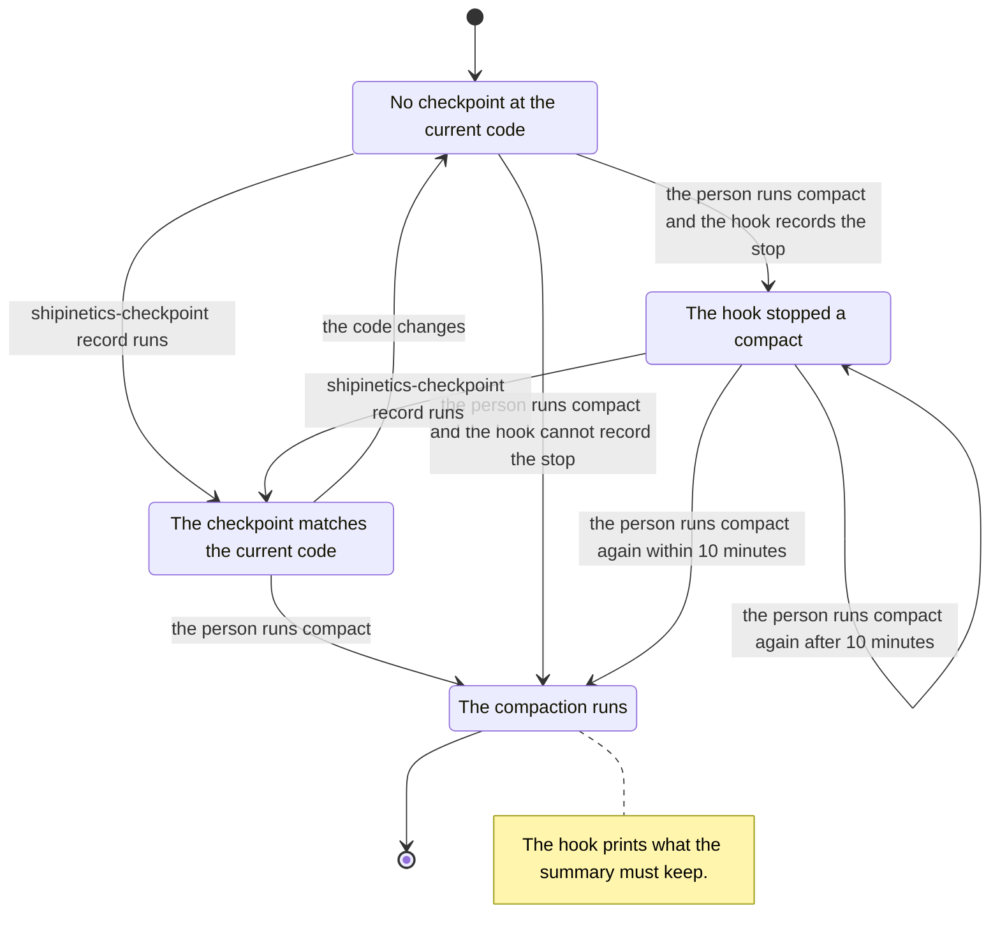

# Spec: write the docs before `/compact`

Status: approved on 2026-11-22. The decision came from a conversation: write the docs before compaction, and for now tie the check to the `/compact` command. Terms: [GLOSSARY.md](../../GLOSSARY.md).

## Problem

Compaction replaces the conversation with a summary. After that, the session loses the terms, decisions and changes that it settled but did not write down. The glossary, the ADRs, the system docs and the worksheet then do not have them.

## Acceptance criteria

- **AC1.** Given a set-up project where the docs checkpoint was not recorded at the current code, when the person runs `/compact`, then the PreCompact hook stops the compaction (exit 2). The message of the hook tells the person three things:
  - Run `/shipinetics:checkpoint`.
  - Then run `/compact` again.
  - A second `/compact` skips the docs.
- **AC2.** Given that the hook stopped a `/compact`, when the person runs `/compact` again within 10 minutes, then the compaction runs. It runs whatever changed in the meantime, because a log file or a watcher can change files. After 10 minutes, the hook stops the compaction again. If the hook can't record the stop, the compaction runs.
- **AC3.** Given that `shipinetics-checkpoint record` ran at the current code, when the person runs `/compact`, then the compaction runs.
- **AC4.** Each time the hook lets a compaction run in a set-up project, its output asks the summary to keep these items (the output is the instructions for the summary):
  - The name of the current worksheet.
  - The acceptance criteria that are done, and the ones that are open.
  - The decisions and terms that are not yet written down.
  - The next step.
- **AC5.** The hook does nothing (exit 0, no output) in these cases:
  - The compaction is automatic.
  - The project is not a set-up project.
  - `compact` is in `hooks_off` or in `SHIPINETICS_HOOKS_OFF`.
- **AC6.** `shipinetics-checkpoint check` exits 0 when the recorded checkpoint matches the current code. It exits 1 when the checkpoint doesn't match, or when no checkpoint was recorded. An edit to only the worksheet or the feedback log keeps the checkpoint, as it keeps a verify pass.
- **AC7.** The `/shipinetics:checkpoint` skill writes these docs for what the session decided or changed:
  - The new and sharpened terms in `GLOSSARY.md`.
  - ADRs for the decisions that pass the three tests.
  - The system docs that changed.
  - The worksheet.

  Then the skill runs `shipinetics-checkpoint record`, and it tells the person to run `/compact`.

## Out of scope

- Automatic compaction. The hook doesn't block it, because a blocked automatic compaction can make the current request fail.
- Harnesses other than Claude Code. Codex also has PreCompact, and the Codex adapter adds the hook.

## Approach

The approach has three parts:

- A PreCompact hook with the matcher `manual` (`scripts/compact-checkpoint.sh`).
- A tool that records and checks the checkpoint (`bin/shipinetics-checkpoint`).
- A skill (`skills/checkpoint`).

The checkpoint is the code fingerprint that verify uses. Thus the same files count as code for the checkpoint and for verify. The test seams are the hook script with recorded PreCompact input, and the exit codes of the tool.

This diagram shows the states of the docs checkpoint for a manual `/compact` in a set-up project. The code is in `scripts/compact-checkpoint.sh` and `bin/shipinetics-checkpoint`.

When the hook lets the compaction run after a stop, it removes the record of the stop. The diagram does not show the cases of AC5, where the hook does nothing.

Sources (checked 2026-11-22): https://code.claude.com/docs/en/hooks, sections PreCompact and PostCompact. The sources say:

- PreCompact gets `trigger` and `custom_instructions`.
- Exit 2 blocks the compaction. For a manual `/compact`, the person sees the message.
- On exit 0, stdout becomes instructions for the summary (up to 10,000 characters).
