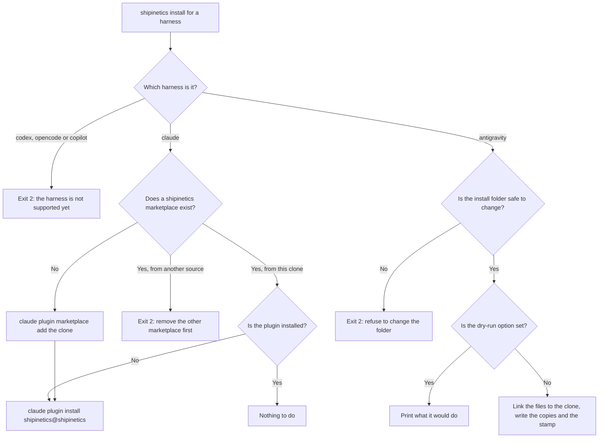
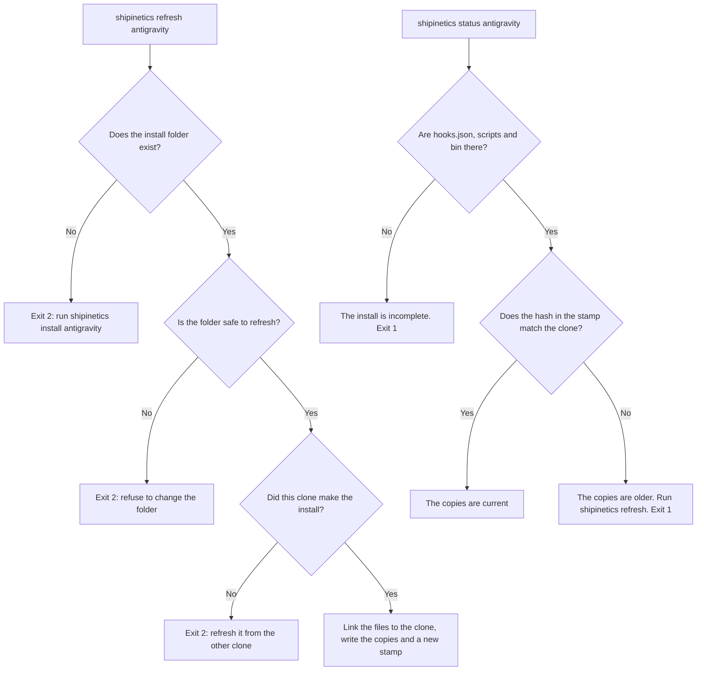

# Spec: one installer for every harness (step 1 of multi-harness support)

Status: approved on 2026-11-22. Design approved on 2026-11-22 ([research](../research/harnesses.md), [ADR 0001](../adr/0001-generated-copies-per-harness.md)). Terms: [GLOSSARY.md](../../GLOSSARY.md).

## Goal

One command installs Shipinetics from a local clone into a harness. One command shows what works in that harness. This step is for Claude Code and Antigravity. It also builds the parts that the Codex, Copilot and OpenCode adapters (steps 2 to 4) will use:

- Generated copies of the skills.
- A check that the copies are current.
- A table that shows which guards each harness enforces.

Out of scope for this step:

- The Codex, Copilot and OpenCode adapters, and their hook formats.
- Model roles and the model catalog.
- The plan-aware setup.

## Acceptance criteria

- **AC1.** Given a clone, when a person runs `shipinetics install antigravity`, then the installed skills are copies that contain no `${CLAUDE_PLUGIN_ROOT}` and no `${CLAUDE_SKILL_DIR}`. Each path that replaced them exists in the clone.
- **AC2.** Given an install, when a skill file in the clone changes, then `shipinetics status antigravity` says that the copies are older than the clone. It names `shipinetics refresh antigravity`, and it exits 1. Immediately after an install or a refresh, it says that the copies are current.
- **AC3.** When a person runs `shipinetics refresh antigravity`, then the copies match the clone again. Nothing outside the install folder changes.
- **AC4.** Given the start of an Antigravity session in a project, when the copies are older than the clone, then the session-start notice says so and names the refresh command. When the copies are current, the notice adds nothing.
- **AC5.** When a person runs `shipinetics status` with no harness, then it prints, for each of the five harnesses, whether Shipinetics is installed there. For each guard and gate, it also prints one of three results for that harness: the harness enforces it, gives it as an instruction only, or doesn't support it yet. The table matches `docs/research/harnesses.md`.
- **AC6.** When a person runs `shipinetics install` for `codex`, `opencode` or `copilot`, then it exits 2. It says that the harness isn't supported yet, and it points to `shipinetics status`.
- **AC7.** When a person runs `shipinetics install claude`, then it runs `claude plugin marketplace add <clone>` and `claude plugin install shipinetics@shipinetics`. With `--dry-run`, it prints these commands and does not run them. When an agent runs it, the install gate checks it, as the gate checks each plugin install.
- **AC8.** `shipinetics-antigravity install`, `link-skills` and `status` work as before. The one change is AC1: the skills become copies.
- **AC9.** When the install folder exists and doesn't look like a Shipinetics install, then install and refresh refuse to change it. This is true for every harness.
- **AC10.** When a person runs `shipinetics uninstall antigravity`, then it removes the install folder, and nothing else changes.
- **AC11.** When the folder that `uninstall` would remove isn't a Shipinetics install, then `uninstall` refuses (exit 2), and the folder stays as it was. Examples of such a folder are another plugin's folder, an unrelated folder, the clone itself and a git repo. Install and refresh also refuse the clone and a git repo. Refresh refuses to write through a symlink.
- **AC12.** When a person adds `--dry-run` to `install`, `refresh` or `uninstall`, then the command says what it would do, and nothing on disk changes. The install gate doesn't ask about a lone `shipinetics install ... --dry-run` that has only plain words. The gate still asks when another command can run together with it.
- **AC13.** Given an Antigravity install that has a stamp, where `hooks.json`, `scripts` or `bin` is missing, when a person runs `shipinetics status antigravity`, then it says that the install is incomplete. It names `shipinetics refresh antigravity`, and it exits 1. Where `ln -s` makes copies (Windows without Developer Mode), `install` and `refresh` copy those items, and `status` says that the install is made of copies.

## Decisions

- **D1.** One command for the machine, `shipinetics`, with `install`, `refresh`, `status` and `uninstall`. `shipinetics-config` stays the command for the project.
- **D2.** The generated copies of each harness are in the plugin folder of that harness (for Antigravity, `~/.gemini/config/plugins/shipinetics/`).
- **D3.** In the copies, the path of the clone replaces `${CLAUDE_PLUGIN_ROOT}`. The folder of the skill in the clone replaces `${CLAUDE_SKILL_DIR}`. Scripts, templates and `bin/` come from the clone.
- **D4.** A copy is out of date when a hash of the clone's `skills/` and `agents/` is different from the hash that the copy was made from.
- **D5.** Refresh is a command. `shipinetics-update merge` runs it for each installed harness. The session-start hook only reports.
- **D6.** `shipinetics install claude` stops when a `shipinetics` marketplace from another source exists. When the marketplace already points at this clone and the plugin is installed, it only reports. When the plugin is not installed, it installs the plugin.
- **D7.** `shipinetics status` reads `harnesses.tsv` (one row for each harness and guard). `docs/research/harnesses.md` stays the dated research behind the table.
- **D8.** The session-start hook becomes "the session notice". Its `hooks_off` name is `notice`, and `companions` still works.
- **D9.** `shipinetics-antigravity` stays as an alias that prints a hint of one line, until a later breaking release.
- **D10.** Release it in the next minor version (0.12.0). Each Antigravity user runs `shipinetics install antigravity` one more time, on each machine.

## How the commands work

This diagram shows the steps of `shipinetics install`. The code is in `bin/shipinetics` (`claude_install`, `antigravity_install`, `safe_target`).

With `--dry-run`, the claude route prints the two `claude plugin` commands and does not run them.

This diagram shows the steps of `shipinetics refresh antigravity` and `shipinetics status antigravity`. The code is in `bin/shipinetics` (`antigravity_refresh`, `antigravity_status`, `copies_line`) and `scripts/lib.sh` (`sy_copies_state`).

A folder is safe to refresh when it looks like a Shipinetics install, and it is not a symlink, the clone or a git repo (AC9, AC11). With `--dry-run`, refresh says what it would do, and it changes nothing.

The status part of the diagram starts from an install that has a `plugin.json` and a stamp. The status also checks the agents, the `PATH` and `skills.json`. Each problem that it finds makes it exit 1.

## How to check it

- Run `bash tests/run.sh` and `/bin/bash tests/run.sh`. The runs include the tests from test-writer for each criterion.
- For AC4, use a real Antigravity session if one is available. If none is available, test the hook with recorded input, and say so in the summary.
